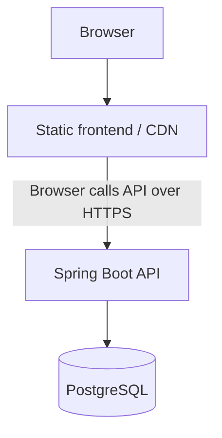

# Deployment: free to launch, ready to grow

SOURCE OS keeps deployment choices separate from its domain model. A free static frontend tier and low-cost/free API or PostgreSQL development hosting can support an MVP. Paid hosting, custom domains, a CDN or an AWS/CloudFront deployment can follow without changing application ownership or business semantics. No provider SDK is required by the frontend.



The diagram describes delivery and data ownership; the CDN serves assets and the browser makes API calls. PostgreSQL is the portable system of record. Production customer data needs durable PostgreSQL storage, backups, tested recovery and an explicit retention policy. Free-tier sleep, eviction, reset or ephemeral-container behavior must not be treated as a durability guarantee.

## Frontend build and hosting

Build the existing Vite application using its pinned Node and pnpm versions. Publish `apps/web/dist/` as static assets. Use a root-domain deployment and configure the static host to return `index.html` for browser routes such as `/organization` and `/admin`; preserve real missing-asset errors. The application continues to use React Router. No vendor SDK, service worker or special application server is needed to serve the bundle.

`VITE_API_BASE_URL` is **public, build-time configuration**. Its value is embedded in JavaScript; changing it requires rebuilding and publishing the frontend. It is not a secret or a runtime setting read from navigation, storage, cookies or remote content.

| Configuration | Result |
| --- | --- |
| Unset, empty or whitespace | Calls the current frontend origin; existing Vite development proxies continue to work |
| An explicit HTTPS origin | Calls the separately hosted API directly |
| Exact same HTTP origin as the current page | Allowed; production internet deployments should serve both surfaces with HTTPS |
| Cross-origin HTTP | Allowed only in DEV/test for `localhost`, `127.0.0.1` or `[::1]`; never for a production cross-origin API |

The configured value represents an **origin**, not a path prefix. An optional single root slash is normalized away. Paths, dot-segment tricks, query strings, fragments, backslashes, embedded whitespace, userinfo/credentials and non-HTTP(S) schemes are rejected. Invalid configuration fails with a fixed message that does not echo its value. Ports may be part of the origin.

Example with a reserved placeholder origin (not a live deployment):

```sh
cd apps/web
VITE_API_BASE_URL=https://api.example.invalid pnpm build
```

Omit the variable for same-origin deployment, with a reverse proxy forwarding `/api` to the API. Configure the final, canonical API origin: authenticated API calls reject redirects instead of forwarding headers to another destination. The API client checks the destination against its resolved origin before attaching credentials and before sending. API response URLs and caller-supplied alternative origins are not authenticated request targets.

**Never put secrets in any `VITE_*` variable.** This includes OAuth client secrets, database passwords, private API keys, signing secrets, AWS secrets and refresh tokens. Only public deployment settings belong in the bundle. Keep private API/DB/OIDC configuration in the backend host's secret configuration, outside source control. Do not commit live endpoints or credentials.

## API, CORS and authentication

The Spring Boot API can run independently of the static host. Supply its existing database connection and OIDC issuer/audience configuration through the deployment environment. A3 production browser IdP sign-in/refresh integration remains a separate release dependency; a portable frontend build does not complete production authentication. Never deploy the local authentication profile or synthetic identities to production.

For separate frontend/API origins, configure the **exact frontend origin** in the existing backend `CORS_ORIGINS` allowlist. A future deployment task supplies the actual origin; the existing CORS policy is unchanged. Its configuration source is explicitly connected to both security filter chains. Backend allowlist entries must be exact HTTP(S) origins without paths (including a trailing slash), query strings, fragments or userinfo; malformed entries fail configuration rather than being repaired. Never use wildcard CORS for authenticated traffic. The current policy allows Authorization and request-ID headers and exposes the response request ID. Browser preflights must succeed before authenticated requests can proceed. The deployment's delivery policy must also permit connections to its configured API origin.

Access tokens remain memory-only. Credentials are attached only to the trusted API origin; changing frontend hosting does not change Actor identity, query isolation, organization membership or PLATFORM_ADMIN authority. Backend authorization remains authoritative. Session changes clear caches and organization selection; old responses cannot invalidate a newer session. Capability refresh preserves an existing result while in flight, but a failed refresh disables curation UX until a successful retry.

Before a production deployment, verify TLS, SPA route fallback, the exact CORS allowlist, request-ID visibility, real IdP integration, durable database recovery and private storage configuration. These are deployment checks, not additional implementations in this hardening slice. No production resources are provisioned here.

## Files and durable storage

The backend container's local filesystem is **not** a persistent application data store. The current local storage adapter is for development/test. Future persisted files must use the existing `StoragePort` / authorized storage abstraction with object storage, potentially an S3-compatible service. Keep the domain independent of the storage vendor and keep private-file authorization explicit. Uploads, new adapters and object-storage provisioning are not implemented in this task.

## PWA and application packaging

Responsive web, an installable PWA or a wrapped/native app can be reviewed later. No service worker or offline API cache is added now.

Authenticated API responses containing supplier/material data, commercial terms, prices, inventory, provenance or admin data **must not be persisted in an offline service-worker cache by default**. Future PWA work may consider versioned static JS/CSS, public icons and non-sensitive shell assets only after separate review. Offline/private data support needs an explicit design for authorization, identity changes, retention and clearing; it cannot inherit permission merely from an earlier online session.

## Additive paid SaaS capabilities

Billing, plans, subscriptions, entitlement enforcement and usage metering are not implemented. Future Plan, Subscription, Entitlement and Usage concepts should be additive and Organization-scoped where appropriate. They must not redefine SupplierProfile, Facility, Material or Listing ownership, or conflate account membership with canonical supply data. No speculative billing table is added.
