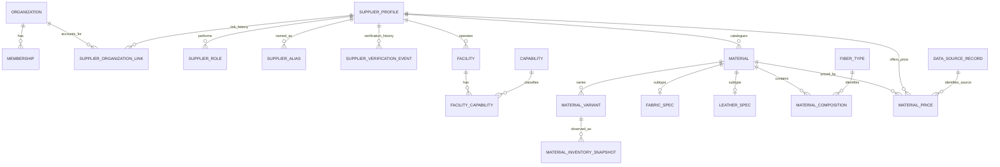
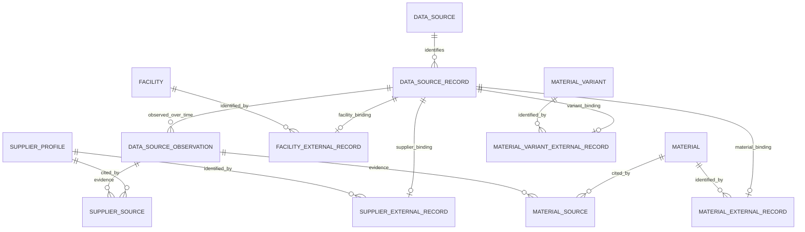

# SOURCE OS Phase 1 계획안

상태: **검토용 제안 / 계획 단계만 수행**. 이 문서의 테이블·API·화면·마이그레이션은 아직 구현하지 않았다. 사용자의 다음 지시 전에는 1A 구현으로 넘어가지 않는다.

기준: `Croco-JY/codex`, `main`의 Phase 0 병합 커밋 `4b33b44e6bc928817b914a249e8a81528c8d7ea7`. 작업 브랜치는 같은 커밋에서 시작한 `phase-1-supply-network`이다. `work`와 `main`에는 커밋하지 않는다.

## 1. 목표와 범위

한국·일본·중국의 공급처, 실제 시설, 역량, 소재를 가입 여부와 독립적으로 관리하고 검색한다. Java 25 / Spring Boot 4.1 모듈러 모놀리스, PostgreSQL 18 / Flyway, React / 기존 OpenAPI 생성 클라이언트를 유지한다.

이번 제출물은 안정성 검토를 반영한 계획 문서 한 개다. 이번 요청에 따라 문서 커밋과 지정 브랜치 push까지만 수행하며 PR은 만들지 않는다. 실제 구현은 이후 1A → 1B → 1C로 나눈다. RFQ, 견적, 샘플 업무, BOM, 주문, 생산, 거래 QC, 배송, 결제·정산, 추천·LLM·임베딩, 운영 크롤러, claim 신청·승인 흐름은 만들지 않는다. 새 인프라나 Python 서비스도 추가하지 않는다.

## 2. 저장소 감사와 Phase 0 기준선

2026-10-19에 README, 코어 설계 문서, 마스터 명세, ADR 001–016, 검증 보고서, 실제 엔티티·권한·감사 구현, Flyway V1/V2, OpenAPI 생성과 API 클라이언트, CI를 확인했다. 실제 코드와 과거 보고서가 다르면 코드와 현재 검증 결과를 기준으로 한다.

| 확인 항목 | 관찰 및 계획에 주는 영향 |
|---|---|
| PR #1 | 병합 완료. 최초 계획 감사 시 `main`과 Phase 1 원격 브랜치가 위 병합 커밋을 가리켰음. 이후 문서 커밋은 Phase 1 브랜치에만 추가 |
| `organization`, `membership` | 계정·테넌트 경계. 외부 공급처 카탈로그를 담는 테이블이 아님 |
| 인증 | `(issuer, subject)`가 기존 신원 키. 별도 비밀번호나 중복 사용자 테이블 불필요 |
| 권한 | 조직별 OWNER/ADMIN/VIEWER만 있음. 조직 관리자를 플랫폼 관리자로 취급하면 안 됨 |
| `audit_event` | `organization_id NOT NULL`. 전역 카탈로그 변경을 기록할 수 있도록 호환 확장 필요 |
| 감사 서비스 | 기존 트랜잭션에 참여하는 `MANDATORY`, 추가 전용 트리거 유지 필요 |
| 마이그레이션 | V1, V2만 존재. 새 마이그레이션은 V3부터. 기존 파일 수정 금지 |
| outbox | Phase 0에 실제 outbox 테이블/전달기가 없음. 필요한 비동기 소비자가 없으므로 Phase 1에도 추가하지 않음 |
| 기존 검증 재실행 | `./scripts/test.sh`: 백엔드 13개, Vitest 2개, Playwright 1개 통과. 실패·스킵 0 |
| 나머지 기준선 | 타입 검사·프로덕션 빌드, 실제 API/DB 기동, OpenAPI 재생성 후 Git 차이 0, Terraform fmt/init/validate 통과 |

위 테스트 결과는 최초 계획 작성 전의 Phase 0 기준선이다. 이번 문서 수정에서는 전체 Phase 0 테스트를 다시 실행하지 않는다. 로컬 검증 로그는 Git 제외 경로 `.local/phase1-baseline-*.log`에 있다. Phase 1의 새 기능이나 스키마가 검증됐다는 의미는 아니다.

## 3. 핵심 모델: Organization ≠ SupplierProfile ≠ Facility

| 개념 | 의미 | 가입 없이 존재 | 관계와 권한 |
|---|---|---|---|
| Organization | SOURCE OS에 가입한 계정·업무 조직 | 해당 없음 | Membership을 통해 사용자 접근 범위를 결정 |
| SupplierProfile | 외부 공급 생태계의 사업체에 대한 정규 프로필 | 가능, 기본 상태 | 계정·사용자·Membership을 요구하지 않음 |
| Facility | 공급처가 운영하는 실제 사업장·공장·쇼룸 등 | 가능 | 정확히 하나의 SupplierProfile에 속함 |

ERD의 링크 관계는 전체 이력을 나타낸다. **동시에 ACTIVE인 연결은 SupplierProfile당 최대 1개**라는 별도 부분 유일성 제약을 둔다. 한 Organization에는 여러 SupplierProfile의 ACTIVE 연결이 존재할 수 있다. 조직별 전역 UNIQUE 제약은 두지 않는다.

### 계정 연결은 별도 모델

`SupplierProfile`에는 Organization FK를 넣지 않는다. `supplier_organization_link`가 supplier FK, organization FK, ACTIVE/REVOKED 상태, 연결/해제 시각·사유, 각 작업자의 issuer/subject를 보관한다. `supplier_id WHERE status='ACTIVE'` 부분 UNIQUE로 동시 중복 연결을 막고 과거 REVOKED 행은 보존한다. 미래 동시 claim도 이 제약과 트랜잭션으로 한쪽만 성공시킨다.

Phase 1에는 claim 신청·승인·연결·해제 API, 자동 연결, 직접 링크를 바꾸는 일반 관리자 CRUD를 만들지 않는다. 공급처 DTO로 organization 연결 값을 받아 쓰는 것도 금지한다. 링크 스키마를 준비하더라도 운영 claim 이력은 미래의 검증된 절차에서만 생성한다. Organization 연결은 canonical 데이터의 소유권 이전이나 수정 권한 부여와 동일하지 않다.

### 미가입 일본 원단사 5,000개를 먼저 수록하는 경우

1. 안정적인 `(data_source_id, external_record_key)` 5,000개를 등록하고 SupplierProfile과 typed external binding을 연결한다. Organization, 사용자, Membership, 계정 링크는 자동 생성하지 않는다.
2. 같은 source/key를 다시 import하면 기존 binding의 SupplierProfile ID를 재사용한다. 이름·URL·content hash를 바꿨다는 이유로 새 사업체를 생성하지 않는다. 자세한 트랜잭션 규칙은 5.1 참조.
3. Facility와 Material은 처음부터 안정적인 `supplier_profile.id`를 FK로 사용한다.
4. 미래에 해당 업체가 가입하면 새 Organization/Membership을 만들고, claim 검증 후 `supplier_organization_link` 행만 추가한다. 한 Organization의 복수 프로필 관리도 이 모델이 허용한다.
5. 이때 SupplierProfile ID와 기존 시설·소재·검증·가격·출처 이력은 그대로 유지한다. 서로 다른 source의 동명이인/중복 후보는 자동 병합하지 않는다.

## 4. 소유권과 모듈 경계

카탈로그 데이터는 플랫폼이 관리하는 공통 공급망 정보다. `created_by`나 계정 연결은 수정 권한의 근거가 아니다. 가입 조직의 비공개 계정 데이터는 기존 organization 모듈에 그대로 둔다.

| 모듈 | 소유 범위 및 공개 계약 |
|---|---|
| `identity`, `organization` | 기존 인증·Membership·Organization 유지 |
| `authorization` | 기존 조직 정책 유지, 별도 PlatformAuthorization 및 관리자 권한 배정 |
| `audit` | 조직 감사와 전역 플랫폼 감사, 동일 트랜잭션 보장 |
| `geography` | Country, Region, IndustrialCluster와 유효성 조회 |
| `dataingestion` | 출처 registry, stable external record, 관측 이력과 멱등 import 조정. 크롤러 실행 기능 없음 |
| `supplier` | SupplierProfile, 역할, 별칭, 공급처별 출처와 typed external binding |
| `supplieraccount` | canonical master와 분리된 SupplierOrganizationLink. Phase 1에는 스키마만 준비하고 claim API 없음 |
| `supplierverification` | 검증 이벤트 및 상태 전이. 공급처의 현재 상태는 공개 서비스로 갱신 |
| `capability` | 역량 분류 체계 |
| `facility` | 시설, 시설 역량과 각각의 출처 |
| `material` | 소재·변형·서브타입·조성·소재 출처 |
| `pricing`, `inventory` | 역사적 가격 사실·감사를 남기는 유효기간 종료와 재고 관측 이력 |
| `supplysearch` | 공급처/소재/시설 검색 및 상세 읽기 조합. 제한된 읽기 SQL로 도메인 간 조회만 수행 |

supplier가 facility/material의 엔티티를 역참조하지 않게 한다. 공급처 상세처럼 여러 도메인이 필요한 응답은 supplysearch에서 조합한다. 공개 서비스·UUID·불변 DTO를 사용하고, 다른 모듈의 엔티티를 변경하지 않는다. 검증 모듈 → supplier 방향만 허용해 순환을 피한다. 공개 읽기 SQL의 테이블 의존도도 문서화하고, 수정 SQL은 소유 모듈에만 둔다. Modulith 경계 검사를 계속 실행한다.

### 4.1 모든 사람 식별은 기존 Actor 사용

Phase 0에는 독립 user 테이블이 없다. 새로운 `user`/`user_identity` 테이블이나 가상의 사용자 FK를 만들지 않는다. 기존 `Actor(String issuer, String subject)`와 같은 키를 사용하고 이메일·표시 이름을 신원 키로 쓰지 않는다. issuer는 비어 있지 않은 최대 500자, subject는 비어 있지 않은 최대 255자다. nullable actor 쌍은 둘 다 NULL 또는 둘 다 제공하도록 CHECK한다.

| 모델 | 대상 또는 작업자 식별 |
|---|---|
| PlatformRoleAssignment | 권한 대상 `issuer/subject`, 배정/해제 작업자 `granted_by_issuer` + `granted_by_subject`, `revoked_by_issuer` + `revoked_by_subject` |
| SupplierOrganizationLink | `linked_by_issuer` + `linked_by_subject`, `revoked_by_issuer` + `revoked_by_subject` |
| SupplierVerificationEvent | `actor_issuer/actor_subject` |
| DataSourceObservation의 verification | `verified_by_issuer/verified_by_subject`, verified_at. 검토 전에는 세 값 모두 NULL |
| AuditEvent | 기존 `actor_issuer/actor_subject` 유지 |

새 계정 연결이나 수집 작업 때문에 신원 테이블을 복제하지 않는다. 사람에 의한 관리 명령은 서버에서 인증된 Actor를 사용하며, 요청 body의 actor 값을 신뢰하지 않는다.

## 5. 예정 테이블과 주요 제약

최종 예상은 **신규 34개 테이블**이다. 기존 3개 테이블은 유지하고 `audit_event`만 V3으로 호환 확장한다. 아래 네 표가 전체 신규 테이블 목록이다. FK는 기본 RESTRICT로 두고 업체·계정 삭제가 공급망 이력을 연쇄 삭제하지 않게 한다. 변경 가능한 핵심 엔티티에는 UUID, UTC `timestamptz`, created_at/updated_at/version을 사용한다. 제어 값은 Java enum과 DB CHECK로 함께 검증한다.

### 5.1 권한·지리·외부 출처 식별: 7개

| 테이블 | 핵심 필드·관계·제약 |
|---|---|
| `platform_role_assignment` | UUID, 대상 issuer/subject, role=PLATFORM_ADMIN, ACTIVE/REVOKED, 배정·해제 actor 쌍/시각, version. 활성 `(issuer,subject,role)` 중복 금지 |
| `country` | UUID, ISO alpha-2 UNIQUE, alpha-3 UNIQUE, 영문/원어 이름, active. 운영 seed는 KR/JP/CN만 |
| `region` | country FK, parent_region FK nullable, code nullable, 이름, 제어된 region_type, active. 복합 FK로 부모와 국가 일치. 자기/조상 순환 금지 |
| `industrial_cluster` | country FK, region FK nullable, slug, 이름, 설명, active. `(country_id,slug)` UNIQUE, region과 국가 일치 |
| `data_source` | UUID, stable source_code UNIQUE, source_type, dataset/authority namespace, 이름, 접근 방식, canonical base URL nullable, active. 표시 이름과 URL 변경으로 source identity가 바뀌지 않음 |
| `data_source_record` | UUID, data_source FK, external_record_key, record_kind, first_seen_at, last_seen_at. `(data_source_id,external_record_key)` UNIQUE, `(id,record_kind)` UNIQUE. 외부 레코드의 지속적 신원 |
| `data_source_observation` | UUID, source_record FK, observation_key, observed_at/recorded_at, 실제 retrieved_at nullable, content_hash/알고리즘 nullable, license/terms 상태, 검토 actor 쌍/시각, 내부 notes, supersedes_observation_id nullable. `(source_record_id,observation_key)` UNIQUE, 복합 FK 검증용 `(id,source_record_id)` UNIQUE. 원문 관측은 추가 전용 |

외부 출처 구조는 source registry → stable record → observation history로 나눈다. source_record에 canonical 사업체의 이름/가격을 직접 덮어쓰지 않는다. 관측의 출처 검토·정정도 새 observation과 supersedes 관계로 남긴다. supersedes 대상은 같은 source_record 안에 있어야 한다. content hash는 관측 내용의 변경 감지용이며 canonical 식별 키가 아니다.

#### 대규모 import의 멱등 규칙

1. source는 표시 이름 대신 사전에 등록된 stable source_code와 dataset namespace로 선택한다. external_record_key는 해당 제공처의 지속적 업체/상품 ID 등으로 정한다. 같은 source에서 종류별 ID가 겹치면 `supplier:<id>`, `material:<id>`처럼 키 namespace를 명시한다. 키의 대소문자·정규화 규칙은 adapter별로 고정한다.
2. `(source,key)`를 UNIQUE 기반 upsert한 뒤 해당 source_record 행을 잠근다. 같은 키의 record_kind 변경은 오류로 처리한다. `first_seen_at`/`last_seen_at`은 수용된 실제 observed_at의 최소/최대값이며, 늦은 입력으로 last_seen이 뒤로 가지 않게 한다. 같은 관측의 단순 재시도는 현재 시각으로 last_seen을 부풀리지 않는다. 모르는 과거 retrieved_at을 now로 꾸미지 않는다.
3. 해당 수집 시도를 식별하는 안정적인 observation_key를 사용한다. 같은 import/관측을 재시도하면 같은 observation을 반환한다. 같은 키에 다른 payload를 보내면 충돌로 보고한다. 새로운 실제 수집은 내용 hash가 같더라도 별도 observation으로 남길 수 있다.
4. typed external binding이 있으면 그 canonical ID를 재사용한다. canonical이 ARCHIVED 상태여도 다시 만들지 않는다. 변경된 관측은 출처 이력과 갱신 제안으로 남기고, 관리자가 검증한 필드를 무조건 덮어쓰지 않는다.
5. binding이 없는 최초 레코드만 canonical row + typed binding + 출처 citation + 감사를 **한 트랜잭션**에서 생성한다. source_record 잠금과 binding의 PK/UNIQUE가 동시 생성을 막는다. 충돌/실패 시 전체를 rollback하고 승리한 기존 binding을 조회하므로 고아 canonical row를 남기지 않는다.
6. supplier/material뿐 아니라 facility/variant에도 각각의 typed binding을 둔다. 관측 citation은 각 도메인의 강한 FK로 연결한다. `(entity_type,entity_id)` 하나로 모든 provenance를 연결하는 테이블은 만들지 않는다.

따라서 같은 일본 업체 5,000개를 같은 source/key로 10번 재수집하거나 동시에 재시도해도 canonical 공급처는 5,000개이며 ID가 유지된다. 소재도 같은 규칙이다. source key가 바뀌거나 source가 다른 경우의 실체 중복은 별개 문제다. 강한 공식 식별자/운영자 확인으로 기존 canonical에 연결하고, 이름·도메인·hash만으로 자동 병합하지 않는다. 안정적 키를 확보할 수 없는 입력은 임의 키로 매번 생성하지 않고 검토 대상으로 보류한다.

출처 불명의 자료는 UNKNOWN으로 표현한다. MANUAL_ENTRY에도 명시적 source와 안정적 명령/레코드 키를 부여한다. URL은 http/https, 길이, userinfo 등을 검증한다. 서버의 임의 URL fetch, 인증·수집 제한 우회, 토큰·비공개 원문 보관은 Phase 1 범위가 아니다. 내부 메모는 일반 검색 사용자에게 노출하지 않는다.

### 5.2 공급처·계정 연결·검증·시설·역량: 13개

| 테이블 | 핵심 필드·관계·제약 |
|---|---|
| `supplier_profile` | country FK, display_name 필수, legal/native/English 이름·사업자번호·URL·설명 nullable, verification_status, lifecycle status=ACTIVE/ARCHIVED, version. Organization FK와 active boolean 없음. 이름·URL은 전역 UNIQUE 아님 |
| `supplier_organization_link` | UUID, supplier FK, organization FK, ACTIVE/REVOKED, linked_at/revoked_at, 연결/해제 actor 쌍, reason, version. supplier별 ACTIVE 부분 UNIQUE. organization별 단독 UNIQUE 없음. REVOKED 이력 보존 |
| `supplier_external_record` | source_record_id PK/FK, supplier_id FK, record_kind=SUPPLIER CHECK와 복합 FK. 외부 공급처 레코드 하나가 canonical 공급처 하나만 식별. 한 canonical에는 여러 외부 식별 레코드 가능 |
| `supplier_role` | `(supplier_id,role)` PK. MILL/CONVERTER/MATERIAL_SUPPLIER/TRIM_SUPPLIER/FACTORY/PROCESSOR/QC_COMPANY/LOGISTICS_COMPANY/OTHER. 다중 역할 허용 |
| `supplier_alias` | UUID, supplier FK, alias, normalized_alias, 언어 코드, alias_type. 같은 공급처의 정규화 별칭 중복 제한, 다른 공급처의 같은 이름 허용 |
| `supplier_verification_event` | UUID, supplier FK, previous/new 상태, reason, actor_issuer/subject, source_observation FK nullable, occurred_at. 추가 전용, 최초 DISCOVERED 이벤트 포함 |
| `supplier_source` | supplier FK + source_observation FK + 통제된 field_name/RECORD 범위. identity binding과 증거 citation을 구분 |
| `facility` | supplier FK, facility_type, 이름, country FK, region/cluster FK nullable, 주소·연락처·좌표 nullable, lifecycle status=ACTIVE/ARCHIVED, version. active boolean 없음 |
| `facility_external_record` | source_record_id PK/FK, facility_id FK, record_kind=FACILITY CHECK와 복합 FK |
| `facility_source` | facility FK + source_observation FK + field_name/RECORD 범위 |
| `capability` | UUID, code UNIQUE, parent FK nullable, PRODUCT/MATERIAL_HANDLING/PROCESS 분류, 이름·설명, active. 같은 분류 내 계층, 순환 금지 |
| `facility_capability` | `(facility_id,capability_id)` PK, proficiency nullable, MOQ/최대 수량·단위 nullable, notes, verification_status, timestamps/version |
| `facility_capability_source` | facility_capability 복합 FK + source_observation FK. 없는 시설 역량에 citation 연결 불가 |

각 `*_source` citation은 해당 canonical FK(시설 역량이면 복합 FK), source_observation_id, field_name/RECORD 범위의 중복을 제한한다. 각 typed binding은 고정 record_kind와 `data_source_record(id,record_kind)`에 대한 복합 FK로 잘못된 종류의 교차 연결도 막는다. binding을 일반 CRUD로 다른 canonical에 재지정하지 않는다. 출처 identity 수정·canonical 병합 정책은 별도 명시적 절차가 필요하다.

SupplierOrganizationLink는 ACTIVE이면 revoked_at/해제 actor가 NULL이고, REVOKED이면 해제 시각·해제 actor가 있으며 `revoked_at >= linked_at`이어야 한다. 연결 actor는 필수다. 실제 승인/증빙/재연결 정책은 미래 claim 설계에서 정하고 Phase 1 API로 우회하지 않는다. 같은 법인의 여러 시설은 여러 Facility로 표현한다.

DISCOVERED 공급처는 법적 이름·사업자번호·좌표·역할을 모를 수 있다. 모르는 법적 이름을 표시 이름으로 복사하거나 역할을 OTHER로 추정하지 않는다. 검증된 국가별 사업자번호에 한해 정규화 중복을 제한하며, 불완전 원문은 보존하고 충돌은 검토 대상으로 보낸다.

회사 소재 국가와 시설 소재 국가는 달라도 된다. 시설 region/cluster는 시설 국가와 일치하고, cluster의 region이 있으면 시설 region과 같거나 조상이어야 한다. 위·경도는 NUMERIC(9,6)/NUMERIC(10,6), 범위 ±90/±180, 둘 다 NULL 또는 둘 다 제공이다. 불완전 주소로 좌표를 추정하지 않는다.

상업 수량은 NUMERIC(19,4)/BigDecimal, 단위는 PCS/METER/YARD/KG/GRAM/MM/CM/M2다. MOQ/최대 수량은 0 이상, 둘 다 있으면 최소 ≤ 최대다. unknown은 NULL이며 0으로 치환하지 않는다. proficiency는 NULL 또는 SUPPORTED/EXPERIENCED/SPECIALIST로 제어하고 증거의 신뢰도는 verification_status로 분리한다. 별점은 쓰지 않는다.

### 5.3 소재·서브타입·조성: 10개

| 테이블 | 핵심 필드·관계·제약 |
|---|---|
| `material` | supplier FK, material_type, article_number, display_name, 설명, 원산지 country FK nullable, mill_supplier FK nullable, composition_state, lifecycle status=DRAFT/ACTIVE/ARCHIVED, version. Organization FK·active boolean·가격/재고 컬럼 없음 |
| `material_external_record` | source_record_id PK/FK, material_id FK, record_kind=MATERIAL CHECK와 복합 FK |
| `material_variant` | material FK, supplier_sku nullable, variant_name, 색/코드·batch, 긴 꼬리 attributes JSONB, lifecycle status=ACTIVE/ARCHIVED, version. active boolean 없음. `(material_id,id)` 유일 키 |
| `material_variant_external_record` | source_record_id PK/FK, material_variant_id FK, record_kind=MATERIAL_VARIANT CHECK와 복합 FK |
| `fabric_spec` | material_id PK/FK, construction, weave/knit, GSM·폭mm·두께mm, stretch/shrinkage, finish/surface/handfeel/drape/luster, MOQ/MCQ·단위, 표준/재생산 lead time, intended-use notes |
| `leather_spec` | material_id PK/FK, animal_type/tannage/finish/surface, 두께mm·중량/단위, 원산지 FK nullable. 핵심 속성은 구조화 컬럼 |
| `fiber_type` | UUID, canonical_code UNIQUE, 이름, active. WOOL/CASHMERE/COTTON/LINEN/SILK/POLYESTER/NYLON/ACRYLIC/RAYON/VISCOSE/LYOCELL/ELASTANE/OTHER 참조값 |
| `material_composition` | `(material_id,fiber_type_id)` PK, percentage NUMERIC(7,4) CHECK 0..100, raw_component_name nullable |
| `material_source` | material FK + source_observation FK + field_name/RECORD 범위. 스펙/조성 근거도 표현 |
| `material_variant_source` | variant FK + source_observation FK + field_name/RECORD 범위 |

material_type은 명세의 15종이다. 신뢰할 수 있는 article_number는 공급처 안에서만 유일하고, 모르는 값은 NULL이다. 알려진 정규화 값에 부분 UNIQUE `(supplier_id,article_number)`를 적용한다. SKU는 소재 안에서 알려진 값만 유일하다. 외부 재수집의 primary idempotency는 품번/이름 추정이 아니라 앞의 stable binding이다.

FabricSpec은 FABRIC, LeatherSpec은 LEATHER에만 연결한다. 복합 키/타입 CHECK로 잘못된 서브타입을 막는다. ACTIVE FABRIC/LEATHER는 대응 스펙 한 개가 필요하고 DRAFT는 불완전 입력을 허용한다. 활성화·구성 변경과 조성 완전성은 동일 트랜잭션 및 지연 제약 검사로 검증한다. 타입 변경으로 기존 이력을 지우지 않는다.

조성은 COMPLETE이면 항목이 있고 합계가 정확히 100, PARTIAL이면 합계 100 이하, UNKNOWN이면 확정 항목이 없는 상태다. 소재 버전을 확인하고 조성 전체를 원자적으로 교체한다. float/문자열/JSONB를 유일한 조성 표현으로 쓰지 않는다.

### 5.4 가격·재고 이력: 4개

| 테이블 | 핵심 필드·관계·제약 |
|---|---|
| `material_price` | UUID, material FK, variant nullable, 가격 제공 supplier FK, primary_source_record FK, primary_source_observation FK, amount NUMERIC(19,4)>0, currency, price_unit, minimum_quantity nullable, valid_from/valid_to, created_at/updated_at/version. 역사적 가격 값 불변, 감사된 valid_to 종료만 예외 |
| `material_price_source` | price FK + source_observation FK. 가격 원본의 primary source identity를 바꾸지 않는 추가 증거 citation |
| `material_inventory_snapshot` | UUID, variant FK, quantity NUMERIC(19,4)>=0, unit, recorded_at, created_at. 관측 시점별 추가 전용 |
| `material_inventory_snapshot_source` | snapshot FK + source_observation FK |

기존 계획의 가격 종료 이벤트 테이블은 제거한다. amount/currency/unit, 가격 제공 supplier, material/variant, MOQ tier, primary source record/observation identity, valid_from은 해당 가격 row의 역사적 사실이다. 새 가격은 새 row로 INSERT하며 이 필드들을 UPDATE하지 않는다. primary observation은 primary source record에 속하도록 복합 FK로 확인하고 variant도 해당 material에 속하도록 강제한다. 추가 증거를 연결해도 최초 source identity는 바꾸지 않는다.

가격 supplier는 실제 가격 제공 업체를 가리킨다. schema에서 material의 카탈로그 등록 supplier와 무조건 같다고 제한하지 않는다. 다른 업체의 가격을 연결하는 범위는 실제 증거와 플랫폼 관리자 검증 정책으로 제한하며 RFQ/견적 거래 기능으로 확장하지 않는다. supplier/source가 다르면 별개 가격 제안일 수 있으므로 함께 존재할 수 있다.

기간은 `[valid_from,valid_to)`이다. 허용되는 기존 row 변경은 `valid_to: NULL → 명시적 종료 시각`과 이에 따른 updated_at/version 갱신뿐으로 제안한다. 종료는 `valid_to > valid_from`, 권한·버전 확인, reason, 같은 트랜잭션의 PLATFORM 감사 기록(before_state/after_state 포함)을 요구한다. 종료된 기간을 다시 열거나 amount/source를 고치는 UPDATE와 DELETE/TRUNCATE는 거절한다. 가격 정정은 새 가격으로 남긴다.

**material 전체에 대한 global overlap 금지 제약을 두지 않는다.** supplier, source, variant, currency, unit, MOQ tier가 다르면 동시 유효 가격을 허용한다. 같은 조건의 정상 가격 교체는 해당 offer scope에서 잠금·기존 valid_to 종료·새 가격 INSERT·감사를 원자적으로 수행한다. 불확실한 관측이 겹치면 전부 강제로 지우지 않고 원본과 충돌 표시를 보존한다. 동일 관측의 가격 재시도는 `UNIQUE NULLS NOT DISTINCT(primary_source_observation_id,material_id,material_variant_id,supplier_id,currency,price_unit,minimum_quantity,valid_from)` 범위로 중복 fact를 막으며, 신규 관측 내용이 변하지 않았다면 기존 가격 row에 증거만 추가할 수 있다.

#### effective-current-price resolver 우선순위

1. 입력은 material, 선택 variant, 조회 시각, currency/unit, 수량 및 선택 supplier/source다. 먼저 `valid_from <= at < valid_to`(종료가 NULL이면 상한 없음), 요청 통화·단위·공급처·출처와 맞는 후보만 남긴다. 자동 환율/단위 변환은 하지 않는다.
2. supplier/source를 지정하지 않으면 **각 `(supplier,primary_source_record,currency,unit)`별로 결과를 반환**한다. 서로 다른 출처 중 무조건 하나의 최신/최저가를 고르지 않는다. 출처 우선순위를 원하면 호출자가 검토된 선호 source를 명시한다.
3. 각 그룹에서 요청 수량을 만족하는 **정확한 variant 가격을 공통 variant=NULL 가격보다 우선**한다. 정확한 variant에 적합한 tier가 없을 때만 공통 가격으로 fallback한다.
4. 요청 수량과 같은 단위에서 `minimum_quantity <= quantity`인 tier 중 가장 높은 하한을 고른다. MOQ가 unknown(NULL)이면 자동 적용 가능한 tier로 추정하지 않는다. 수량이 없으면 tier별 가격 목록을 반환한다.
5. 같은 그룹/variant/tier에서 유효 기록이 여러 개면 `valid_from DESC, created_at DESC, id DESC`로 결정하고 중첩 충돌도 응답에 표시한다. 조회 우선순위가 과거 row를 수정하는 근거는 아니다. 모든 원본/유효기간 변경 근거는 이력 조회에 남긴다.

통화는 ISO 형식과 Java Currency로 검증한다. 금액/상업 수량은 BigDecimal이며 API 정밀 소수는 문자열 계약으로 생성한다. Material에 단일 current_price를 저장하지 않는다.

재고는 원본 관측을 변경하지 않는다. 최신 재고는 `(variant,unit)`별 `recorded_at DESC,created_at DESC,id DESC`로 선택한다. 늦게 들어온 과거 관측은 현재 수치를 덮어쓰지 않으며 다른 단위를 합산하지 않는다. source observation 기반 재시도도 중복 snapshot을 만들지 않게 한다. 예약/할당은 범위 밖이다.

## 6. 생명주기와 관리자 권한

### 공급처 검증과 claim을 분리

검증 enum은 DISCOVERED / CLAIMED / VERIFIED / AUDITED / TRANSACTED / PROVEN을 표현하되, 각 상태를 실제 증거와 연결한다. Phase 1에서 관리자가 수동 전이할 수 있는 상태는 DISCOVERED / VERIFIED / AUDITED로 제한한다. 검증 취소도 사유와 새 이벤트를 기록한다. 등록 당시부터 검증 이력을 남기고 current status와 이벤트는 같은 트랜잭션으로 커밋한다.

외부 자료로 검증한 미가입 공급처도 VERIFIED가 될 수 있다. 따라서 DISCOVERED → VERIFIED는 가능하며, 계정 claim을 선행 조건으로 강제하지 않는다. CLAIMED는 미래에 검증된 ACTIVE SupplierOrganizationLink가 있을 때만, TRANSACTED/PROVEN은 미래 거래 근거가 있을 때만 사용할 수 있다. Phase 1에서 관리자 드롭다운만으로 해당 사실을 만들어내지 않는다. 이 제한은 명세의 전체 생명주기를 보존하면서 현재 구현 범위를 좁히는 제안이다.

| 행위 | 미인증 | 일반 인증 사용자/조직 관리자 | 플랫폼 관리자 |
|---|---|---|---|
| 공개 범위의 공급망 검색·상세 | 거절 | 허용, 조직 간 읽기 가능 | 허용 |
| 카탈로그 생성·수정·보관·검증 | 거절 | 거절 | 허용 |
| 내부 출처 메모 | 거절 | 거절 | 별도 관리 권한 검사 |
| claim/계정 연결 변경 | API 없음 | API 없음 | Phase 1 API 없음 |
| 기존 조직 계정/파일 접근 | 거절 | 기존 Membership 정책 | 플랫폼 관리자여도 자동 우회 불가 |

### Platform admin bootstrap

ORG_OWNER/ORG_ADMIN과 PLATFORM_ADMIN은 완전히 분리한다. PlatformAuthorization은 검증된 OIDC Actor와 활성 platform_role_assignment를 확인한다. 임의 헤더, 요청 body의 organizationId/actor, 조직 OWNER 역할이나 이메일 일치만으로 플랫폼 권한을 주지 않는다. 플랫폼 관리자도 타 조직 계정/파일의 Membership 검사를 우회하지 않는다.

최초 production 플랫폼 관리자는 다음 **예정 운영 절차**로만 배정한다. 이번 작업에서 도구를 구현하거나 권한을 배정하지 않는다.

1. 운영자가 승인된 배포 대상과 IdP에서 대상자의 정확한 issuer/subject를 확인한다. 존재하는 신원에 부여하며 이메일이나 미확인 요청 입력으로 계정을 생성하지 않는다. 작업 운영자의 신원도 issuer/subject로 추적한다.
2. 신뢰된 운영 환경의 단발성 CLI/운영 작업을 최소 DB 쓰기 권한으로 실행한다. 자격 증명은 기존 보안 주입 경로를 사용하고 Git, 명령 인수, 터미널 로그, 문서에 비밀값을 넣지 않는다. 공개/private bootstrap HTTP endpoint는 만들지 않는다.
3. 한 트랜잭션에서 플랫폼 grant와 scope=PLATFORM인 audit_event를 생성한다. 감사 대상은 grant UUID이고 대상 principal·실행 Actor·사유·운영 request ID를 기록한다. 부분 실패는 rollback한다. 이미 ACTIVE인 동일 grant는 재시도 시 중복 생성하지 않는다.
4. 별도 읽기 검증으로 대상자가 플랫폼 관리 기능에 접근하고 일반 ORG_OWNER는 거절되는지 확인한다. 실행에 사용한 임시 운영 권한을 종료한다. 잘못된 배정은 기록을 삭제하지 않고 명시적 revoke와 감사를 남긴다.

production migration/시작 코드에 자동 admin seed를 넣지 않는다. 일반 관리 UI/HTTP API로 자기승격할 수 없다. **synthetic platform admin은 local development fixture와 그 격리된 테스트 실행에서만** 허용한다. production에서는 local profile/fixture 실행을 거절하고 테스트 신원이나 기본 계정을 승격하지 않는다.

### Audit V3: ORGANIZATION / PLATFORM

V1의 organization_id NOT NULL과 V1/V2의 기존 append-only trigger를 전제로 다음 호환 확장을 계획한다.

- scope는 NOT NULL이며 `ORGANIZATION` / `PLATFORM`만 허용한다. 기존 호출의 기본값은 ORGANIZATION이다.
- organization_id는 nullable로 바꾸되 기존 FK는 유지한다. CHECK는 **`(scope='ORGANIZATION' AND organization_id IS NOT NULL) OR (scope='PLATFORM' AND organization_id IS NULL)`**이다. 플랫폼 변경을 가짜 조직에 귀속시키지 않는다.
- entity_type과 entity_id(UUID)를 nullable로 추가한다. 두 값은 모두 NULL 또는 모두 제공해야 하며, 신규 PLATFORM 감사에는 둘 다 필수다. 기존 Phase 0 row에 알려지지 않은 entity를 추정해서 넣지 않는다. 기존 조직 감사 API는 유지하고 Phase 1 명령은 구체적 대상 ID를 기록한다.
- before_state / after_state는 필요한 변경만 담는 nullable JSONB다. 필요 없으면 NULL이며 object 타입을 검증한다. 허용된 필드만 직렬화하고 토큰·개인 비밀·비공개 원문은 저장하지 않는다. 가격 종료에는 변경 전후 valid_to와 version 등 필요한 값을 기록한다.
- 기존 actor_issuer/subject와 request_id, occurred_at은 보존한다. PLATFORM 감사도 원래 업무 트랜잭션에 MANDATORY로 참여한다.

**기존 행의 안전한 backfill 순서:** 기존 행 수/ID/필수 organization FK를 확인 → scope 컬럼을 상수 DEFAULT 'ORGANIZATION' + NOT NULL로 추가해 기존 행에 논리적으로 backfill → nullable entity/state 컬럼 추가 → scope/organization과 entity/state CHECK를 추가·검증 → organization_id의 NOT NULL만 해제한다. 단일 migration 트랜잭션에서 수행한다. 상수 기본값을 사용하므로 기존 감사 row에 UPDATE를 실행하거나 trigger를 해제할 필요가 없다.

V1/V2 파일은 절대 수정하지 않는다. reject_audit_mutation 함수, UPDATE/DELETE 차단 trigger, TRUNCATE 차단 trigger를 그대로 보존한다. 업그레이드 테스트는 기존 row의 값/개수와 scope=ORGANIZATION을 확인하고 세 변경 차단 동작, 잘못된 scope/organization 조합의 거절, 신규 PLATFORM INSERT의 성공까지 확인한다.

### Status discipline

SupplierProfile/Facility/Material/MaterialVariant는 lifecycle status 하나를 사용한다. SupplierProfile과 Facility, MaterialVariant는 ACTIVE/ARCHIVED, Material은 입력 중 상태가 필요한 DRAFT/ACTIVE/ARCHIVED다. **이 네 모델에는 active boolean을 중복 저장하지 않는다.** supplier verification_status는 증거 수준이므로 lifecycle status와 별개다. Country/Region/IndustrialCluster/Capability/FiberType/DataSource처럼 참조·설정 성격의 데이터에는 active boolean을 사용할 수 있다. unknown numeric은 NULL, 실제 측정/보고된 0만 0이다.

중요 변경은 scope, Actor, action, 대상 ID, timestamp, request ID와 같은 트랜잭션에 감사한다. 버전 충돌은 Problem Details + request ID를 가진 409로 반환한다. 카탈로그 삭제는 archive이며 출처 관측/검증/재고의 물리 삭제 API는 제공하지 않는다. 가격에는 위에 명시한 좁은 valid_to 종료 예외만 허용한다.

## 7. Flyway 예정 순서

각 파일은 **아직 만들지 않은 예정 파일**이다. 구현 시점의 최고 버전을 다시 확인한다. 현재 기준 V1/V2는 바이트 단위로 보존한다. 확장 설치 권한은 운영 DB에서 미리 점검하고 검증을 우회하지 않는다.

| 순서 | 예정 파일 | 내용/선행 관계 | 구현 구간 |
|---|---|---|---|
| V3 | `V3__audit_platform_scope.sql` | ORGANIZATION/PLATFORM, 상수 기본값으로 기존 row backfill, nullable organization + CHECK/FK, entity_type/id·nullable before/after JSONB, 기존 guard 보존 | 1A |
| V4 | `V4__platform_role_assignment.sql` | issuer/subject 기반 플랫폼 권한·부여/해제 Actor·활성 grant 유일성. production admin seed 없음 | 1A |
| V5 | `V5__geography.sql` | country → region → industrial_cluster, KR/JP/CN 참조 seed | 1A |
| V6 | `V6__external_source_identity.sql` | data_source → stable data_source_record UNIQUE(source,key) → observation history/검토 Actor. canonical FK는 각 소유 도메인의 후속 migration에서 추가 | 1A |
| V7 | `V7__supplier_directory.sql` | profile → 별도 supplier_organization_link·typed supplier binding·roles/aliases/verification events/observation citations. supplier별 ACTIVE link 하나 | 1A |
| V8 | `V8__facility_capability.sql` | facility·typed facility binding + capability → assignment → observation citations | 1A |
| V9 | `V9__material_catalog.sql` | material/variant와 각각의 typed binding → specs/fiber/composition + observation citations | 1B |
| V10 | `V10__material_price_history.sql` | 역사적 가격 값/source identity 불변, 감사된 valid_to 종료 예외, 좁은 재시도 키·resolver용 인덱스. 종료 이벤트 테이블/global overlap constraint 없음 | 1B |
| V11 | `V11__material_inventory_snapshot.sql` | 재고 관측·observation citation·재시도 중복 방지·최신 관측 인덱스 | 1B |
| V12 | `V12__supply_search_indexes.sql` | pg_trgm 및 실제 검색에 필요한 선택적 인덱스. 각 원본 identity/FK 제약은 앞선 migration에 포함 | 1C |

최소 provenance를 1A에 둬 최초 공급처부터 안정적 외부 키와 관측 근거를 연결한다. 참조되는 canonical 테이블이 생기는 V7/V8/V9에 typed binding을 만들어 forward FK 문제를 피한다. 금번 수정은 계획만이며 위 SQL 파일은 하나도 생성하지 않는다.

모든 migration은 빈 PostgreSQL 18에서 V1부터 적용하는 경우와, 기존 조직·회원·감사 행이 있는 V1/V2 DB를 업그레이드하는 경우를 각각 Testcontainers로 검증한다. 업그레이드 후 기존 FK·회원 접근·감사 변경 방지·JPA validate까지 확인한다. 과거 migration 체크섬을 바꾸거나 Flyway repair로 숨기지 않는다. 대형 데이터가 있는 후속 운영 환경의 온라인 인덱스 구축은 별도 배포 계획으로 다루며 초기 빈 테이블용 migration과 혼동하지 않는다.

## 8. 검색·인덱스·페이지네이션

전용 검색 서비스와 JdbcClient의 바인딩 파라미터를 사용한다. 컬럼명·정렬·연산자는 서버의 allowlist로만 선택하고 사용자 입력을 SQL 문자열에 연결하지 않는다.

| 영역 | 검색 의미와 우선 인덱스 |
|---|---|
| 공급처 | 본사/법인 국가, 역할, 검증 상태, 별칭. `(country_id,status,created_at,id)`, 역할 역방향 `(role,supplier_id)`, verification 상태 인덱스를 실제 계획으로 선택 |
| 시설 | 시설 국가·region·cluster·type·capability. FK B-tree, `(capability_id,facility_id)`. 같은 시설이 위치와 역량 조건을 함께 만족하도록 EXISTS 사용 |
| 이름·별칭 | 원문 보존, NFKC + Locale.ROOT 소문자 정규화. 정규화 이름/별칭의 exact/prefix B-tree, 필요한 열만 GIN trigram |
| 소재 | 공급처·원산지·타입·ACTIVE variant 여부. 선택적 복합/부분 인덱스와 EXISTS로 중복 소재 행 방지 |
| 스펙·조성 | GSM/폭 범위, MOQ·lead time, `(fiber_type_id,percentage,material_id)`로 Wool >=80% 등 조회 |
| 가격 | material + supplier/source/variant/currency/unit/tier/valid_from, valid_to 기반 유효 후보 조회. 서로 다른 offer scope의 공존을 금지하는 인덱스 없음 |
| 재고 | `(material_variant_id,unit,recorded_at DESC,created_at DESC,id DESC)` |
| 출처/연결 | UNIQUE(source,key), observation 재시도 키, typed binding의 source_record_id PK와 canonical 역방향 FK 인덱스. supplier별 ACTIVE account link 부분 UNIQUE, organization_id는 비유일 조회 인덱스 |

국가 필터에서 공급처의 국가와 시설의 국가는 구별한다. 공급처 검색의 `country`는 SupplierProfile 국가이고, `facilityCountry`/region/cluster는 시설의 위치다. 같은 공급처의 서로 다른 시설이 위치·역량 조건을 나눠 만족해서 오탐이 생기지 않게 한다. 소재 `originCountry`도 공급처 국가에서 추정하지 않는다.

짧은 한·중·일 검색어를 무조건 3자 미만이라고 거절하지 않는다. 1–2자는 exact/prefix, 긴 문자열은 선택적으로 trigram/부분 일치를 제공하고 UI에도 의미를 표시한다. 로마자·원어·별칭은 수동 등록된 근거를 검색하며 자동 번역·자동 사업체 병합은 하지 않는다. 이름이 같다는 이유로 두 법인을 합치지 않는다.

주요 공급처·시설·소재 목록은 기본 `(created_at DESC,id DESC)` keyset cursor, 기본 25/최대 100건이다. cursor는 불투명하게 인코딩하되 신뢰하지 않고 필드·정렬·필터 hash·page size를 검증한다. 변경되는 데이터 전체에 대한 고정 스냅샷을 보장한다고 주장하지 않는다. 작은 참조/관리 목록만 제한된 OFFSET을 허용한다. 관련 시설/소재/가격 이력도 별도 페이지네이션하여 상세 응답이 무한히 커지지 않게 한다.

가격 범위 검색은 currency와 priceUnit을 필수로 받고 자동 환율·단위 변환을 하지 않는다. 검색과 facet count에는 같은 권한·필터 정의를 적용한다. 선택한 facet의 자기 조건 제외 여부는 `docs/phase-1-search.md`에 명시한다. `docs/phase-1-indexes.md`에는 실제 SQL, 대표 데이터 분포, EXPLAIN ANALYZE/BUFFERS 결과와 각 인덱스의 이유를 남긴다. 이름에 “일본 5,000개”를 넣은 가짜 운영 seed 대신 테스트 전용 대량 데이터로 검사한다.

## 9. 예정 API와 프론트엔드 범위

기존 Phase 0 `/api/organizations`, `/api/identity`, health 계약은 유지한다. 신규 공급망 REST는 `/api/v1` 아래에 둔다.

| 종류 | 예정 리소스 |
|---|---|
| 인증 사용자 읽기 | `GET /countries`, `/regions`, `/industrial-clusters`, `/capabilities`, `/fiber-types` |
| 공급처/시설 읽기 | `GET /suppliers`, `/suppliers/{id}`, `/suppliers/{id}/facilities`, `/suppliers/{id}/materials`, `/suppliers/{id}/verification-events`, `/suppliers/{id}/sources`, `/facilities`, `/facilities/{id}`, `/facilities/{id}/capabilities` |
| 소재 읽기 | `GET /materials`, `/materials/{id}`, `/materials/{id}/variants`, `/materials/{id}/prices`, `/materials/{id}/inventory`, `/materials/{id}/sources` |
| 관리자 수정 | `/admin` 아래 geography/suppliers/roles/aliases/verification-events/facilities/capabilities/facility-capabilities/materials/variants/fabric-spec/leather-spec/composition/prices/inventory-snapshots/sources 관리 |
| 상태/자기 권한 | 기존 identity를 호환 확장하거나 명시적인 `/me/permissions`로 UI에 허용 기능 제공. 서버 권한 검사는 매번 독립 수행 |

위 경로는 모두 `/api/v1` 기준이다. 버전을 확인하는 mutable aggregate PATCH/PUT와 추가 전용 이력 POST를 구별한다. 출처·검증·가격·재고를 일반적인 DELETE CRUD로 취급하지 않는다. claim/계정 링크 변경, platform bootstrap의 HTTP endpoint는 Phase 1에 없다. Composition은 소재 버전을 포함한 전체 교체, 검증·가격 변경은 사유·관측 출처와 함께 원자적 명령으로 받는다. 가격 종료는 valid_to만 변경하는 명시적 명령으로 제한한다. Java DTO → OpenAPI → 생성 TS schema/client 흐름과 CI 계약 검사도 유지한다.

Phase 1C의 사용자 화면은 Dashboard, Supplier Search/Detail, Facility Detail, Material Search/Detail이다. Admin은 Supplier/Facility/Material/Geography/Capability Editor를 같은 React 앱 안에 둔다. 역할·별칭·검증·출처·스펙·조성·변형·가격·재고는 해당 편집기의 하위 영역으로 관리한다. 플랫폼 권한 배정/claim 관리 화면은 Phase 1에 만들지 않는다.

각 화면 구현 전에 `docs/screens/`에 역할·데이터·CTA·로딩/빈 상태/오류·키보드·반응형·권한·수용 조건을 작성한다. RHF/Zod는 입력 편의를 담당하고 백엔드가 최종 검증한다. 검색 상태는 URL에 보존하고 필터 초기화·다음 페이지·오류 재시도를 제공한다. 읽기 편한 기본 목록/테이블부터 만들고 표 편집 등 실제 수요가 생길 때만 TanStack Table 의존성을 정당화한다.

## 10. 구현 구간과 검토 관문

| 구간 | 작업/독립 커밋 | 종료 시 증거 |
|---|---|---|
| 계획 — 현재 | 이 문서와 테이블/관계/순서 제시. 구현 중지 | 사용자 검토 가능한 계획. 코드·SQL 변경 없음 |
| 1A-1 | ADR 017: 계정/사업체/시설 분리, ADR 018: 전역 권한·감사, V3/V4 | 기존 조직 권한·감사 회귀와 플랫폼 권한 부정 테스트 |
| 1A-2 | V5/V6 geography·stable source/key·observation | 국가 일치·계층 순환·source/key 및 observation 재시도 유일성 검증 |
| 1A-3 | V7/V8 supplier·별도 account link 스키마·typed bindings·facility/capability + 관리자 API | 반복/동시 import·ACTIVE link 하나·한 조직 복수 프로필·claim API 부재·cross-org 쓰기 차단 |
| 1B-1 | V9 소재·변형·서브타입·조성 | 공급처별 품번·타입·복합 FK·부분/완전 조성·버전 충돌 |
| 1B-2 | ADR 019: 가격 값 불변성과 감사된 종료 예외, V10/V11 | resolver 우선순위·다중 supplier/source/tier 공존·valid_to 한정 변경·재시도·재고 시점 |
| 1C-1 | 실제 검색 SQL·V12·인덱스/검색 문서·화면 명세 | 다국어 별칭·조성·위치/역량 EXISTS·cursor·쿼리 계획 |
| 1C-2 | 검색·상세·관리 화면·합성 local fixture·Phase 1 E2E·문서 | 전체 회귀·보안·생성 계약·UI 흐름·CI 통과 |

각 구간은 전체 Phase 0 회귀와 해당 신규 테스트를 통과한 뒤 독립 커밋한다. ADR은 해당 변경 구현 전에 작성하며 기존 ADR을 소급 편집하지 않는다. 현재 사용자 요청은 계획 수정·커밋·지정 브랜치 push까지이므로 구현 구간은 실행하지 않는다. 이번에는 PR도 만들지 않는다. 실제 Phase 1 구현과 그 최종 PR은 후속 명시적 지시를 받은 뒤 별도로 진행한다.

## 11. 구현 전에 확정할 검증 항목과 위험

- 미가입 공급처 5,000개를 동일 source/key로 반복/동시 import해도 canonical 수/ID가 유지되고 observation만 규칙에 따라 늘어나는지 검증한다. material/facility/variant binding도 같은 조건으로 검사한다. 같은 관측의 재시도·다른 payload 충돌·rollback 시 고아 canonical 부재를 확인한다.
- 한 SupplierProfile의 동시 ACTIVE account link가 둘일 수 없고, 한 Organization의 서로 다른 여러 SupplierProfile 연결은 허용되는지 실제 DB 제약으로 검사한다. link 이력이 바뀌어도 supplier/facility/material ID는 보존한다.
- 플랫폼 관리자, 일반 조직 OWNER, 다른 조직 사용자, 미인증 사용자를 분리한다. 조직 ID나 연결 필드를 조작해도 수정 권한을 획득할 수 없는지 검증한다.
- 국가 불일치, 자기/간접 계층 순환, 다른 material의 variant 가격 연결, 타입 불일치, 중복 역할·품번·별칭, 잘못된 조성과 음수/알 수 없는 수치 입력을 실제 PostgreSQL로 검사한다.
- 현재 검증 상태/이력·소재/조성·가격 종료/새 가격/감사가 전부 성공하거나 전부 롤백되는지 확인한다. 가격 종료 감사 실패도 valid_to 변경을 rollback해야 한다. 좁은 변경 guard와 재시도 제약은 동시 트랜잭션 테스트로 검증한다.
- 가격은 variant 우선 → 적격 MOQ tier → 최신 유효 기록 순서, 여러 supplier/source 동시 유효, unknown MOQ, 경계 시각, 중첩 표시를 검사한다. amount/currency/unit/primary source identity UPDATE는 거부하고 valid_to 종료만 감사와 함께 허용한다.
- 출처 없는 외부 데이터 활성화 금지. 내부 메모 노출·임의 URL fetch·수집 제한 우회 금지. source 링크는 강한 FK로 확인한다.
- local fixture는 명백한 합성 이름과 결정적 UUID를 사용하고 reset은 해당 fixture 집합만 대상으로 한다. 운영 migration에는 실제/가짜 사업체·소재·가격·기본 관리자 seed를 넣지 않는다.
- E2E는 명시적 local 관리자 → 공급처 → 시설 → 역량 → 원단 → 조성 → 변형 → 가격 → 검색/상세까지 검증한다. 프론트 테스트는 두 검색, 두 상세, 입력 검증, 오류/빈 상태를 추가한다.
- Phase 1 수용 조건으로 빈 DB와 Phase 0 업그레이드, 백엔드/프론트/모듈/권한/E2E, OpenAPI 일치, Terraform, secret scan, Git clean을 구별해서 기록한다. 새 테스트 실행 없이 완료했다고 주장하지 않는다.

### 제안의 핵심 결정

1. **가입과 공급처 등록은 독립적**이다. Organization 없는 SupplierProfile을 정식 데이터로 인정한다.
2. **사업체와 물리 시설은 분리**한다. 글로벌 공급처의 공장별 국가·역량을 Facility에 둔다.
3. **claim은 미래의 검증된 연결 행위**다. Phase 1은 계정 연결 API나 자동 소유권 이전을 제공하지 않는다.
4. **최초 등록부터 stable source/key와 전역 감사가 필요**하다. typed binding과 관측 이력을 사용해 재수집이 canonical 중복 생성을 일으키지 않게 한다.
5. **현재 상태와 역사적 값을 구별**한다. 검증·재고·관측과 가격 값은 보존하며, 가격 유효기간 종료는 좁은 예외와 감사로 처리한다.

## 12. 아직 확정이 필요한 사항

다음은 구현 전 세부 정책을 확정할 항목이며, 이번 계획의 안정성 원칙을 미루는 예외가 아니다.

1. **source/key 계약:** 실제 최초 import 대상 dataset과 제공처별 안정적 업체/상품 키, namespace·정규화 규칙. 키가 없는 자료는 자동 생성 대신 보류한다. 서로 다른 source의 실체 중복을 연결할 관리자 검토 기준도 구체화한다.
2. **가격 제공 범위:** 카탈로그 등록 supplier와 다른 supplier의 가격을 Phase 1 UI/API에서 허용할 구체적 증빙 기준, 선호 source 설정의 주체. schema는 다중 supplier/source를 막지 않으며 기본 resolver는 그룹별 결과를 반환한다.
3. **가격 종료 정정 범위:** 현재 제안은 NULL → 종료 시각 1회만 허용한다. 이미 종료된 valid_to의 단축/연장을 허용할 필요가 생기면 별도 감사·권한·역사 재현 정책을 먼저 정한다.
4. **운영 권한 provision:** 실제 production issuer와 최초 대상 subject, 실행할 운영 CLI/단발 작업의 권한 경계·배포 경로. 값은 운영 설정에서 확인하며 문서나 Git에 자격 증명을 넣지 않는다.
5. **미래 claim:** 증빙·승인·해제·재연결 정책은 미래 단계에서 결정한다. 한 supplier의 ACTIVE link 최대 1개와 한 organization의 복수 supplier 허용은 현재 schema 원칙으로 확정하며 claim API는 이번 Phase 1 범위 밖이다.
6. **출처/감사 보관:** 관측과 nullable before/after 상태의 필드 allowlist·보관 기간·내부 메모 노출 범위. 보관 정책 확정 전 일반 사용자에게 내부 자료를 노출하지 않는다.
