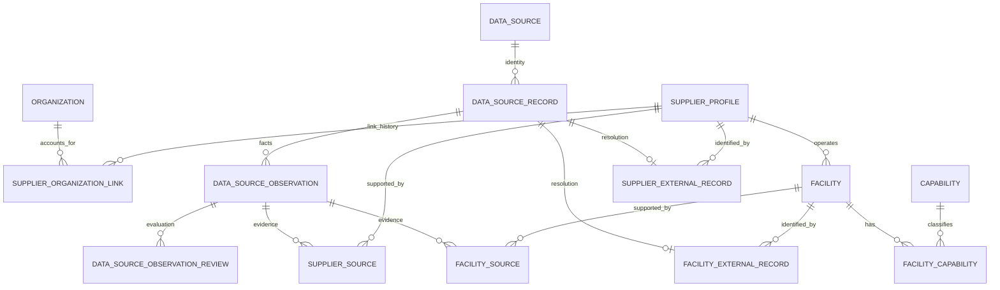

# SOURCE OS Phase 1A implementation plan

Authority: user's final consolidated Phase 1A specification, 2026-10-19. This supersedes the earlier full Phase 1 proposal. Work only on `phase-1-supply-network`, based on main `4b33b44`. Preserve the existing documentation commits. No PR, merge, V9, Phase 1B or Phase 1C implementation.

## Baseline and architecture

Read Phase 0 architecture/domain/authorization/security/ingestion documents, master specification, ADRs and actual audit/membership implementations. V1/V2 are immutable. Existing identity is Actor(issuer,subject); no user/app_user/user_identity tables. Keep Java 25, Spring Boot 4.1 MVC modular monolith, PostgreSQL 18/Flyway and existing React/generated OpenAPI client. Do not introduce services, infrastructure, search clusters, AI or worker runtimes.

The prior Phase 0 baseline passed 13 backend tests, 2 frontend tests, 1 browser smoke, contract generation and Terraform validation. Revalidate regression behavior during the implementation slices and the full existing workflow at completion. Do not treat these previous results as Phase 1A validation.

## Three implementation slices

| Slice / commit | Migrations and work | Validation before commit |
|---|---|---|
| 1A-1: platform audit and authorization | ADR 017 domain separation; ADR 018 global authorization/audit; V3 audit extension; V4 platform grants; PlatformAuthorization; operator-only bootstrap runbook | Actual PostgreSQL migrations, legacy audit preservation/guards, scope checks, allowlist serialization, grants/revocation and organization-role isolation |
| 1A-2: geography and external identity | V5 geography; V6 source/record/observation/review; services and admin/reference APIs | Country FKs, direct/indirect cycles, key normalization, retry/conflict, immutable observations/reviews, supersession and actor attribution |
| 1A-3: supplier/facility/capability directory | V7 supplier/link/roles/aliases/verification/bindings/citations; V8 facility/capabilities/bindings/citations; admin/read/search APIs | All new integrity/auth/concurrency/search tests, full Phase 0 regression, OpenAPI/client, frontend, Terraform, secret scan; commit and push, then stop |

## Domain and tenancy

Organization is an account/tenant; SupplierProfile is a canonical business; Facility is a site. It is valid to have 5,000 supplier profiles and zero accounts for those businesses. SupplierProfile never has an Organization FK. Canonical data is platform-managed and readable by authenticated users across organizations. Linked membership never grants canonical write privileges or access to other tenants' private files.

All people are issuer+subject, obtained from server security context for normal requests. This applies to grant/revoke actors, link history, verification events, observation reviewers and audit events. Optional actor pairs are both NULL or both present. No normal mutation body can select its actor.

## V3: audit

Add scope ORGANIZATION/PLATFORM, with default ORGANIZATION. Add nullable entity_type/entity_id together and nullable before_state/after_state JSONB objects. PLATFORM requires entity type/id. Require `(scope='ORGANIZATION' AND organization_id IS NOT NULL) OR (scope='PLATFORM' AND organization_id IS NULL)`; retain the FK.

Backfill existing rows using a constant NOT NULL DEFAULT ORGANIZATION at column addition, without UPDATE of historical events. Validate new checks, then drop only organization_id's NOT NULL. Preserve V1 UPDATE/DELETE guards and V2 TRUNCATE guard. Existing record(actor,org,...) remains supported. New platform audit joins the caller transaction (MANDATORY).

State serialization is an explicit business-field allowlist with scalar values only, never an entity serializer. Exclude passwords, tokens, secret keys, auth headers, raw payloads, whole objects and unrelated personal data. Reject unexpected fields before SQL. Store only necessary changed fields; null is valid when no state payload is needed.

## V4: platform authorization and bootstrap

`platform_role_assignment`: UUID, target issuer/subject, role PLATFORM_ADMIN, status ACTIVE/REVOKED, grant/revoke issuer/subject/timestamps, version. Partial UNIQUE on active (issuer,subject,role). ORG_OWNER/ORG_ADMIN do not confer this role. Revocation immediately removes access. All canonical mutations call PlatformAuthorization independently of organization IDs/links.

No production seed, default account, password, HTTP bootstrap or self-promotion endpoint. Document an operator-only parameterized SQL transaction that accepts bootstrap actor and target issuer/subject and atomically inserts grant plus PLATFORM audit. No actual production principal values are committed. Synthetic grants are only local/test fixtures.

## V5: geography

`country`, `region`, `industrial_cluster`. Seed only KR/JP/CN reference countries. Reference rows can use active booleans. Region parents and clusters' regions must share country via composite FKs. Reject self/indirect region cycles in PostgreSQL, including concurrent reparenting using a shared transaction lock and recursive checks. Geography changes must not invalidate existing facility region/cluster relationships.

## V6: external identity and observation review

Four distinct tables:

- `data_source`: stable provider/dataset namespace, unique source_code, source type/name/base URL/access method/active.
- `data_source_record`: source FK, record_kind, raw external_record_key, normalized_external_record_key, first/last_seen_at. UNIQUE(source,record_kind,normalized key); UNIQUE(id,record_kind) for typed FKs.
- `data_source_observation`: immutable record FK, observation_key, observed_at/recorded_at/retrieved_at, optional hash+algorithm, same-record supersedes FK. UNIQUE(record,observation_key). No raw_payload/HTML/API-response dump columns or unrestricted metadata JSON.
- `data_source_observation_review`: append-only observation FK, ACCEPTED/REJECTED/NEEDS_REVIEW, nullable license/terms, reviewer issuer/subject/reviewed_at, bounded notes/created_at. Resolve latest by reviewed_at,created_at,id descending. Reviews never change observation facts.

Raw keys remain unchanged. Normalization is selected explicitly by source contract; default preserves identity and case. No global uppercase/lowercase/character stripping. record_kind is a structured key component, not an artificial prefix. Same source SUPPLIER 123 and MATERIAL 123 may coexist; MATERIAL/MATERIAL_VARIANT are enum preparation only, with no corresponding business entities/bindings in 1A.

Record creation uses unique upsert/locking; retry of same observation key compares all immutable fact fields and reuses the row. Conflicting retry returns 409. Corrections create new observations. first/last_seen are derived from accepted observation times and cannot be inflated by retries. Typed identity binding is stable and unique per record. First canonical creation+binding+observation citation+audit is one transaction under record lock. Repeated imports reuse canonical IDs, including archived records. Cross-source entity matching is explicit; no alias-driven auto-merge.

## V7: supplier foundation

Seven tables: supplier_profile, supplier_organization_link, supplier_external_record, supplier_role, supplier_alias, supplier_verification_event, supplier_source.

- SupplierProfile lifecycle ACTIVE/ARCHIVED, version, country, display name and optional legal/native/English/registration/website/description. No active boolean, no organization FK, no global name/URL uniqueness.
- Link statuses ACTIVE/REVOKED only. Partial UNIQUE(supplier_profile_id) WHERE ACTIVE, with organization_id nonunique. Retain revoke history/actor pairs/times. No PENDING/claim states or link mutation APIs.
- Multi-valued supplier roles: MILL, CONVERTER, MATERIAL_SUPPLIER, TRIM_SUPPLIER, FACTORY, PROCESSOR, QC_COMPANY, LOGISTICS_COMPANY, OTHER.
- Aliases preserve original text, store controlled search normalization, language/type. No translation or automatic merging.
- Verification DISCOVERED/CLAIMED/VERIFIED/AUDITED/TRANSACTED/PROVEN is separate from lifecycle. Current value+event+audit commit together. Phase 1A manual actions use DISCOVERED/VERIFIED/AUDITED; claim/transaction-derived states need future proof/workflows, not a dropdown shortcut.
- `supplier_external_record` is Identity Resolution, references DataSourceRecord and SupplierProfile with SUPPLIER kind CHECK/composite FK and source_record PK. No ordinary rebinding API.
- `supplier_source` is Fact Provenance, references SupplierProfile and actual DataSourceObservation with controlled fact/RECORD scope and real FKs. Identity and citation are never interchangeable.

## V8: facilities and capabilities

Six tables: facility, facility_external_record, facility_source, capability, facility_capability, facility_capability_source.

Facility belongs to one supplier, has controlled type, own country/region/cluster, nullable address/contact/exact coordinates, lifecycle ACTIVE/ARCHIVED and version. No active boolean. A company's country may differ from its facility country. Facility region/cluster must match facility country, and cluster region must be an ancestor/equal of facility region when specified. Enforce consistency in DB, not only UI. No fabricated coordinates.

Capability taxonomy categories PRODUCT/MATERIAL_HANDLING/PROCESS, unique code, same-category parent, no direct/indirect cycle, active reference flag. Use PostgreSQL recursive protection with serialized hierarchy changes. FacilityCapability has composite PK, nullable controlled proficiency, NUMERIC(19,4) quantities/units, verification state, version. Unknown is NULL; reject negatives/unitless quantities and inverted ranges. No stars.

Facility binding enforces FACILITY record kind in DB. Facility and capability citations reference observations via typed real FKs. Add COMMENT ON for record identity, immutable observations, identity-resolution bindings and fact-provenance links.

## API and search scope

Preserve Phase 0 endpoints. Under /api/v1 expose authenticated GET countries/regions/industrial-clusters/suppliers/supplier detail/supplier facilities/supplier verification events/facilities/facility detail/capabilities. Source/review/internal provenance reads may remain platform-admin-only.

Under /api/v1/admin expose only geography, source/record/observation/review, supplier/roles/aliases/verification, facility/capability/assignment and citation operations. All mutations require PLATFORM_ADMIN and server Actor. No claim/link mutation, bootstrap, Material or price endpoints. Optimistic conflicts return 409, constraints/invalid input return safe correlated problem responses.

PostgreSQL supplier filters: company country, role, verification, facility country/region/cluster/capability, name/alias. Facility filters: own geography/type/capability. All facility predicates in supplier search must match the SAME facility via a correlated EXISTS. Preserve names, normalize search text only. No pg_trgm unless measurements justify it. Baseline name/alias substring matching suffices for 1A.

Supplier/facility lists use created_at DESC,id DESC keyset with default 25/max 100; cursor validates structure/sort/filter hash. Reference lists use bounded pagination. No unbounded detail collections. Bind SQL parameters and allowlist sort/filter fields.

## Modules, tests and delivery

Domain modules own their tables. Identity/organization stay unchanged; authorization owns platform policy; audit owns serialization. Geography/dataingestion/supplier/facility/capability/supplysearch use public services, IDs and immutable records, with no direct mutation of foreign entities. Account-link schema and verification history remain encapsulated in the supplier module; no separate claim service exists. Read composition can use documented parameterized joins. No shared business mega-module.

Use actual PostgreSQL 18 Testcontainers for clean V1→V8 and populated V1/V2→V8 upgrade, audit guards/allowlist, platform grant/revoke/denials, recursive geography/taxonomy cycles, source normalization/idempotency, immutable observations/reviews, correct-kind binding/citations, ACTIVE link cardinalities, supplier multi-role/aliases/verification atomicity, facility geography/quantities, optimistic conflicts, all search filters and same-facility predicates. Include direct DB constraint and concurrent/retry checks where behavior depends on SQL. Preserve Phase 0 regression.

Frontend remains existing shell; do not build full Phase 1 UI. Regenerate Java-owned OpenAPI and TypeScript schema and preserve existing frontend types/tests/build/browser smoke. Run full backend, scripts/test.sh, contract consistency, module/auth tests, Terraform fmt/init/validate and available secret scan before final push. Record actual counts and unrun outcomes separately.

Exactly three logical implementation commits after validation. Update architecture/domain/authorization/ingestion docs and add a Phase 1A validation report with observed results. Push only phase-1-supply-network; stop without PR/merge or V9.

Implementation status: slices 1A-1 through 1A-3 and local validation are complete. See [observed validation](phase-1a-validation.md) for exact migration/table/API inventory and test counts. This does not authorize Phase 1B or claim a GitHub Actions result.

## Mandatory Phase 1B review gates — document only

- The later accepted direction is supplier-scoped Material + SupplierMaterialListing; [Phase 1B architecture plan](phase-1b-plan.md) records the detailed proposal and review gates. This does not authorize V9 or Phase 1B implementation.
- Future subtype correctness needs type-aware DB integrity (material type plus composite unique/FK), not application checks alone.
- Future price commercial/source identity is immutable; narrow DB guard may allow only valid_to NULL→timestamp plus version/updated_at. New price is INSERT; no casual reopening.
- Future resolver order: effective date, supplier/source scope, exact variant, eligible MOQ, valid_from, observed_at, created_at, stable ID. Do not collapse supplier/source scopes.
- Imported inventory idempotency primarily uses observation identity; nullable facility keys require NULLS NOT DISTINCT or correct partial indexes. Manual inventory needs command idempotency.
- Raw source artifacts, if needed later, belong in authorized private encrypted object storage with retention rules. No raw evidence storage implementation in 1A.
