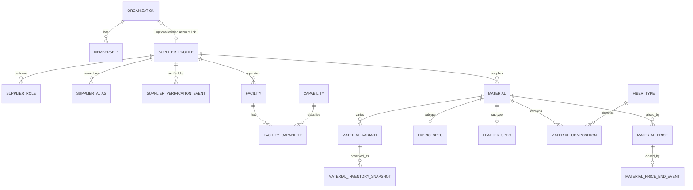

# SOURCE OS Phase 1 계획안

상태: **검토용 제안 / 계획 단계만 수행**. 이 문서의 테이블·API·화면·마이그레이션은 아직 구현하지 않았다. 사용자의 다음 지시 전에는 1A 구현으로 넘어가지 않는다.

기준: `Croco-JY/codex`, `main`의 Phase 0 병합 커밋 `4b33b44e6bc928817b914a249e8a81528c8d7ea7`. 작업 브랜치는 같은 커밋에서 시작한 `phase-1-supply-network`이다. `work`와 `main`에는 커밋하지 않는다.

## 1. 목표와 범위

한국·일본·중국의 공급처, 실제 시설, 역량, 소재를 가입 여부와 독립적으로 관리하고 검색한다. Java 25 / Spring Boot 4.1 모듈러 모놀리스, PostgreSQL 18 / Flyway, React / 기존 OpenAPI 생성 클라이언트를 유지한다.

이번 제출물은 계획 문서 한 개다. 실제 구현은 이후 1A → 1B → 1C로 나눈다. RFQ, 견적, 샘플 업무, BOM, 주문, 생산, 거래 QC, 배송, 결제·정산, 추천·LLM·임베딩, 운영 크롤러, claim 신청·승인 흐름은 만들지 않는다. 새 인프라나 Python 서비스도 추가하지 않는다.

## 2. 저장소 감사와 Phase 0 기준선

2026-10-19에 README, 코어 설계 문서, 마스터 명세, ADR 001–016, 검증 보고서, 실제 엔티티·권한·감사 구현, Flyway V1/V2, OpenAPI 생성과 API 클라이언트, CI를 확인했다. 실제 코드와 과거 보고서가 다르면 코드와 현재 검증 결과를 기준으로 한다.

| 확인 항목 | 관찰 및 계획에 주는 영향 |
|---|---|
| PR #1 | 병합 완료. `main`과 Phase 1 원격 브랜치가 위 병합 커밋을 가리킴 |
| `organization`, `membership` | 계정·테넌트 경계. 외부 공급처 카탈로그를 담는 테이블이 아님 |
| 인증 | `(issuer, subject)`가 기존 신원 키. 별도 비밀번호나 중복 사용자 테이블 불필요 |
| 권한 | 조직별 OWNER/ADMIN/VIEWER만 있음. 조직 관리자를 플랫폼 관리자로 취급하면 안 됨 |
| `audit_event` | `organization_id NOT NULL`. 전역 카탈로그 변경을 기록할 수 있도록 호환 확장 필요 |
| 감사 서비스 | 기존 트랜잭션에 참여하는 `MANDATORY`, 추가 전용 트리거 유지 필요 |
| 마이그레이션 | V1, V2만 존재. 새 마이그레이션은 V3부터. 기존 파일 수정 금지 |
| outbox | Phase 0에 실제 outbox 테이블/전달기가 없음. 필요한 비동기 소비자가 없으므로 Phase 1에도 추가하지 않음 |
| 기존 검증 재실행 | `./scripts/test.sh`: 백엔드 13개, Vitest 2개, Playwright 1개 통과. 실패·스킵 0 |
| 나머지 기준선 | 타입 검사·프로덕션 빌드, 실제 API/DB 기동, OpenAPI 재생성 후 Git 차이 0, Terraform fmt/init/validate 통과 |

로컬 검증 로그는 Git 제외 경로 `.local/phase1-baseline-*.log`에 있다. Phase 1의 새 기능이나 스키마가 검증됐다는 의미는 아니다.

## 3. 핵심 모델: Organization ≠ SupplierProfile ≠ Facility

| 개념 | 의미 | 가입 없이 존재 | 관계와 권한 |
|---|---|---|---|
| Organization | SOURCE OS에 가입한 계정·업무 조직 | 해당 없음 | Membership을 통해 사용자 접근 범위를 결정 |
| SupplierProfile | 외부 공급 생태계의 사업체에 대한 정규 프로필 | 가능, 기본 상태 | 계정·사용자·Membership을 요구하지 않음 |
| Facility | 공급처가 운영하는 실제 사업장·공장·쇼룸 등 | 가능 | 정확히 하나의 SupplierProfile에 속함 |

### 미가입 일본 원단사 5,000개를 먼저 수록하는 경우

1. 출처를 가진 SupplierProfile 5,000개를 생성한다. `linked_organization_id`는 모두 NULL이다. Organization, 사용자, Membership은 자동 생성하지 않는다.
2. 이름·사업자번호·별칭으로 중복 후보를 찾되, 이름이나 도메인이 같다는 이유만으로 자동 병합하지 않는다.
3. Facility와 Material은 처음부터 안정적인 `supplier_profile.id`를 FK로 사용한다.
4. 미래에 해당 업체가 가입하면 새 Organization과 Membership을 만든다. 별도의 claim 검증·승인 기능이 승인한 경우에만 기존 프로필과 연결한다.
5. 이때 SupplierProfile을 새로 만들거나 ID를 교체하지 않는다. 기존 시설·소재·검증·가격·출처 이력도 이동하거나 다시 생성하지 않는다.

Phase 1은 선택적 연결 필드만 모델링한다. 일반 공급처 생성/수정 DTO에는 `linkedOrganizationId`가 없고, claim/연결/해제 API도 제공하지 않는다. 값을 보내면 거절한다. 연결이 있어도 일반 조직 회원에게 카탈로그 수정 권한이 생기지 않는다.

초기 연결 카디널리티는 **Organization 0..1 ↔ SupplierProfile 0..1**로 제안한다. nullable FK에 UNIQUE를 걸어 두 조직의 동일 프로필 점유와 한 조직의 무제한 프로필 점유를 차단한다. 여러 법인을 보유한 그룹 계정의 다중 연결은 별도 요구가 확정될 때 검토한다. 같은 법인의 여러 공장은 여러 SupplierProfile이 아니라 여러 Facility로 표현한다.

## 4. 소유권과 모듈 경계

카탈로그 데이터는 플랫폼이 관리하는 공통 공급망 정보다. `created_by`나 계정 연결은 수정 권한의 근거가 아니다. 가입 조직의 비공개 계정 데이터는 기존 organization 모듈에 그대로 둔다.

| 모듈 | 소유 범위 및 공개 계약 |
|---|---|
| `identity`, `organization` | 기존 인증·Membership·Organization 유지 |
| `authorization` | 기존 조직 정책 유지, 별도 PlatformAuthorization 및 관리자 권한 배정 |
| `audit` | 조직 감사와 전역 플랫폼 감사, 동일 트랜잭션 보장 |
| `geography` | Country, Region, IndustrialCluster와 유효성 조회 |
| `dataingestion` | 출처 기록 계약과 검증 메타데이터. 크롤러 실행 기능 없음 |
| `supplier` | SupplierProfile, 역할, 별칭, 공급처별 출처 |
| `supplierverification` | 검증 이벤트 및 상태 전이. 공급처의 현재 상태는 공개 서비스로 갱신 |
| `capability` | 역량 분류 체계 |
| `facility` | 시설, 시설 역량과 각각의 출처 |
| `material` | 소재·변형·서브타입·조성·소재 출처 |
| `pricing`, `inventory` | 가격 사실·종료 기록과 재고 관측 이력 |
| `supplysearch` | 공급처/소재/시설 검색 및 상세 읽기 조합. 제한된 읽기 SQL로 도메인 간 조회만 수행 |

supplier가 facility/material의 엔티티를 역참조하지 않게 한다. 공급처 상세처럼 여러 도메인이 필요한 응답은 supplysearch에서 조합한다. 공개 서비스·UUID·불변 DTO를 사용하고, 다른 모듈의 엔티티를 변경하지 않는다. 검증 모듈 → supplier 방향만 허용해 순환을 피한다. 공개 읽기 SQL의 테이블 의존도도 문서화하고, 수정 SQL은 소유 모듈에만 둔다. Modulith 경계 검사를 계속 실행한다.

## 5. 예정 테이블과 주요 제약

아래는 **신규 28개 테이블** 제안이다. 기존 3개 테이블은 유지하고 `audit_event`만 새 마이그레이션으로 호환 확장한다. FK는 기본 RESTRICT로 두며, 업체·계정 삭제가 공급망 이력을 연쇄 삭제하지 않게 한다. 변경 가능한 핵심 엔티티에는 UUID, UTC `timestamptz`, `created_at`, `updated_at`, `version`을 사용한다. 제어 값은 Java enum과 DB CHECK로 함께 검증한다.

### 5.1 권한·지리·출처: 5개

| 테이블 | 핵심 필드·관계·제약 |
|---|---|
| `platform_role_assignment` | UUID, issuer, subject, role=`PLATFORM_ADMIN`, ACTIVE/REVOKED, 생성·해제 시각, version. 활성 `(issuer,subject,role)` 중복 금지. 사용자 테이블에 전역 role을 넣지 않음 |
| `country` | UUID, ISO alpha-2 UNIQUE, alpha-3 UNIQUE, 영문/원어 이름, active. 운영 seed는 KR/JP/CN만 |
| `region` | country FK, parent_region FK nullable, code nullable, 이름, 제어된 region_type, active. `(id,country_id)` 유일 키와 복합 FK로 부모와 국가 일치. 자기 참조·조상 순환 금지 |
| `industrial_cluster` | country FK, region FK nullable, slug, 영문/원어 이름, 설명, active. `(country_id,slug)` UNIQUE, region이 있으면 국가 일치 |
| `data_source_record` | 종류·이름·URL·접근 방식, 실제 retrieved_at, recorded_at, 원문 hash, license/terms 상태, 검토 actor의 issuer/subject와 시각, notes. 인증값·비공개 원문을 저장하지 않음 |

출처는 외부 자료뿐 아니라 MANUAL_ENTRY도 표현한다. 출처를 모르면 UNKNOWN으로 표시하고, 과거 수집 시각을 현재 시각으로 꾸미지 않는다. 검토/수정은 새 출처 레코드와 `supersedes_id`로 남기며 기존 증거는 덮어쓰지 않는다. URL은 http/https, 길이, userinfo 등을 검증하며 Phase 1 서버가 임의 URL을 가져오는 기능은 없다. 내부 메모와 민감한 원문은 일반 검색 사용자에게 노출하지 않는다.

### 5.2 공급처·검증·시설·역량: 10개

| 테이블 | 핵심 필드·관계·제약 |
|---|---|
| `supplier_profile` | `linked_organization_id` nullable FK + UNIQUE, country FK, display_name 필수, legal/native/English 이름·사업자번호·URL·설명 nullable, verification_status, ACTIVE/ARCHIVED, version. 이름·URL은 전역 UNIQUE 아님 |
| `supplier_role` | `(supplier_id,role)` PK. MILL/CONVERTER/MATERIAL_SUPPLIER/TRIM_SUPPLIER/FACTORY/PROCESSOR/QC_COMPANY/LOGISTICS_COMPANY/OTHER. 한 공급처가 여러 역할 가능 |
| `supplier_alias` | UUID, supplier FK, 원문 alias, normalized_alias, 언어 코드, alias_type. 동일 공급처의 정규화 별칭 중복 제한, 다른 공급처의 같은 이름 허용 |
| `supplier_verification_event` | UUID, supplier FK, previous/new 상태, reason, actor issuer/subject, 출처 FK nullable, occurred_at. 추가 전용, 생성 시 DISCOVERED 이벤트 포함 |
| `supplier_source` | supplier FK + source_record FK + 통제된 field_name/RECORD 범위. 출처별·필드별 근거를 보존 |
| `facility` | supplier FK 필수, facility_type, 이름, country FK, region/cluster FK nullable, 주소·우편번호·전화·이메일, 좌표 nullable, 상태, version. supplier 연결은 일반 수정에서 변경 금지 |
| `facility_source` | facility FK + source_record FK + field_name/RECORD 범위 |
| `capability` | UUID, code UNIQUE, parent FK nullable, PRODUCT/MATERIAL_HANDLING/PROCESS 분류, 이름·설명, active. 같은 분류 내 계층, 자기/조상 순환 금지 |
| `facility_capability` | `(facility_id,capability_id)` PK, proficiency nullable, MOQ/최대 수량·단위 nullable, notes, 검증 상태, timestamps/version. 수량의 하한·상한과 단위 검증 |
| `facility_capability_source` | facility_capability 복합 FK + source_record FK. 존재하지 않는 시설 역량에 출처 연결 불가 |

DISCOVERED 공급처는 법적 이름·사업자번호·좌표·역할을 모를 수 있다. 모르는 법적 이름을 표시 이름으로 복사하거나 역할을 OTHER로 추정하지 않는다. 사업자번호는 국가별 정규화가 검증된 값에 한해 `(country,normalized_registration_number)` 중복을 제한하고, 불완전 원문은 별도로 보존한다. 충돌은 관리자 검토 대상으로 돌린다.

회사 소재 국가와 공장 소재 국가는 달라도 된다. Facility의 region/cluster는 Facility 국가와 일치해야 하며, cluster의 region이 있으면 시설 region과 같거나 조상이어야 한다. cluster는 행정구역 자체와 동일한 개념이 아니다. 위·경도는 `NUMERIC(9,6)` / `NUMERIC(10,6)`, 범위는 각각 ±90 / ±180이며 둘 다 NULL 또는 둘 다 제공한다. 불완전 주소로 좌표를 추정하지 않는다.

수량은 `NUMERIC(19,4)`/BigDecimal이며 단위는 PCS/METER/YARD/KG/GRAM/MM/CM/M2 중 명시적으로 선택한다. MOQ/최대 수량은 0 이상이고 둘 다 있으면 최소 ≤ 최대여야 한다. 단위 없는 수량과 알 수 없는 값을 0으로 치환하지 않는다. proficiency는 NULL 또는 SUPPORTED(수행 가능)/EXPERIENCED(반복 수행 경험)/SPECIALIST(특화 수행)로 제어하고, 증거의 신뢰도는 별도의 verification_status로 표현한다. 별점은 저장하지 않는다.

### 5.3 소재·서브타입·조성: 8개

| 테이블 | 핵심 필드·관계·제약 |
|---|---|
| `material` | supplier FK, material_type, article_number, display_name, 설명, 원산지 country FK nullable, mill_supplier FK nullable, composition_state, DRAFT/ACTIVE/ARCHIVED, version. 가격·재고 필드 없음 |
| `material_variant` | material FK, supplier_sku nullable, variant_name, 색 이름/코드·batch, 긴 꼬리 attributes JSONB, 상태, version. `(material_id,id)` 유일 키 제공 |
| `fabric_spec` | material_id PK/FK, construction, weave/knit, GSM·폭mm·두께mm, stretch/shrinkage, finish/surface/handfeel/drape/luster, MOQ/MCQ·단위, 표준/재생산 lead time, intended-use notes |
| `leather_spec` | material_id PK/FK, animal_type/tannage/finish/surface, 두께mm·중량과 단위, 원산지 FK nullable. 핵심 검색 속성은 구조화 컬럼 |
| `fiber_type` | UUID, canonical_code UNIQUE, 이름, active. WOOL/CASHMERE/COTTON/LINEN/SILK/POLYESTER/NYLON/ACRYLIC/RAYON/VISCOSE/LYOCELL/ELASTANE/OTHER 참조값 |
| `material_composition` | `(material_id,fiber_type_id)` PK, percentage `NUMERIC(7,4)` CHECK 0..100, raw_component_name nullable |
| `material_source` | material FK + source_record FK + field_name/RECORD 범위. 스펙·조성의 필드 단위 근거도 표현 |
| `material_variant_source` | variant FK + source_record FK + field_name/RECORD 범위 |

`material_type`은 명세의 15종으로 통제한다. 신뢰할 수 있는 article_number는 공급처 안에서만 유일하다. 값이 모르면 NULL을 허용하고, 알려진 정규화 값에 부분 UNIQUE `(supplier_id,article_number)`를 적용한다. SKU는 소재 안에서 알려진 값만 유일하게 관리한다. 같은 공급처의 소재 전반에서 SKU 유일성을 보장한다는 가정은 하지 않는다.

FabricSpec은 FABRIC에, LeatherSpec은 LEATHER에만 연결한다. DB 복합 키/타입 CHECK로 잘못된 서브타입을 차단한다. ACTIVE인 FABRIC/LEATHER는 대응 스펙 한 개를 요구하며, DRAFT는 입력 중의 불완전 상태를 허용한다. 활성화와 구성 변경은 동일 트랜잭션으로 처리하고 지연 제약 검사로 직접 SQL의 불일치도 차단한다. 타입 변경으로 기존 서브타입/가격 이력을 지우지 않는다.

조성은 COMPLETE면 항목이 있고 합계가 정확히 100, PARTIAL이면 합계가 100 이하, UNKNOWN이면 확정된 항목이 없는 상태다. 합계와 완전성은 서비스 및 지연 DB 제약 검사로 검증한다. 변경 시 Material 버전을 확인하고 조성 전체를 원자적으로 교체한다. float를 쓰지 않으며 JSONB나 문자열을 유일한 조성 표현으로 사용하지 않는다.

### 5.4 가격·재고 이력: 5개

| 테이블 | 핵심 필드·관계·제약 |
|---|---|
| `material_price` | UUID, material FK, variant nullable, supplier FK, amount `NUMERIC(19,4)>0`, ISO-4217 currency, unit, minimum_quantity nullable, valid_from, valid_to nullable, created_at. 추가 전용 |
| `material_price_end_event` | UUID, price_id UNIQUE FK, ends_at, reason, actor issuer/subject, occurred_at. 열린 가격을 종료하는 추가 전용 사실 |
| `material_price_source` | price FK + source_record FK. 가격 생성 시 출처 필수 |
| `material_inventory_snapshot` | UUID, variant FK, quantity `NUMERIC(19,4)>=0`, 단위, recorded_at, created_at. 관측 시점별 추가 전용 |
| `material_inventory_snapshot_source` | snapshot FK + source_record FK |

가격은 `(material,variant 또는 공통,currency,unit,minimum_quantity tier)`별 별도 시계열이다. 서로 다른 통화·단위·수량 tier를 하나의 가격으로 비교하지 않는다. variant와 supplier는 해당 material과 일치하도록 복합 FK로 강제한다. 통화는 ISO 코드 형식과 Java Currency로 검증하고, 수량·금액은 BigDecimal로 계산한다. API의 정밀 소수는 문자열 계약으로 생성해 프론트의 부동소수 연산으로 손실되지 않게 한다.

기간은 `[valid_from, valid_to)`이다. **현재 열린 가격의 valid_to를 UPDATE하는 방식은 사용하지 않는다.** 새 가격을 등록할 때 기존 가격에 종료 이벤트를 추가하고 새 가격 사실을 INSERT한다. 유효 종료 시각은 원래 valid_to와 종료 이벤트 중 이른 값이다. 원본 가격과 종료 이벤트는 UPDATE/DELETE/TRUNCATE를 거부한다.

같은 material의 가격 변경은 부모 행 잠금으로 직렬화하고, 실제 종료 시각을 반영하는 지연 constraint trigger로 같은 scope의 기간 중첩을 거부한다. 직접 INSERT와 동시 요청에도 적용되도록 트리거에서 같은 잠금 규약을 강제한다. 이 규칙은 1B의 선행 SQL 검증 대상으로 삼는다. 단순 exclusion index가 종료 이벤트로 계산한 범위를 그대로 제약할 수 있다고 가정하지 않는다.

유효 가격 조회는 시각·통화·단위·수량 tier와 variant scope를 명시한다. variant 가격과 공통 가격의 fallback 규칙은 같은 scope 안에서만 적용하고 API 계약에 드러낸다. 여러 통화/단위의 결과가 있으면 목록으로 반환한다. “단일 현재 가격”을 Material에 저장하지 않는다. 이미 종료된 과거 기간을 소급 덮어쓰는 수정은 Phase 1에 제공하지 않는다.

재고도 원본 관측을 변경하지 않는다. 최신 재고는 `(variant,unit)`별 `recorded_at DESC, created_at DESC, id DESC`로 선택한다. 늦게 들어온 과거 관측이 현재 수치를 덮어쓰지 않으며, 단위가 다르면 합산하지 않는다. 예약·할당·결제 재고는 범위 밖이다.

## 6. 생명주기와 관리자 권한

### 공급처 검증과 claim을 분리

검증 enum은 DISCOVERED / CLAIMED / VERIFIED / AUDITED / TRANSACTED / PROVEN을 표현하되, 각 상태를 실제 증거와 연결한다. Phase 1에서 관리자가 수동 전이할 수 있는 상태는 DISCOVERED / VERIFIED / AUDITED로 제한한다. 검증 취소도 사유와 새 이벤트를 기록한다. 등록 당시부터 검증 이력을 남기고 current status와 이벤트는 같은 트랜잭션으로 커밋한다.

외부 자료로 검증한 미가입 공급처도 VERIFIED가 될 수 있다. 따라서 DISCOVERED → VERIFIED는 가능하며, 계정 claim을 선행 조건으로 강제하지 않는다. CLAIMED는 미래에 검증된 계정 연결이 있을 때만, TRANSACTED/PROVEN은 미래 거래 근거가 있을 때만 사용할 수 있다. Phase 1에서 관리자 드롭다운만으로 해당 사실을 만들어내지 않는다. 이 제한은 명세의 전체 생명주기를 보존하면서 현재 구현 범위를 좁히는 제안이다.

| 행위 | 미인증 | 일반 인증 사용자/조직 관리자 | 플랫폼 관리자 |
|---|---|---|---|
| 공개 범위의 공급망 검색·상세 | 거절 | 허용, 조직 간 읽기 가능 | 허용 |
| 카탈로그 생성·수정·보관·검증 | 거절 | 거절 | 허용 |
| 내부 출처 메모 | 거절 | 거절 | 별도 관리 권한 검사 |
| claim/계정 연결 변경 | API 없음 | API 없음 | Phase 1 API 없음 |
| 기존 조직 계정/파일 접근 | 거절 | 기존 Membership 정책 | 플랫폼 관리자여도 자동 우회 불가 |

PlatformAuthorization은 기존 OIDC로 검증된 issuer/subject와 명시적인 활성 플랫폼 권한 배정을 확인한다. 요청 body의 organizationId, 임의 헤더, 조직 OWNER 역할을 플랫폼 권한으로 바꾸지 않는다. 첫 관리자 배정은 신뢰된 운영자만 실행하는 별도 bootstrap 절차와 감사 기록으로 남기며, 공개 자기승격 API나 운영용 기본 관리자 계정은 만들지 않는다. local/E2E 관리자도 테스트·로컬 전용 도구로 명시적으로 배정한다. Phase 1에서는 이 배정을 일반 관리 화면이나 HTTP API로 변경하지 않는다.

V3에서 `audit_event`에 TENANT/PLATFORM 범위와 entity_type/entity_id 등의 호환 컬럼을 추가한다. TENANT는 organization_id 필수, PLATFORM은 NULL이라는 CHECK로 의미를 분명히 한다. 기존 행은 기본 TENANT로 유지하며 UPDATE하지 않는다. 기존 `record(actor,org,...)` 계약도 유지하고 전역 감사 메서드를 추가한다. 가짜 PLATFORM Organization을 seed하거나 감사 트리거를 해제하지 않는다.

중요 변경은 플랫폼 감사, actor, action, 대상 ID, 시각, request ID와 함께 같은 트랜잭션에 저장한다. 원문·토큰은 감사 payload에 넣지 않는다. 버전이 어긋난 수정은 기존 Problem Details + request ID를 포함한 409로 반환한다. 카탈로그 삭제는 기본적으로 archive이며 가격·출처·검증·재고의 물리적 삭제 API는 제공하지 않는다.

## 7. Flyway 예정 순서

각 파일은 **아직 만들지 않은 예정 파일**이다. 구현 시점의 최고 버전을 다시 확인한다. 현재 기준 V1/V2는 바이트 단위로 보존한다. 확장 설치 권한은 운영 DB에서 미리 점검하고 검증을 우회하지 않는다.

| 순서 | 예정 파일 | 내용/선행 관계 | 구현 구간 |
|---|---|---|---|
| V3 | `V3__audit_platform_scope.sql` | 기존 감사 로그의 전역 범위 호환 확장. 기존 행/트리거 유지 | 1A |
| V4 | `V4__platform_role_assignment.sql` | 플랫폼 관리자 권한 배정 테이블과 인덱스. 운영 관리자 seed 없음 | 1A |
| V5 | `V5__geography.sql` | country → region → industrial_cluster, KR/JP/CN 참조 seed | 1A |
| V6 | `V6__data_source_record.sql` | 출처 원본 및 출처 개정 관계. 공급처 생성보다 먼저 필요 | 1A |
| V7 | `V7__supplier_directory.sql` | profile → roles/aliases/verification events/supplier sources | 1A |
| V8 | `V8__facility_capability.sql` | facility + capability → assignment → 각 출처 FK | 1A |
| V9 | `V9__material_catalog.sql` | material → variant/specs/fiber types/composition + 소재/변형 출처 | 1B |
| V10 | `V10__material_price_history.sql` | 가격 원본 → 종료 이벤트/출처 → 기간 무중첩·불변성 제약 | 1B |
| V11 | `V11__material_inventory_snapshot.sql` | 재고 관측 및 출처, 최신 관측 조회 인덱스 | 1B |
| V12 | `V12__supply_search_indexes.sql` | pg_trgm 및 실제 검색 쿼리에 필요한 선택적 인덱스 | 1C |

명세의 권장 순서에서 **최소 provenance를 1B가 아닌 1A 앞부분으로 이동**한다. 첫 공급처부터 출처를 FK로 연결해야 이후 대량 이관이나 NULL 출처 보정이 필요 없기 때문이다. 가격용 종료 이벤트 테이블도 원본 가격의 불변성과 열린 기간 갱신을 함께 만족시키기 위한 추가다.

모든 migration은 빈 PostgreSQL 18에서 V1부터 적용하는 경우와, 기존 조직·회원·감사 행이 있는 V1/V2 DB를 업그레이드하는 경우를 각각 Testcontainers로 검증한다. 업그레이드 후 기존 FK·회원 접근·감사 변경 방지·JPA validate까지 확인한다. 과거 migration 체크섬을 바꾸거나 Flyway repair로 숨기지 않는다. 대형 데이터가 있는 후속 운영 환경의 온라인 인덱스 구축은 별도 배포 계획으로 다루며 초기 빈 테이블용 migration과 혼동하지 않는다.

## 8. 검색·인덱스·페이지네이션

전용 검색 서비스와 JdbcClient의 바인딩 파라미터를 사용한다. 컬럼명·정렬·연산자는 서버의 allowlist로만 선택하고 사용자 입력을 SQL 문자열에 연결하지 않는다.

| 영역 | 검색 의미와 우선 인덱스 |
|---|---|
| 공급처 | 본사/법인 국가, 역할, 검증 상태, 별칭. `(country_id,status,created_at,id)`, 역할 역방향 `(role,supplier_id)`, verification 상태 인덱스를 실제 계획으로 선택 |
| 시설 | 시설 국가·region·cluster·type·capability. FK B-tree, `(capability_id,facility_id)`. 같은 시설이 위치와 역량 조건을 함께 만족하도록 EXISTS 사용 |
| 이름·별칭 | 원문 보존, NFKC + Locale.ROOT 소문자 정규화. 정규화 이름/별칭의 exact/prefix B-tree, 필요한 열만 GIN trigram |
| 소재 | 공급처·원산지·타입·ACTIVE variant 여부. 선택적 복합/부분 인덱스와 EXISTS로 중복 소재 행 방지 |
| 스펙·조성 | GSM/폭 범위, MOQ·lead time, `(fiber_type_id,percentage,material_id)`로 Wool >=80% 등 조회 |
| 가격 | material/scope/valid_from, 종료 이벤트 price_id UNIQUE. 통화·단위·수량 조건이 맞는 유효 가격만 비교 |
| 재고 | `(material_variant_id,unit,recorded_at DESC,created_at DESC,id DESC)` |
| 출처 연결 | 복합 PK와 역방향 source_record_id FK 인덱스. source만 삭제해 근거를 고아로 만들지 않음 |

국가 필터에서 공급처의 국가와 시설의 국가는 구별한다. 공급처 검색의 `country`는 SupplierProfile 국가이고, `facilityCountry`/region/cluster는 시설의 위치다. 같은 공급처의 서로 다른 시설이 위치·역량 조건을 나눠 만족해서 오탐이 생기지 않게 한다. 소재 `originCountry`도 공급처 국가에서 추정하지 않는다.

짧은 한·중·일 검색어를 무조건 3자 미만이라고 거절하지 않는다. 1–2자는 exact/prefix, 긴 문자열은 선택적으로 trigram/부분 일치를 제공하고 UI에도 의미를 표시한다. 로마자·원어·별칭은 수동 등록된 근거를 검색하며 자동 번역·자동 사업체 병합은 하지 않는다. 이름이 같다는 이유로 두 법인을 합치지 않는다.

주요 공급처·시설·소재 목록은 기본 `(created_at DESC,id DESC)` keyset cursor, 기본 25/최대 100건이다. cursor는 불투명하게 인코딩하되 신뢰하지 않고 필드·정렬·필터 hash·page size를 검증한다. 변경되는 데이터 전체에 대한 고정 스냅샷을 보장한다고 주장하지 않는다. 작은 참조/관리 목록만 제한된 OFFSET을 허용한다. 관련 시설/소재/가격 이력도 별도 페이지네이션하여 상세 응답이 무한히 커지지 않게 한다.

가격 범위 검색은 currency와 priceUnit을 필수로 받고 자동 환율·단위 변환을 하지 않는다. 검색과 facet count에는 같은 권한·필터 정의를 적용한다. 선택한 facet의 자기 조건 제외 여부는 `docs/phase-1-search.md`에 명시한다. `docs/phase-1-indexes.md`에는 실제 SQL, 대표 데이터 분포, EXPLAIN ANALYZE/BUFFERS 결과와 각 인덱스의 이유를 남긴다. 이름에 “일본 5,000개”를 넣은 가짜 운영 seed 대신 테스트 전용 대량 데이터로 검사한다.

## 9. 예정 API와 프론트엔드 범위

기존 Phase 0 `/api/organizations`, `/api/identity`, health 계약은 유지한다. 신규 공급망 REST는 `/api/v1` 아래에 둔다.

| 종류 | 예정 리소스 |
|---|---|
| 인증 사용자 읽기 | `GET /countries`, `/regions`, `/industrial-clusters`, `/capabilities`, `/fiber-types` |
| 공급처/시설 읽기 | `GET /suppliers`, `/suppliers/{id}`, `/suppliers/{id}/facilities`, `/suppliers/{id}/materials`, `/suppliers/{id}/verification-events`, `/suppliers/{id}/sources`, `/facilities`, `/facilities/{id}`, `/facilities/{id}/capabilities` |
| 소재 읽기 | `GET /materials`, `/materials/{id}`, `/materials/{id}/variants`, `/materials/{id}/prices`, `/materials/{id}/inventory`, `/materials/{id}/sources` |
| 관리자 수정 | `/admin` 아래 geography/suppliers/roles/aliases/verification-events/facilities/capabilities/facility-capabilities/materials/variants/fabric-spec/leather-spec/composition/prices/inventory-snapshots/sources 관리 |
| 상태/자기 권한 | 기존 identity를 호환 확장하거나 명시적인 `/me/permissions`로 UI에 허용 기능 제공. 서버 권한 검사는 매번 독립 수행 |

위 경로는 모두 `/api/v1` 기준이다. 버전을 확인하는 mutable aggregate PATCH/PUT와 추가 전용 이력 POST를 구별한다. 출처·검증·가격·재고를 일반적인 DELETE CRUD로 취급하지 않는다. Composition은 소재 버전을 포함한 전체 교체, 검증·가격 변경은 사유·출처와 함께 원자적 명령으로 받는다. Java DTO → OpenAPI → 생성 TS schema/client 흐름과 CI 계약 검사도 유지한다.

Phase 1C의 사용자 화면은 Dashboard, Supplier Search/Detail, Facility Detail, Material Search/Detail이다. Admin은 Supplier/Facility/Material/Geography/Capability Editor를 같은 React 앱 안에 둔다. 역할·별칭·검증·출처·스펙·조성·변형·가격·재고는 해당 편집기의 하위 영역으로 관리한다. 권한 배정 관리 화면을 일반 공급처 편집 화면과 합치지 않는다.

각 화면 구현 전에 `docs/screens/`에 역할·데이터·CTA·로딩/빈 상태/오류·키보드·반응형·권한·수용 조건을 작성한다. RHF/Zod는 입력 편의를 담당하고 백엔드가 최종 검증한다. 검색 상태는 URL에 보존하고 필터 초기화·다음 페이지·오류 재시도를 제공한다. 읽기 편한 기본 목록/테이블부터 만들고 표 편집 등 실제 수요가 생길 때만 TanStack Table 의존성을 정당화한다.

## 10. 구현 구간과 검토 관문

| 구간 | 작업/독립 커밋 | 종료 시 증거 |
|---|---|---|
| 계획 — 현재 | 이 문서와 테이블/관계/순서 제시. 구현 중지 | 사용자 검토 가능한 계획. 코드·SQL 변경 없음 |
| 1A-1 | ADR 017: 계정/사업체/시설 분리, ADR 018: 전역 권한·감사, V3/V4 | 기존 조직 권한·감사 회귀와 플랫폼 권한 부정 테스트 |
| 1A-2 | V5/V6 geography와 최소 provenance | 국가 일치·계층 순환·출처 FK와 수집 근거 검증 |
| 1A-3 | V7/V8 supplier/roles/aliases/verification/facility/capability + 관리자 API | 미가입 공급처 CRUD·다중 역할·역량·검증 이력·cross-org 쓰기 차단 |
| 1B-1 | V9 소재·변형·서브타입·조성 | 공급처별 품번·타입·복합 FK·부분/완전 조성·버전 충돌 |
| 1B-2 | ADR 019: 원본 가격 불변성, V10/V11 가격·재고 | 기간 경계·동시 등록·가격 종료·다중 tier·늦은 재고 관측 |
| 1C-1 | 실제 검색 SQL·V12·인덱스/검색 문서·화면 명세 | 다국어 별칭·조성·위치/역량 EXISTS·cursor·쿼리 계획 |
| 1C-2 | 검색·상세·관리 화면·합성 local fixture·Phase 1 E2E·문서 | 전체 회귀·보안·생성 계약·UI 흐름·CI 통과 |

각 구간은 전체 Phase 0 회귀와 해당 신규 테스트를 통과한 뒤 독립 커밋한다. ADR은 해당 변경 구현 전에 작성하며 기존 ADR을 소급 편집하지 않는다. 현재 사용자 요청은 계획까지이므로 구현 구간은 실행하지 않는다. Phase 1 완료 시에만 최종 명세대로 branch push 및 `main ← phase-1-supply-network` PR을 준비하고, 병합은 하지 않는다.

## 11. 구현 전에 확정할 검증 항목과 위험

- 미가입 SupplierProfile 5,000개에 Organization/Membership이 0개여도 FK·검색·출처가 성립하는 테스트. 미래 claim의 연결 필드가 바뀌어도 supplier/facility/material ID가 유지된다는 모델 테스트.
- 플랫폼 관리자, 일반 조직 OWNER, 다른 조직 사용자, 미인증 사용자를 분리한다. 조직 ID나 연결 필드를 조작해도 수정 권한을 획득할 수 없는지 검증한다.
- 국가 불일치, 자기/간접 계층 순환, 다른 공급처의 variant 가격 연결, 타입 불일치, 중복 역할·품번·별칭, 잘못된 조성과 음수/알 수 없는 수치 입력을 실제 PostgreSQL로 검사한다.
- 현재 검증 상태/이력·소재/조성·가격 종료/새 가격/감사가 전부 성공하거나 전부 롤백되는지 확인한다. 행 잠금과 지연 트리거는 동시 트랜잭션 테스트를 먼저 만든다.
- 가격은 경계 시각, variant fallback, 동일 통화/단위/tier의 중첩, 서로 다른 scope의 공존, 과거 원본 수정 거부를 검증한다. 이 설계가 검증되지 않으면 편의상 원본 UPDATE 방식으로 바꾸지 않는다.
- 출처 없는 외부 데이터 활성화 금지. 내부 메모 노출·임의 URL fetch·수집 제한 우회 금지. source 링크는 강한 FK로 확인한다.
- local fixture는 명백한 합성 이름과 결정적 UUID를 사용하고 reset은 해당 fixture 집합만 대상으로 한다. 운영 migration에는 실제/가짜 사업체·소재·가격·기본 관리자 seed를 넣지 않는다.
- E2E는 명시적 local 관리자 → 공급처 → 시설 → 역량 → 원단 → 조성 → 변형 → 가격 → 검색/상세까지 검증한다. 프론트 테스트는 두 검색, 두 상세, 입력 검증, 오류/빈 상태를 추가한다.
- Phase 1 수용 조건으로 빈 DB와 Phase 0 업그레이드, 백엔드/프론트/모듈/권한/E2E, OpenAPI 일치, Terraform, secret scan, Git clean을 구별해서 기록한다. 새 테스트 실행 없이 완료했다고 주장하지 않는다.

### 제안의 핵심 결정

1. **가입과 공급처 등록은 독립적**이다. Organization 없는 SupplierProfile을 정식 데이터로 인정한다.
2. **사업체와 물리 시설은 분리**한다. 글로벌 공급처의 공장별 국가·역량을 Facility에 둔다.
3. **claim은 미래의 검증된 연결 행위**다. Phase 1은 계정 연결 API나 자동 소유권 이전을 제공하지 않는다.
4. **최초 등록부터 출처와 전역 감사가 필요**하다. provenance와 관리자 기반을 1A의 선행 작업으로 둔다.
5. **현재 상태와 원본 이력을 구별**한다. 검증·가격·재고·출처 사실은 보존하고, 편의상 과거를 덮어쓰지 않는다.
