# SOURCE OS Phase 1B architecture plan

Status: final Phase 1B implementation plan. Authority: the user’s consolidated V9–V12 implementation specification, received 2026-10-20 (Asia/Seoul), supersedes earlier proposals. Supplier-scoped Material + SupplierMaterialListing is accepted. Implement only Phase 1B on phase-1-supply-network; preserve V1–V8 bytes, exactly 16 new tables, no Flyway repair, PR, merge, Phase 1C UI or Phase 2.

Baseline: Phase 1A hardening `9f14aac`; micro-fix `9f377ebbd89a38f397a62a96ef7a28ea120bef61` explicitly names `data_source_record_kind_check`. Its [SOURCE OS CI](https://github.com/Croco-JY/codex/actions/runs/39245263123) completed successfully before this document was started. Local validation passed 63 backend / 2 frontend / 1 browser tests, clean V1→V8 and populated Phase 0 V1/V2→V8 migration, contract consistency, Terraform and secret scans. V1/V2 are unchanged. All SQL fragments below are **future design examples**, not applied migrations.

## 1. Identity, catalog and commerce

Material is a catalog Article / Quality defined by `catalog_supplier_id`, a SupplierProfile. It is not a global physical-cloth ontology. MaterialVariant describes that catalog article's variants. SupplierMaterialListing is a seller's commercial offering of that article. One material can have zero variants and zero listings. Creating a material never automatically creates a listing.

`catalog_supplier_id` identifies the catalog supplier, while `seller_supplier_id` identifies a listing's seller. Neither is an Organization. Organization links grant no canonical write authority. Do not add `owner_supplier_id`, `primary_supplier_id`, `manufacturer_supplier_id`, `supplier_sku`, MasterMaterial, CanonicalMaterial or a material relation graph.

Catalog and seller codes remain separate: `catalog_article_number`, `catalog_variant_sku`, `seller_article_number`. Preserve their original case/text; they are not automatically unique identifiers. Source identity uses the existing source-specific key contract. Name-search normalization never becomes identity normalization.

Equal composition, GSM, width, names, article numbers, images or AI similarity do not merge materials. If Converter B republishes Mill A cloth under B's distinct catalog Article / Quality, B can have a separate Material even when the upstream cloth is physically identical. A B listing of A's Material requires reliable evidence of the **same catalog article identity**, not an inferred physical similarity. Cross-source binding is an explicit authorized decision with observation evidence. Repeated imports reuse an existing binding, including archived entities, and never silently rebind or recreate them.

## 2. ERD

The diagram separates catalog supplier, seller supplier, physical specs and commercial terms. Existing Country and Facility references are shown for context. The 16 proposed new tables are listed in section 3; DataSource/Record/Observation and SupplierProfile already exist.

```mermaid
erDiagram
  SUPPLIER_PROFILE ||--o{ MATERIAL : "catalog supplier defines catalog article"
  SUPPLIER_PROFILE ||--o{ SUPPLIER_MATERIAL_LISTING : "seller supplier offers commercial terms"
  MATERIAL ||--o{ MATERIAL_VARIANT : "catalog variants"
  MATERIAL ||--o{ SUPPLIER_MATERIAL_LISTING : "catalog article to seller listing"
  MATERIAL ||--o| FABRIC_SPEC : "physical spec FABRIC only"
  MATERIAL ||--o| LEATHER_SPEC : "physical spec LEATHER only"
  MATERIAL ||--o{ MATERIAL_COMPOSITION : "physical composition"
  FIBER_TYPE ||--o{ MATERIAL_COMPOSITION : "controlled fiber"
  COUNTRY o|--o{ MATERIAL : "origin independent of supplier country"
  SUPPLIER_MATERIAL_LISTING ||--o{ MATERIAL_PRICE : "commercial price"
  MATERIAL_VARIANT o|--o{ MATERIAL_PRICE : "optional exact variant"
  SUPPLIER_MATERIAL_LISTING ||--o{ MATERIAL_INVENTORY_SNAPSHOT : "commercial inventory"
  MATERIAL_VARIANT o|--o{ MATERIAL_INVENTORY_SNAPSHOT : "optional known variant"
  FACILITY o|--o{ MATERIAL_INVENTORY_SNAPSHOT : "optional location not ownership"
  DATA_SOURCE ||--o{ DATA_SOURCE_RECORD : "persistent external identity"
  DATA_SOURCE_RECORD ||--o{ DATA_SOURCE_OBSERVATION : "immutable observation"
  DATA_SOURCE ||--o{ MATERIAL_PRICE : "provider scope"
  DATA_SOURCE_RECORD ||--o| MATERIAL_EXTERNAL_RECORD : "identity resolution MATERIAL"
  MATERIAL ||--o{ MATERIAL_EXTERNAL_RECORD : "identified by"
  DATA_SOURCE_RECORD ||--o| MATERIAL_VARIANT_EXTERNAL_RECORD : "identity resolution MATERIAL_VARIANT"
  MATERIAL_VARIANT ||--o{ MATERIAL_VARIANT_EXTERNAL_RECORD : "identified by"
  DATA_SOURCE_RECORD ||--o| SUPPLIER_MATERIAL_LISTING_EXTERNAL_RECORD : "identity resolution MATERIAL_LISTING"
  SUPPLIER_MATERIAL_LISTING ||--o{ SUPPLIER_MATERIAL_LISTING_EXTERNAL_RECORD : "identified by"
  DATA_SOURCE_OBSERVATION ||--o{ MATERIAL_SOURCE : "fact provenance"
  MATERIAL ||--o{ MATERIAL_SOURCE : "supported by"
  DATA_SOURCE_OBSERVATION ||--o{ MATERIAL_VARIANT_SOURCE : "fact provenance"
  MATERIAL_VARIANT ||--o{ MATERIAL_VARIANT_SOURCE : "supported by"
  DATA_SOURCE_OBSERVATION ||--o{ SUPPLIER_MATERIAL_LISTING_SOURCE : "fact provenance"
  SUPPLIER_MATERIAL_LISTING ||--o{ SUPPLIER_MATERIAL_LISTING_SOURCE : "supported by"
  DATA_SOURCE_OBSERVATION ||--o{ MATERIAL_PRICE_SOURCE : "fact provenance same provider"
  MATERIAL_PRICE ||--o{ MATERIAL_PRICE_SOURCE : "supported by"
  DATA_SOURCE_OBSERVATION o|--o{ MATERIAL_INVENTORY_SNAPSHOT : "direct imported provenance and idempotency"
```



## 3. Exact table inventory and conventions

Exactly **16 new tables**; no generic idempotency table, listing-variant table, inventory-source table or price-end-event table.

| Migration | # | Table |
|---|---:|---|
| V9 | 1 | `material` |
| V9 | 2 | `material_external_record` |
| V9 | 3 | `material_source` |
| V9 | 4 | `material_variant` |
| V9 | 5 | `material_variant_external_record` |
| V9 | 6 | `material_variant_source` |
| V9 | 7 | `fabric_spec` |
| V9 | 8 | `leather_spec` |
| V9 | 9 | `fiber_type` |
| V9 | 10 | `material_composition` |
| V9 | 11 | `supplier_material_listing` |
| V9 | 12 | `supplier_material_listing_external_record` |
| V9 | 13 | `supplier_material_listing_source` |
| V10 | 14 | `material_price` |
| V10 | 15 | `material_price_source` |
| V11 | 16 | `material_inventory_snapshot` |
| V12 | — | indexes/search only; zero new tables |

Field dictionaries below enumerate all proposed columns; comma-separated field names mean distinct columns with the same rule. `NN` means NOT NULL; `?` means nullable. UUIDs are primary identifiers; times are UTC `timestamptz` at PostgreSQL microsecond precision. No unspecified numeric field defaults to zero.

Mutable records use `version bigint NN DEFAULT 0`, `created_at timestamptz NN DEFAULT now()` and `updated_at timestamptz NN DEFAULT now()`. Creation time/ID are immutable. On updates compare expected version, increment once and update the timestamp; stale requests return 409. Material lifecycle is DRAFT/ACTIVE/ARCHIVED (default DRAFT); Variant and Listing lifecycle is ACTIVE/ARCHIVED (default ACTIVE). Each uses a NOT NULL status CHECK, without an active boolean. Reference FiberType may use active. Unless stated otherwise, FKs use NO ACTION, never destructive cascades.

Material types: FABRIC, LEATHER, LINING, INTERLINING, ZIPPER, BUTTON, SNAP, BUCKLE, THREAD, TAPE, LABEL, ELASTIC, FILLING, PACKAGING, OTHER. A named DB CHECK enforces this set. Only FABRIC and LEATHER have dedicated specs; no forced spec for lining/interlining/trims.

Quantity/price-unit codes: PCS, METER, YARD, KG, GRAM, MM, CM, M2, FT2, ROLL, HIDE, SET, PACK. DB CHECKs enforce the shared controlled set, without introducing a units table. Quantities/amounts use `NUMERIC(19,4)` / BigDecimal; reject excess precision rather than silently rounding API input. Unknown is NULL. Explicit known zero is allowed only where the field's check permits it. Currency is an uppercase ISO-4217 code: DB format CHECK `^[A-Z]{3}$`, plus supported ISO registry validation in the service; direct DB writes must use that reviewed registry too. Reject noncommercial XXX/XTS currency identifiers even if Java recognizes them. No FX/unit conversion.

JSONB fields below are nullable bounded objects, not raw source payloads: `jsonb_typeof(value)='object'` and maximum 8192 UTF-8 bytes of its serialized representation. Application schemas allow only documented long-tail physical keys/values. Core searchable facts stay in columns. Never accept authentication data, arbitrary API responses or whole entities in these objects.

### 3.1 `material`

| Column | Type and integrity |
|---|---|
| id | uuid NN PK; immutable |
| catalog_supplier_id | uuid NN FK supplier_profile(id); immutable |
| catalog_article_number | varchar(160) ?; catalog code, preserved text |
| material_type | varchar(30) NN; controlled set above; immutable |
| display_name | varchar(160) NN, nonblank |
| normalized_name | varchar(320) NN; server-derived NFKC/ROOT lowercase for search only |
| description | varchar(4000) ? |
| origin_country_id | uuid ? FK country(id); no default from supplier country |
| composition_completeness | varchar(20) NN DEFAULT 'UNKNOWN'; COMPLETE/PARTIAL/UNKNOWN |
| status | DRAFT/ACTIVE/ARCHIVED, default DRAFT |
| version, created_at, updated_at | mutable-record convention above |

Add `UNIQUE(id,material_type)` for subtype FKs. Do not add global or supplier/article-number uniqueness: incomplete/reused codes must not force false identity merges. Imported identity is the typed external binding. Catalog article number may be enriched/corrected only with evidence that it is still the same catalog article; a different article means archive + new Material. Wrong catalog supplier or type always means archive + new Material, never UPDATE those identity fields. Mutable fields are article-code representation, display/normalized name, description, origin, composition completeness and lifecycle, plus version/update time.

### 3.2 `material_variant`

| Column | Type and integrity |
|---|---|
| id | uuid NN PK; immutable |
| material_id | uuid NN FK material(id); immutable |
| catalog_variant_sku | varchar(160) ?; catalog supplier's SKU only |
| variant_name | varchar(160) NN, nonblank |
| color_name, color_code | varchar(160) ?, varchar(80) ? |
| batch_number | varchar(100) ? |
| attributes | jsonb ?; bounded physical long-tail object |
| status | lifecycle above |
| version, created_at, updated_at | mutable-record convention |

Add `UNIQUE(id,material_id)`. Catalog SKU, name, color, batch and physical attributes may be corrected for the same variant with version/audit/provenance. A different parent material requires a new variant. No guessed SKU uniqueness. Seller-specific variant SKU and SupplierMaterialListingVariant are deferred: no concrete Phase 1B requirement justifies the extra mapping. Price/inventory may identify a catalog variant; a seller code cannot yet have an independent variant mapping.

### 3.3 `supplier_material_listing`

| Column | Type and integrity |
|---|---|
| id | uuid NN PK; immutable; manual create uses server-generated UUID, section 5 |
| material_id | uuid NN FK material(id); immutable |
| seller_supplier_id | uuid NN FK supplier_profile(id); immutable |
| seller_article_number | varchar(160) ?; seller's commercial reference |
| minimum_order_quantity, minimum_color_quantity | numeric(19,4) ?; CHECK >=0 |
| quantity_unit | varchar(10) ?; controlled set; required if either minimum is non-NULL |
| standard_lead_time_days, reproduction_lead_time_days | integer ?; CHECK >=0 |
| status | lifecycle above |
| version, created_at, updated_at | mutable-record convention |

Add `UNIQUE(id,material_id)` for price/inventory FKs. **No UNIQUE(material_id,seller_supplier_id)**, including partial ACTIVE uniqueness. Stock-service, made-to-order, domestic, export and other programmes can coexist as distinct UUID listings. External listing identity deduplicates imports; manual create uses a server UUID without a retry-idempotency guarantee. No weak programme/article-number natural key is invented.

Exact immutable fields: id, material_id, seller_supplier_id, created_at. Correcting the seller/material relationship requires archive + new listing. Exact mutable business fields: seller_article_number, both minima, quantity_unit, both lead times and status. Seller article number is mutable because it is a seller reference that can be corrected/renamed without changing the catalog article or seller; preserve evidence and audit, and never use its change to rebind an external record. No canonical JSON hashing, client-assigned Listing PK or generic idempotency framework is allowed. Low-frequency manual Listing retries may create duplicates; document this explicit limitation. Imported listings remain idempotent through MATERIAL_LISTING external identity.

### 3.4 Physical specs

Both spec tables have `material_id uuid NN PK`, `material_type varchar(30) NN` fixed by CHECK, and the composite FK `(material_id,material_type) → material(id,material_type)`. `fabric_spec` fixes FABRIC; `leather_spec` fixes LEATHER. A wrong subtype fails in PostgreSQL, including direct SQL. A spec row is optional when facts are unknown; at most one per applicable Material. Mutable-record version/timestamps apply. Material ID/type/creation time are immutable.

| `fabric_spec` remaining columns | Type and integrity |
|---|---|
| construction | varchar(20) ?; WOVEN/KNIT/NONWOVEN/OTHER |
| weave_type, knit_type | varchar(80) ? each; controlled application vocabulary |
| gsm | numeric(10,4) ?; CHECK >0 |
| width_mm | numeric(12,4) ?; CHECK >0 |
| thickness_mm | numeric(10,4) ?; CHECK >0 |
| stretch_warp_percentage, stretch_weft_percentage | numeric(9,4) ? each; CHECK >=0; stretch may exceed 100% |
| shrinkage_warp_percentage, shrinkage_weft_percentage | numeric(7,4) ? each; CHECK BETWEEN -100 AND 100; negative means growth |
| finish, surface, handfeel, drape, luster | varchar(300) ? each |
| attributes | jsonb ?; bounded physical long-tail object |
| version, created_at, updated_at | mutable-record convention |

`weave_type IS NULL OR construction='WOVEN'` and `knit_type IS NULL OR construction='KNIT'` must be enforced with NULL-safe CHECK expressions (use `construction IS NOT DISTINCT FROM 'WOVEN'` / 'KNIT' when a value is supplied). No MOQ/MCQ, sales quantity unit, seller code or sales/reproduction lead time belongs here.

| `leather_spec` remaining columns | Type and integrity |
|---|---|
| hide_type | varchar(20) ?; BOVINE/OVINE/CAPRINE/PORCINE/OTHER |
| tanning_method | varchar(20) ?; CHROME/VEGETABLE/COMBINATION/OTHER |
| thickness_min_mm, thickness_max_mm | numeric(10,4) ? each; CHECK >0 and min<=max when both known |
| average_hide_area_m2 | numeric(12,4) ?; CHECK >0 |
| finish, surface, handfeel, luster | varchar(300) ? each |
| attributes | jsonb ?; bounded physical long-tail object |
| version, created_at, updated_at | mutable-record convention |

### 3.5 Fiber and composition

| Table | Columns and integrity |
|---|---|
| fiber_type | `id uuid NN PK`; `code varchar(40) NN UNIQUE CHECK ^[A-Z][A-Z0-9_]*$`; `name_en varchar(160) NN` nonblank; `name_local varchar(160) ?`; `active boolean NN DEFAULT true`; `version bigint NN DEFAULT 0`; `created_at,updated_at timestamptz NN DEFAULT now()` |
| material_composition | `material_id uuid NN FK material(id)`; `fiber_type_id uuid NN FK fiber_type(id)`; `percentage numeric(7,4) NN CHECK percentage>0 AND percentage<=100`; `created_at,updated_at timestamptz NN DEFAULT now()`; PK(material_id,fiber_type_id) |

Initial reference fibers: WOOL, CASHMERE, COTTON, LINEN, SILK, POLYESTER, NYLON, ACRYLIC, RAYON, VISCOSE, LYOCELL, ELASTANE, OTHER. Defer aliases rather than add a table or complicate JPA/search. Do not auto-map unknown source terms to OTHER without an explicit reviewed mapping. Do not infer unknown fibers or populate fake zero rows. Fiber code/ID/creation time are immutable; names/active are versioned reference updates. Composition changes use the Material version and parent lock, not an independent version per component. Aggregate completeness enforcement is in section 6.

### 3.6 Typed bindings and typed fact citations

Each binding table has exactly `source_record_id uuid NN PK`, its canonical target column `uuid NN`, `record_kind varchar(30) NN` fixed to its kind, and `created_at timestamptz NN DEFAULT now()`. Each target has a real FK to its named table; each `(source_record_id,record_kind)` has the composite FK to `data_source_record(id,record_kind)`.

| Binding table | Canonical target column/FK | Fixed record_kind |
|---|---|---|
| material_external_record | material_id → material(id) | MATERIAL |
| material_variant_external_record | material_variant_id → material_variant(id) | MATERIAL_VARIANT |
| supplier_material_listing_external_record | listing_id → supplier_material_listing(id) | MATERIAL_LISTING |

These are **Identity Resolution**. One persistent source record binds at most one target of the correct kind; a target may have multiple external identities. Reuse Phase 1A record locking, unique upsert, transactional canonical creation/binding/audit and UPDATE/DELETE/TRUNCATE rejection. No ordinary rebinding endpoint. No source-key prefixes standing in for record_kind.

Each citation table has exactly its canonical target column `uuid NN FK`, `source_observation_id uuid NN FK data_source_observation(id)`, `field_name varchar(30) NN` with the controlled CHECK below, and `created_at timestamptz NN DEFAULT now()`. PK is `(canonical_target,source_observation_id,field_name)`.

| Citation table | Canonical target column/FK | Allowed field_name |
|---|---|---|
| material_source | material_id → material(id) | RECORD, CATALOG_ARTICLE_NUMBER, NAME, DESCRIPTION, ORIGIN, COMPOSITION, FABRIC_SPEC, LEATHER_SPEC |
| material_variant_source | material_variant_id → material_variant(id) | RECORD, CATALOG_VARIANT_SKU, NAME, COLOR, BATCH, ATTRIBUTES |
| supplier_material_listing_source | listing_id → supplier_material_listing(id) | RECORD, SELLER_ARTICLE_NUMBER, MOQ, MCQ, UNIT, STANDARD_LEAD_TIME, REPRODUCTION_LEAD_TIME |

These are **Fact Provenance**, supporting a field/fact with an actual immutable observation. Citation insertion is idempotent by PK; never use a DataSourceRecord ID as evidence. New citation tables are append-only associations using the existing rejection function; no update/delete/truncate API or destructive cascade. Add COMMENT ON distinguishing identity bindings from fact citations. Existing supplier_source/facility_source are unchanged. PriceSource and inventory's deliberate direct provenance are described separately below.

### 3.7 `material_price`

| Column | Type and integrity |
|---|---|
| id | uuid NN PK |
| listing_id | uuid NN; listing composite FK below |
| material_id | uuid NN; deliberate integrity duplication only |
| material_variant_id | uuid ?; variant composite FK below |
| data_source_id | uuid NN FK data_source(id); provider scope |
| amount | numeric(19,4) NN CHECK >0; no default; unknown/free/pending/sample is not a zero price |
| currency | varchar(3) NN; ISO/format validation in section 3 |
| price_unit | varchar(10) NN; controlled unit CHECK |
| minimum_order_quantity | numeric(19,4) ? CHECK >=0; tier threshold, not listing MOQ |
| valid_from | timestamptz NN |
| valid_to | timestamptz ?; CHECK valid_to IS NULL OR valid_to>valid_from |
| observed_at | timestamptz NN; source fact time |
| version | bigint NN DEFAULT 0; controlled closure only |
| updated_at, created_at | timestamptz NN DEFAULT now(); only update time can change on closure |

FK `(listing_id,material_id) → supplier_material_listing(id,material_id)` and FK `(material_variant_id,material_id) → material_variant(id,material_id)`, using MATCH SIMPLE. A NULL variant intentionally skips the second composite FK; material still comes from the listing FK. A non-NULL variant must belong to the listing's material. Do not use MATCH FULL, which would reject the intended nullable variant. The same pattern applies to inventory.

There is no seller_supplier_id here: seller is obtained through Listing. There is no global overlap/exclusion constraint. Concurrently valid rows may differ by listing, provider, variant, tier, currency or unit; deterministic resolution selects within one explicit scope. New value/identity always means a new row. Section 7 defines the DB mutation guard.

### 3.8 `material_price_source`

Exactly `material_price_id uuid NN FK material_price(id)`, `source_observation_id uuid NN FK data_source_observation(id)`, and `created_at timestamptz NN DEFAULT now()`. PK `(material_price_id,source_observation_id)`. This append-only association is Fact Provenance. A small DB trigger enforces same provider, section 7. One price may have multiple supporting observations, all from that provider. No polymorphic target or denormalized provider column is added here.

### 3.9 `material_inventory_snapshot`

| Column | Type and integrity |
|---|---|
| id | uuid NN PK |
| listing_id, material_id | uuid NN each; listing composite FK |
| material_variant_id | uuid ?; variant composite FK |
| facility_id | uuid ? FK facility(id); location only |
| quantity | numeric(19,4) NN CHECK >=0; no default |
| unit | varchar(10) NN; controlled unit CHECK |
| capture_mode | varchar(10) NN CHECK IN ('IMPORTED','MANUAL') |
| observed_at | timestamptz NN; observation/capture fact time |
| recorded_at | timestamptz NN DEFAULT now(); first ingestion time |
| source_observation_id | uuid ? FK data_source_observation(id) |
| manual_idempotency_key | varchar(200) ?; opaque, case-sensitive command key |
| actor_issuer, actor_subject | varchar(500) ?, varchar(255) ?; server Actor only |
| created_at | timestamptz NN DEFAULT now(); technical creation time |

FK `(listing_id,material_id) → supplier_material_listing(id,material_id)`; FK `(material_variant_id,material_id) → material_variant(id,material_id)`, MATCH SIMPLE. No seller duplicate or owner-match constraint. A third-party warehouse/partner Facility is valid even if `facility.supplier_id != listing.seller_supplier_id`.

All columns are immutable after INSERT; there is no version or updated_at. Unknown variant/facility is NULL, not a dummy UUID. Known zero quantity means zero stock; unknown quantity produces no quantitative snapshot. Modes/NULL-aware uniqueness are specified in section 9. No material_inventory_snapshot_source table: imported provenance is the direct observation FK; manual traceability is Actor + audit + command key.

## 4. V9–V12 migration plan

Future filenames proposed for review: `V9__material_catalog_and_listings.sql`, `V10__material_price.sql`, `V11__material_inventory_snapshot.sql`, `V12__material_search_indexes.sql`. Create these four files only during their authorized implementation slices.

### V9: named constraint extension, then 13 tables

Use the explicitly named constraint from micro-fix 9f377eb. Flyway executes the following inside V9's normal transaction, with schema qualification and no IF EXISTS fallback:

```sql
ALTER TABLE public.data_source_record
  DROP CONSTRAINT data_source_record_kind_check;
ALTER TABLE public.data_source_record
  ADD CONSTRAINT data_source_record_kind_check
  CHECK (record_kind IN (
    'SUPPLIER','FACILITY','MATERIAL','MATERIAL_VARIANT','MATERIAL_LISTING'
  )) NOT VALID;
ALTER TABLE public.data_source_record
  VALIDATE CONSTRAINT data_source_record_kind_check;
```

DROP fails if the expected baseline name is absent; do not discover/guess PostgreSQL-generated names or use repair. Existing kinds remain accepted, no old row's identity changes, and new MATERIAL_LISTING is a structured kind, not a prefixed external key. Transactional DDL holds its lock through commit, so no externally visible period of unconstrained writes occurs. NOT VALID followed by VALIDATE explicitly validates existing rows; a failure rolls the entire migration back. Plan a maintenance window for ALTER/validation locks on a large existing record table.

Create the 13 V9 tables in section 3 order, their PK/FK/UNIQUE/CHECKs, binding/citation protections, identity-field guards and composition validation. Before-update guards compare the exact immutable Material/Variant/Listing fields in section 3 with NULL-safe comparisons; metadata corrections cannot change parent identity. Reject physical DELETE/TRUNCATE of these three catalog/commercial entities using the existing rejection function; archive lifecycle replaces ordinary destruction. Seed only reviewed fiber reference codes; never fake materials/listings or production admins. The Java enum extension and new DTO/services would be future V9 implementation work, not changes to V6/V7/V8. Existing Phase 1A functions/append-only protections remain intact.

### V10: two price tables

Create material_price and material_price_source, listing/variant composite FKs, provider-consistency trigger, price closure-only guard and DELETE/TRUNCATE rejection. Add the resolver index in section 11. No material_price_end_event and no general correction framework.

### V11: one inventory table

Create material_inventory_snapshot, listing/variant/location/observation FKs, capture-mode and actor CHECKs, two partial idempotency indexes, history read indexes and UPDATE/DELETE/TRUNCATE rejection. No reservations, allocations or available-to-promise.

### V12: indexes/search only

Zero new tables. Measure PostgreSQL queries on representative, permission-safe datasets; add only demonstrated indexes. No Redis/search cluster or pg_trgm extension by default. Clean V1→V12 and populated V8→V12 upgrade must pass with V1–V8 immutable after the reviewed baseline is accepted. Do not repair/disable Flyway checksums or hide an old edited development migration.

## 5. Creation idempotency and external identity

Repository inspection found no general HTTP command-idempotency table/service or Idempotency-Key handler. [RequestIds](../apps/api/src/main/java/com/sourceos/shared/RequestIds.java) is correlation/logging only. [SourceService.record/observe](../apps/api/src/main/java/com/sourceos/dataingestion/SourceService.java) already uses unique upsert, row locks, immutable-fact comparison and transaction/audit; supplier/facility identity resolution reuses that foundation. Reuse those database patterns, not X-Request-ID as a deduplication key.

### Manual Listing create decision

Use the existing normal PLATFORM_ADMIN create pattern: server-generated UUID, one transaction and audit. Do not accept a client Listing PK, add creation_request_hash, hash canonical request JSON, require Idempotency-Key or add a generic idempotency table. Low-frequency manual creation intentionally has no automatic retry deduplication; a retry may create another listing. Imported Listing idempotency remains the persistent MATERIAL_LISTING record + typed binding. Same seller/material may legitimately have multiple listings, so do not guess a natural deduplication key.

### Imported catalog/variant/listing identity

Use source + structured record_kind + source-normalized stable key. An imported listing needs its own external offer/programme identity; material+seller is insufficient for multiple programmes. Preserve raw keys, and retain the source's PRESERVE/default or reviewed source-specific normalization. Under the existing record lock, canonical row + typed binding + initial observation citation + platform audit commit together. Same key returns the same ID, including an archived ID; a new corrected observation supports a new fact update through the explicit versioned mutation path, not silent canonical overwriting. A binding mismatch returns 409; names/SKUs/images never select an automatic merge target.

## 6. Composition integrity and concurrency

Proposed exact semantics at transaction commit:

| completeness | Row/aggregate rule |
|---|---|
| UNKNOWN | zero composition rows; no fake zero-percent components |
| PARTIAL | at least one explicitly known positive component row; exact NUMERIC sum >0 and <=100 |
| COMPLETE | at least one row; exact NUMERIC sum =100 |

Every row also satisfies 0<percentage<=100 and unique material/fiber. No epsilon/FLOAT tolerance. Every 0% component row is forbidden; absence means no row. PARTIAL may total 100 without claiming the source evidence was reviewed as COMPLETE. Unknown quantitative evidence never defaults to zero. Do not infer a fiber for leather/other types.

| Strategy | Assessment |
|---|---|
| Service-only transactional SUM validation | Easy errors/DTO validation, but direct SQL/import mistakes can bypass the total/completeness rule; concurrent writers need parent serialization anyway. Insufficient as the only invariant. |
| Small DEFERRABLE constraint triggers | Chosen: service validates early; PostgreSQL validates final rows at commit. Allows replacing a COMPLETE composition atomically without rejecting temporary intermediate totals. No queue/framework/table is needed. |

Use one shared aggregate-check function and DEFERRABLE INITIALLY DEFERRED constraint triggers on material_composition INSERT/UPDATE/DELETE and material INSERT/UPDATE OF composition_completeness. They validate the final parent completeness and component SUM/count. A small BEFORE ROW composition-write trigger locks its parent Material FOR UPDATE; completeness changes already lock that same row. Do not allow moving a component row to another material by UPDATE; replace it explicitly. All composition API operations lock the parent and compare/increment Material.version before replacing rows. Multi-material batch operations lock material UUIDs in stable order. At READ COMMITTED, a waiter validates against the committed preceding writer plus its own changes; serialization/deadlock failures abort and return a retryable conflict. Test the concurrent direct-SQL case on PostgreSQL, not just service calls.

For COMPLETE creation/update, parent and components must be supplied/changed within the same transaction. UNKNOWN transition deletes components in that transaction. Invalid deferred checks roll back canonical facts, citations and audit together. Trigger functions should stay small (one aggregate query per checked parent); no novelty trigger framework. Aggregate tests must cover zero/partial/exact/over-100, duplicate fiber, direct SQL, and concurrent inserts that would otherwise overshoot 100.

## 7. Price integrity, provider and historical mutation

### Provider-consistent provenance

Choose a small PostgreSQL BEFORE INSERT OR UPDATE trigger on material_price_source. Join the attached observation to its source_record and compare `data_source_record.data_source_id` to `material_price.data_source_id`; reject a mismatch with SQLSTATE 23514. Existing FKs handle missing IDs. Association UPDATE is independently rejected by the append-only guard, but the provider checker still states the complete invariant.

This stays valid after insertion because observation source_record_id, record data_source_id and price data_source_id are immutable. No existing V6 table needs a new provider duplicate or UNIQUE composite just for this join. An FK-only alternative would propagate provider identity through observation and price_source (or add a mapping table); that broad redundancy/new table is worse than this single stable-chain check. Do not accept a client-provided provider ID as proof that evidence belongs to it.

### Closure-only mutation guard

The price BEFORE UPDATE trigger compares all immutable columns with NULL-safe IS DISTINCT FROM semantics: **id, listing_id, material_id, material_variant_id, data_source_id, amount, currency, price_unit, minimum_order_quantity, valid_from, observed_at, created_at**. Any change to any of these rejects the statement. Also reject every UPDATE unless all of the following hold:

1. OLD.valid_to IS NULL and NEW.valid_to IS NOT NULL.
2. NEW.valid_to > NEW.valid_from.
3. NEW.version = OLD.version + 1; the trigger assigns NEW.updated_at = transaction_timestamp(), never a client-controlled timestamp.
4. No other field changes.

The only successful UPDATE is thus one valid_to closure plus its technical fields. No no-op/technical-only UPDATE; no reopen, extend, shorten or second close, even to the same timestamp. DB guards also reject DELETE and TRUNCATE, reusing the existing rejection function where appropriate. The SQL update itself compares expected version/valid_to IS NULL; service races return 409 rather than overwriting. Closure and PLATFORM audit commit together. A newly inserted historical price may already have valid_to if its interval is valid; it cannot subsequently be edited.

New price knowledge/value/currency/unit/source/tier/variant means INSERT, not UPDATE. Simultaneous valid records remain allowed; no global overlap constraint is introduced. For optional idempotent manual Price creation, accept an Idempotency-Key UUID (and allow that header in CORS for browser calls); otherwise generate the Price UUID server-side. Use that command UUID as the Price ID and compare existing immutable business facts, returning the existing row without altering its closure. Conflicting reuse returns 409 before evidence is attached. A matching retry appends missing valid observations idempotently in the same transaction; existing associations emit no audit, a new association emits one source-added audit, and no retry emits another price-created audit. Invalid evidence is rejected even on retry and rolls back all new associations/audit together. Imported line commands must derive that UUID from stable source observation + provider item identity; not from amount/name similarity. This needs no mutable aggregate wrapper or additional price-idempotency table. A later supporting observation is an idempotent PriceSource association, checked against the same provider and audited.

## 8. Price Match and separate current commercial eligibility

Price Match uses immutable MaterialPrice facts only. Never gate it by current Listing MOQ, MCQ, lead time, status or mutable parent lifecycle. Reading a past price still works after a listing is archived or its terms change. No ListingTermsHistory is added.

Request: listing_id; optional requested_variant_id; optional requested_quantity; optional currency, price_unit and data_source_id; optional as_of (omitted means capture server now once); allow_material_fallback defaults FALSE. Explicit as_of is treated as a historical/specified-time query for eligibility disclosure. Validate variant’s immutable Material relationship, not its current lifecycle. Reject supplied quantity <=0 or excess scale. Inputs/outputs use the existing unit codes plus justified additions, never aliases or conversions.

Partition by listing_id + data_source_id + currency + price_unit. Return independently bounded provider/currency/unit scopes; never select a global winner. Filter each scope by listing, optional provider/currency/unit and `valid_from<=as_of AND (valid_to IS NULL OR valid_to>as_of)`.

Variant rules: without requested_variant_id only NULL-variant rows are candidates (MATERIAL_EXACT). With a variant and fallback=false only that exact variant is eligible (VARIANT_EXACT). Only explicit fallback=true admits NULL-variant rows as MATERIAL_FALLBACK, after exact variant candidates.

Price-tier rules: supplied quantity admits non-NULL tiers <=quantity plus NULL base rows; highest eligible explicit tier wins before NULL base within a variant priority. If quantity is absent, only NULL base prices are eligible. NULL price MOQ is an untiered base price, never an unknown Listing MOQ or an assumed zero. Full history/tier lists remain readable independently.

Rank inside each provider/currency/unit scope: exact variant, explicit material fallback, explicit eligible MOQ DESC NULLS LAST, valid_from DESC, observed_at DESC, created_at DESC, id DESC. Return MATCHED/NO_MATCH plus VARIANT_EXACT/MATERIAL_FALLBACK/MATERIAL_EXACT, row ID, provider, currency, unit, amount, tier, interval and observation time. Known scopes with no candidate return NO_MATCH; an empty listing has no price scopes and an overall NO_MATCH outcome.

Separately expose current listing terms (MOQ, MCQ, unit, lead times, status), listingTermsScope and commercialEligibility. A specified as_of returns NOT_EVALUATED_FOR_HISTORICAL_QUERY and explicitly says historical listing terms are not reconstructed. For an omitted-as_of current query: archived listing yields INELIGIBLE; unknown MOQ/unit or missing/incomparable quantity yields UNKNOWN_TERMS; known comparable MOQ is checked for ELIGIBLE/INELIGIBLE. This result never suppresses or rewrites a valid priceMatch. MCQ is exposed, never compared to generic requested quantity: a variant may be finish, batch, length or size rather than a color lot. No color_lot_quantity/RFQ model is added.

Thus MATCHED + UNKNOWN_TERMS is valid and useful, and changing Listing MOQ today cannot change historical Price Match. Listing minimum and price-tier minimum are distinct facts. No FX, unit conversion, source priority or implicit zero.

## 9. Inventory capture, idempotency and immutability

The capture-mode CHECK must express these complete branches with explicit NULL tests:

- IMPORTED: source_observation_id IS NOT NULL; manual_idempotency_key IS NULL. Optional actor fields are both NULL or both nonblank if the server records an importing Actor.
- MANUAL: source_observation_id IS NULL; manual_idempotency_key IS NOT NULL and length(trim(manual_idempotency_key))>0; actor_issuer/actor_subject are both NOT NULL and nonblank, obtained from server context.

For either mode, a separate paired-actor CHECK rejects partial/blank actor pairs. Never take actor identity from a body. Nonblank text CHECKs retain explicit IS NOT NULL in the manual branch because a SQL CHECK's NULL result alone would not reject a missing actor.

### Exact proposed PostgreSQL 18 indexes

```sql
CREATE UNIQUE INDEX material_inventory_import_identity_uq
  ON material_inventory_snapshot
  (listing_id, material_variant_id, facility_id, source_observation_id)
  NULLS NOT DISTINCT
  WHERE capture_mode = 'IMPORTED';

CREATE UNIQUE INDEX material_inventory_manual_command_uq
  ON material_inventory_snapshot (listing_id, manual_idempotency_key)
  WHERE capture_mode = 'MANUAL';
```

The position of NULLS NOT DISTINCT is **after the index column list and before WHERE**, unlike UNIQUE table-constraint spelling. Syntax and NULL/NULL duplicate rejection were exercised on PostgreSQL **18.3** using a generic temporary probe table, including a different-observation insert and rows outside the partial predicate; all probe objects/data were rolled back. No Material/Inventory table or migration was created. [PostgreSQL CREATE INDEX reference](https://www.postgresql.org/docs/18/sql-createindex.html); the direct runtime probe is the validation evidence here.

Imported identity is observation-based, not timestamp coincidence. Same listing/variant/facility/observation retry returns the existing row if immutable business facts match; differing quantity/unit/observed fact returns 409. Nullable variant and facility still deduplicate. A different observation can create a new snapshot even at an identical observed_at. One source observation may contain multiple distinct variant/location facts; conflicting facts for the same tuple must be corrected via a new observation, not fabricated key variants.

Manual identity is `(listing_id,manual_idempotency_key)`; the key may be a generated UUID or other bounded opaque text but is never assumed globally unique. Same key on another listing is valid. Same listing/key with changed quantity, variant, facility, time or authenticated Actor is 409. Retries reuse recorded_at/created_at of the first row. Normalize comparison of NUMERIC values and timestamp precision without mutating stored facts. Unique insert + conflict lookup/immutable comparison is atomic under concurrent retries; the database index is authoritative.

No snapshot UPDATE, DELETE or TRUNCATE is allowed, including technical-only updates. A correction/new stock observation INSERTs a new row. Imported provenance/idempotency is the direct source_observation_id; manual evidence is server Actor + immutable row + audit + scoped command key. No source join table is justified.

Facility means a location and may be NULL or any known third-party Facility. Do not impose seller ownership. Do not insert unknown quantity as zero. Read history with keyset pagination; a latest-snapshot projection selects by observed_at DESC, recorded_at DESC, created_at DESC, id DESC within listing/variant/location/provider/unit (manual capture remains separately identified). Distinct units remain separate, with no implicit conversion. Do not sum historical snapshots or silently combine providers/unknown locations into available stock. No reservation/allocation/available-to-promise logic.

## 10. Search semantics

PostgreSQL is the only search engine. Physical filters select one Material: type, origin, composition, GSM/width/thickness, catalog supplier and catalog name/code. Commercial filters select a Listing of that Material: seller, known MOQ/MCQ, quantity unit and lead times. Use one correlated EXISTS per candidate listing, with **all combined commercial predicates inside that same EXISTS**. Never satisfy MOQ from one listing and unit/price/seller from another.

Example Wool>=80%, GSM 450–550, origin JP and listing MOQ<=50 METER means that one Material satisfies the wool/spec/origin predicates and at least one of its ACTIVE listings satisfies both quantity_unit=METER and known minimum_order_quantity<=50. Supplier nationality does not imply material origin. NULL MOQ does not satisfy <=50. Composition queries Wool>=80, Cashmere>=10 and Cotton=100 compare structured NUMERIC rows; expose completeness and optionally filter COMPLETE rather than silently treating PARTIAL as complete.

Price-range filtering requires explicit currency and price_unit and uses the same as_of, optional quantity, provider partition and fallback semantics as section 8. Historical price predicates never implicitly add current Listing MOQ/MCQ/status; explicitly requested commercial filters are separate current-term predicates. Evaluate the selected effective price within that candidate Listing/provider; do not match an arbitrary obsolete row or one provider's currency with another provider's amount. A variant/color filter and price filter must refer to the same selected variant, or an explicitly permitted material fallback; unrelated variants cannot satisfy the two halves. No FX/unit conversion.

Normalize names for search only using the existing SearchText policy; preserve catalog/seller codes and source keys. Use bound literal substring predicates and SQL parameters; no dynamic column/sort SQL from input. Return Material views; bounded listing detail endpoints expose the current offerings. Lifecycle filters are explicit; discovery without a status filter can return DRAFT, ACTIVE and ARCHIVED records. Price history/match does not inherit current Listing lifecycle or terms. An explicit MOQ/MCQ/lead-time filter excludes NULL; without that filter missing terms do not exclude discovery.

Use created_at DESC,id DESC keyset pagination, default 25/max 100. Validate cursor structure, sort and the complete physical/commercial filter hash, including resolver quantities/units/currency/as_of/fallback. Bound child collections and provider-group responses too; provider pagination can order by data_source_id with the full request identity in its cursor. as_of is explicit and stable across pages.

## 11. Index plan

PK/UNIQUE constraints already supply their indexes. Add ordinary FK lookup indexes where the leading FK is not already covered. These are nonunique access paths, not new identity assumptions:

| Responsibility | Proposed index keys/predicate |
|---|---|
| V9 type-aware integrity | material UNIQUE(id,material_type); variant UNIQUE(id,material_id); listing UNIQUE(id,material_id) |
| V9 binding lookup | each external_record target FK; source_record_id is already its PK |
| V9 observation citations | each *_source.source_observation_id, in addition to the target-leading PK |
| V10 resolver | `(listing_id,data_source_id,currency,price_unit,material_variant_id,minimum_order_quantity DESC NULLS LAST,valid_from DESC,observed_at DESC,created_at DESC,id DESC)`; consider INCLUDE(amount,valid_to) only with measurements |
| V10 price evidence | material_price_source(source_observation_id) |
| V11 imported/manual identity | exact partial unique indexes in section 9 |
| V11 history/latest | `(listing_id,material_variant_id,facility_id,unit,observed_at DESC,recorded_at DESC,id DESC)`; direct source_observation_id lookup for provenance |
| V12 active material lists | `(created_at DESC,id DESC) WHERE status='ACTIVE'`; type/origin/catalog_supplier filters with measured column orders |
| V12 physical filters | composition `(fiber_type_id,percentage,material_id)`; measured fabric GSM/width + material_id access paths |
| V12 commercial EXISTS | listing `(material_id,quantity_unit,minimum_order_quantity,id) WHERE status='ACTIVE'`; nonunique seller/material lookup |
| V12 variant filters | variant(material_id,color_code,id) WHERE status='ACTIVE' |

Do not add global price overlap exclusion, seller/material uniqueness or uniqueness on similar names/SKUs. Benchmark query plans and realistic cardinalities before expanding indexes. No pg_trgm by default; an extension would need evidence and explicit review. Default migrations use normal transactional CREATE INDEX; a later live concurrent-index rollout would require its own explicit operational plan, not accidental CONCURRENTLY inside a Flyway transaction.

## 12. Implemented API resources

All paths below have `/api/v1` prefix. Read APIs require authentication; every admin command also calls PlatformAuthorization. Resource names deliberately distinguish catalog materials and seller listings.

| Read resources | Meaning |
|---|---|
| GET /materials; /materials/{id} | catalog search/detail and physical facts; related offerings through listing endpoints |
| GET /materials/{id}/variants; /material-variants/{id} | catalog variants; no seller-variant mapping |
| GET /materials/{id}/listings; /material-listings/{id} | seller offerings and current terms |
| GET /suppliers/{id}/catalog-materials | catalog_supplier_id scope |
| GET /suppliers/{id}/material-listings | seller_supplier_id scope |
| GET /fiber-types | bounded controlled reference list |
| GET /material-listings/{id}/prices | bounded historical price rows, explicit currency/unit filters |
| GET /material-listings/{id}/effective-prices | section 8 request/result; one result/outcome per provider, default fallback=false |
| GET /material-listings/{id}/inventory-snapshots | bounded immutable history |
| GET /material-listings/{id}/inventory | latest per variant/location/provider/unit/capture scope, not available-to-promise |

| Admin commands | Transactional behavior |
|---|---|
| POST /admin/materials; PUT /admin/materials/{id} | create catalog article; update allowed facts/lifecycle with version; supplied supplier/type must match the existing immutable identity |
| POST /admin/materials/{id}/variants; PUT /admin/material-variants/{id} | create/update permitted variant facts/lifecycle; immutable parent |
| PUT /admin/materials/{id}/fabric-spec or /leather-spec | subtype-aware create/update; own version, parent identity/status checked under lock |
| PUT /admin/materials/{id}/composition | completeness + full component replacement in one Material-version transaction |
| POST/PUT /admin/fiber-types[/{id}] | platform-controlled reference maintenance; immutable code after creation |
| POST /admin/material-listings | manual create with server-generated UUID; no retry-idempotency guarantee |
| PUT /admin/material-listings/{id} | versioned commercial terms/lifecycle only; supplied seller/material must match the existing immutable identity |
| POST /admin/material-identities; /admin/material-variant-identities; /admin/material-listing-identities | typed import resolution, source-record lock, observation evidence, atomic binding/create/audit |
| POST /admin/{materials,material-variants,material-listings}/{id}/external-records | explicit bind, correct-kind FK; no rebind/update/delete |
| GET/POST /admin/{materials,material-variants,material-listings}/{id}/sources | typed field citations; append idempotently with audit |
| POST /admin/material-prices | historical INSERT with 1..100 same-provider observations; optional UUID Idempotency-Key; derive material_id from listing; matching retry appends missing evidence |
| POST /admin/material-price-imports | explicit observation/itemKey/provider context; stable row identity, no PRICE record kind |
| POST /admin/material-prices/{id}/close | valid_to + expected version only; guarded single closure and audit |
| GET/POST /admin/material-prices/{id}/sources | same-provider observation evidence only |
| POST /admin/material-inventory-snapshots | IMPORTED/MANUAL branch, idempotency and server Actor checks; derive material_id from listing |

Lifecycle changes use the allowed versioned update route and audit (including archive); no HTTP DELETE, history PUT/PATCH, claim, self-promotion or self-service price endpoint. A wrong immutable identity is archived and recreated with the correct identity. Java DTOs own OpenAPI/type generation; Phase 1B DTOs have explicit distinct schema names to prevent nested Input/View collisions. Do not expose client-supplied material_id as proof of a relationship: derive it where possible and retain DB composite FKs regardless.

## 13. Authorization, audit, modules and concurrency

PLATFORM_ADMIN is required for Material, Variant, Listing, spec, composition, price, inventory, external binding and provenance mutations. ORG_OWNER/ORG_ADMIN and a supplier-linked Organization confer none of these rights. Keep Actor(issuer,subject); no user/user_identity table or client actor fields. Preserve production/local identity separation and existing correlated problem responses. Administrative evidence reads remain platform-only when they expose internal provenance/review metadata.

All writes and their audit join one transaction. Use PLATFORM scope with organization_id=NULL and required entity_type/entity_id; normal audit Actor/request ID comes from the server. Planned audited events: Material create/archive/fact update; Variant create/archive/update; Listing create/update/archive; spec update; composition update; Price insert/valid_to closure; Inventory insert; typed external binding; provenance association. A pure retry adds no mutation event.

Extend the scalar audit allowlist only during future implementation for the necessary IDs, status, amount/currency/unit, thresholds, quantity/capture mode, validity and changed physical facts. Never serialize a whole entity/request, JSONB attributes, raw payload, token or creation-request hash. Composition audit records changed fiber ID/percentage and completeness as small scalar deltas (multiple events under one request if needed), not a whole array dump. before/after may be NULL when no state is needed. Audit failures and deferred integrity failures roll back the complete business mutation.

| Future module | Ownership/boundary |
|---|---|
| material | Material/Variant/spec/fiber/composition and their typed bindings/citations; public immutable views/IDs |
| materiallisting | Listing, listing binding/citation, manual create idempotency; calls material/supplier services, never their entities |
| materialprice | Price/PriceSource and resolver; reads listing/material contracts; provider evidence via dataingestion |
| materialinventory | snapshots and projections; listing/material/facility/dataingestion contracts; no private organization data |
| materialsearch | parameterized read-only composition across those tables, like existing supplysearch |

Keep Java 25/Spring Boot 4.1 modular monolith, ordinary JPA aggregates and JdbcClient for explicit complex SQL/immutable inserts/resolver queries. Add allowedDependencies and Modulith verification, no cycles or foreign entity/repository access. Reuse identity, authorization, audit, geography, supplier, facility, dataingestion and shared contracts; no business mega-module or independent worker writer.

Material, Variant and Listing use optimistic versions. Specs and FiberType use their own versions. Composition uses its Material version and parent lock. Immutable Price INSERT and Inventory INSERT do not get artificial mutable-aggregate behavior; Price.version exists solely for its controlled one-time close. Unique constraints/locks govern idempotent inserts; stale/identity/conflicting retries return 409. Database errors remain safe, correlated problems rather than SQL/payload dumps.

## 14. Required future validation and release boundary

This initial finalization commit changes the plan only. Subsequent authorized slices must add the tests/code below. Before any future implementation is accepted, require PostgreSQL 18 Testcontainers tests for:

- clean V1→V12 and populated V8→V12, unchanged V1–V8, named-kind constraint extension/rollback and no fake business/admin seeds;
- immutable catalog supplier/type/parent/listing seller/material, correct-kind bindings, retry reuse, no rebinding and UPDATE/DELETE/TRUNCATE guards;
- optional variants/specs; wrong subtype and cross-material price/inventory variants rejected by direct SQL;
- COMPLETE/PARTIAL/UNKNOWN commit-time totals, rollback and concurrent composition writes;
- multiple ACTIVE same-seller/material listings, server-generated manual listing IDs and documented retry limitation; imported identity concurrent retry/conflict;
- every immutable price field, only NULL→valid_to closure, second/no-op closure rejection, DELETE/TRUNCATE, optimistic closure conflict, provider-mismatched evidence rejection;
- resolver exact/fallback default false, material-only request, historical price unaffected by listing edits/archive, separate current MOQ eligibility, MCQ not implicitly compared, base-only absent quantity, tier/null ranking, dates, stable ties and provider/currency/unit separation;
- imported NULL variant/facility duplicates, different observation at same timestamp, manual key scope/conflicting fact retry, server Actor spoof rejection, third-party facility, known zero vs missing quantity, immutable snapshots;
- same-Material physical and same-Listing commercial search, same-variant prices, bound SQL/cursors and archive behavior;
- platform grant/revoke/ORG_OWNER/linked-account denials, audit atomicity, module boundaries, generated OpenAPI/client consistency and the existing Phase 0/1A regression suite.

Then run the full repository script, frontend typechecks/tests/build/browser, Terraform and redacted secret scan. No new dependency/infrastructure/runtime is justified by this plan. Production performance, real source licensing/IDs and live IdP/deployment validation are separate operational work. The final user specification authorizes V9–V12 implementation after this plan commit, while preserving all stated boundaries.

## 15. B36 decision register

| # | Explicit proposed decision |
|---:|---|
| 1 | V9 transaction DROP the exact named data_source_record_kind_check, ADD the same name with the five allowed kinds NOT VALID, then VALIDATE; fail if baseline name is absent. Never edit V6 for MATERIAL_LISTING. Section 4. |
| 2 | Material immutable: id, catalog_supplier_id, material_type, created_at. Correct supplier/type or a different actual article requires archive + new Material. Article-code representation can be evidence-corrected for the same article. Section 3.1. |
| 3 | Listing immutable: id, material_id, seller_supplier_id, created_at. Mutable: seller_article_number, MOQ, MCQ, unit, both lead times, status and version/update time. Section 3.3. |
| 4 | No existing generic command store. Reuse PostgreSQL source upsert/lock/transaction patterns for imports; use server-generated UUID for manual Listing creates, with no retry-idempotency guarantee; imports reuse typed source identity. No hash/client PK/new table. Section 5. |
| 5 | seller_article_number is mutable because seller references can be corrected/renamed independently of catalog/seller identity; preserve audit/evidence and never rebind by that text. Section 3.3. |
| 6 | Multiple ACTIVE seller/material listings represent independent stock/MTO/channel/programme offers; UUID/external listing identity, not seller/material natural-key uniqueness. Section 3.3. |
| 7 | Seller-specific variant SKU is deferred because catalog variants suffice for Phase 1B price/inventory and no concrete seller-variant identity use case justifies an extra table. Sections 3.2 and 17. |
| 8 | Service early validation + small deferred DB constraint triggers; UNKNOWN=no rows, PARTIAL>=1 positive row and 0<sum<=100, COMPLETE sum exactly 100; parent locking serializes concurrent writes. Section 6. |
| 9 | PriceSource BEFORE INSERT/UPDATE trigger checks observation→record→provider against immutable Price.data_source_id. FK-only propagation would harmfully duplicate provider scope through existing V6 tables. Section 7. |
| 10 | Price has listing/material and nullable variant/material composite FKs to the two explicit UNIQUE pairs, MATCH SIMPLE; no redundant seller column. Section 3.7. |
| 11 | DB guard freezes the 12 specified identity/value/time fields, permits only first valid_to closure plus version+1/update timestamp, rejects all further/no-op updates, DELETE and TRUNCATE. Section 7. |
| 12 | Fallback defaults FALSE; exact requested variant first, NULL-variant only with explicit true; no requested variant means NULL-variant candidates only. Expose VARIANT_EXACT/MATERIAL_FALLBACK/MATERIAL_EXACT. Section 8. |
| 13 | Price Match checks immutable price-tier MOQ only (absent quantity means base only); current Listing MOQ eligibility is separate and never suppresses a match. MCQ is exposed, not compared to generic quantity. Section 8. |
| 14 | Inventory uses the same listing/material and nullable variant/material composite FKs, MATCH SIMPLE; facility is independent location, never seller ownership. Section 3.9. |
| 15 | CREATE UNIQUE INDEX ... ON material_inventory_snapshot (listing_id,material_variant_id,facility_id,source_observation_id) NULLS NOT DISTINCT WHERE capture_mode='IMPORTED'; position/behavior verified on PostgreSQL 18.3 temporary objects, rolled back. Section 9. |
| 16 | Manual inventory uniqueness is listing_id + opaque manual_idempotency_key under MANUAL partial predicate; differing immutable facts/Actor on retry produce 409. Section 9. |
| 17 | Direct imported source_observation_id already gives provenance + dedup; manual Actor/audit/key gives traceability. No inventory-source join table. Section 9. |
| 18 | Rebranded catalog articles may be separate Materials despite identical physical upstream cloth. Same-article evidence is required to share a Material through listings; no physical/global ontology or auto-merge. Section 1. |

## 16. Explicit non-goals

No global CanonicalMaterial/MasterMaterial/material_relation graph, similarity merge, manufacturer inference/field, AI or image identity resolution, FX conversion, unit conversion, inventory reservation/allocation/available-to-promise, claim workflow, supplier self-service canonical editing/pricing, production crawler, raw-artifact storage or Phase 1C UI. AI may later suggest a match; it must never silently merge identities.

PostgreSQL stores structured facts, stable source identities, hashes, times, permitted bounded metadata and typed evidence. No unrestricted raw_payload/HTML/full API-response JSON. Future raw artifacts require private encrypted object storage, explicit authorization and retention policies, outside Phase 1B. No new generic polymorphic source model.

## 17. Review risks and deliberate limits

- This final plan follows the authorized implementation specification; implementation must stop after Phase 1B. The accepted core model and exact 16-table count have no structural deviation.
- Global ISO currency validation is service-backed with a DB format check; privileged direct SQL must follow the supported ISO registry. A stronger DB currency allowlist can be reviewed without silently adding a seventeenth table.
- Manual Listing creation intentionally lacks retry idempotency; clients must handle uncertain submissions and avoid blind repeated creation. No hash/client-assigned ID is added.
- Price Match is independent of current commercial eligibility. Historical queries do not reconstruct prior listing terms; unknown terms must not suppress matched price data. Generic MCQ/color-lot ordering and conversions are excluded.
- Distinct rebranded catalog articles can represent physically identical cloth. Seller-specific variant codes cannot yet be independently mapped; both limitations are intentional, not automatic merge opportunities.
- Real sources must supply stable catalog/variant/listing and price-line identities and permission to ingest. Repeated imports cannot be made reliable by guessing at article/name similarity.
- Deferred composition checks, V9 ALTER/validation locking and query/index choices need concurrency/load tests during separately authorized implementation. No production-scale benchmark is claimed here.
- Snapshot latest views remain per observation/provider/location scope. Unknown location and separate providers cannot be summed into trustworthy available stock.

Implementation proceeds only through the authorized slices below, then stops without PR/merge or Phase 2.

## 18. Final implementation execution and acceptance

Commit this finalized plan first (`docs: finalize Phase 1B implementation semantics`). Then A: V9/catalog/variant/spec/fiber/composition/listing/bindings/citations; B: V10/immutable positive pricing/provider evidence/independent Price Match + current eligibility; C: V11/immutable inventory/idempotency; D: V12/search/read contracts/OpenAPI/frontend types. Before advancing each slice compile, run relevant PostgreSQL clean/upgrade/module/auth tests and commit only a green slice.

Final validation: full backend verify and scripts/test.sh, frontend typecheck/unit/build/browser, contract regeneration consistency, module/auth/audit tests, Terraform fmt/init/validate, redacted secret scans, V1–V8 byte comparison and clean git status. Push all commits to origin/phase-1-supply-network and wait for SOURCE OS CI; fix only demonstrated failures without weakening checks. Exactly 16 new tables; only V9 extends existing data_source_record’s named CHECK. No raw payload, unauthorized infrastructure, PR, merge, full Phase 1C UI or Phase 2.

## 19. Implemented read and validation decisions

V9–V12 now implement the authorized 16-table design. Only existing data_source_record is altered (named CHECK extension in V9). All other new indexes target new Phase 1B tables. V1–V8 remain byte-identical to reviewed commit 51f4a0d.

Price search requires maxPrice plus explicit priceDataSourceId, currency, priceUnit and asOf. requestedQuantity remains optional (absent means base price only), fallback defaults false. The correlated scalar subquery selects the same ranked effective price as the resolver before comparing amount; it does not accept any cheaper losing historical tier. Every commercial predicate, including that selected price, is inside the same Listing EXISTS. No implicit current Listing terms/status filter is applied to a historical price. Color without variantId correlates every color-matching Variant inside the same Listing EXISTS: at least one such Variant must have a qualifying winning effective price. Material-level fallback is considered only when explicitly enabled, and an exact eligible Variant price still ranks first. Explicit variantId remains the shared identity for both color and price predicates. Without either variantId or color, only material-level prices are selected. No variants are fetched into Java for filtering.

Large material/price/inventory reads use created_at/id keysets with complete filter identity. Effective-price provider/currency/unit groups use their deterministic tuple key; a cursor retains the initial asOf across pages. Variants/listings/reference/citation child lists follow existing bounded offset conventions (maximum 100). Inventory latest returns the latest fact per variant/facility/unit/capture-mode/provider, without adding quantities. A manual retry preserves its original Actor and rejects a different authenticated Actor with 409; imported retries preserve the first recording metadata.

V12 indexes the demonstrated catalog/supplier/origin/type-status keysets, composition fiber range, fabric GSM/width, variant color context, correlated listing commercial conditions, seller/material pages, price history and inventory latest scope. V10 already supplies the resolver index. No trigram extension, global price overlap exclusion or seller/material uniqueness is added. Existing proposed index alternatives in section 11 describe review considerations, not extra migration requirements or measured production benchmarks.

PostgreSQL 18 tests cover clean migrations, populated V2 and V8 upgrades, exact new table/reference seed counts, composition final-state and concurrent integrity, immutable price values and single closure, provider-consistent evidence, imported/manual stock uniqueness, concurrent identity retries, same-Listing search and all canonical mutation denials for linked ORG_OWNER. Registered controller mappings have no ordinary destructive history routes. Generated OpenAPI separately identifies Material/Listing/Price/Inventory DTOs; no Phase 1C screens are added.

Production source licensing, stable real external keys, OIDC deployment and workload-scale query measurements remain operational checks; local synthetic data is test/development only. This implementation ends at Phase 1B with no PR, merge or Phase 2.

## 20. Initial implementation acceptance evidence (2026-10-20 UTC)

- Initial full `./mvnw -B verify`: 126 tests, zero failures/errors/skips.
- Full `./scripts/test.sh`: backend 126, frontend 2, browser 1; typecheck and production build passed.
- PostgreSQL 18.3: clean V1→V12, populated V2→V12 and V8→V12 passed without repair. The populated V8 test compares all existing table rows before/after; the fresh test asserts exactly 16 new tables, 13 reference fibers and no new business/admin seeds.
- V1–V8 SHA-256 comparison: eight reviewed migrations unchanged. V12 adds indexes only.
- Backend-owned OpenAPI and generated frontend types reproduce byte-for-byte. All 44 Phase 1B operations have distinct typed models; no DELETE business operation.
- Terraform fmt, backend-disabled init and validate passed. Staged change and full git-history Gitleaks scans found no leaks (redacted output).
- Remote SOURCE OS CI remains the final release gate after this slice is committed and pushed. Its exact run/HEAD result is reported separately; no PR or merge is part of this task.

## 21. Final hardening contracts

Material q and color inputs use SearchText.normalize (NFKC, Unicode strip, Locale.ROOT lowercase), including cursor filter identity. Material normalized names use that value directly; searchable article/color text is normalized in a PostgreSQL read expression. Stored article codes, UUIDs, external keys and source normalization contracts are unchanged. Color+price search uses a nested correlated Variant EXISTS under the same commercial Listing; it evaluates all matching variants, never an arbitrary variant or an in-memory filtered page.

All application price creation requires 1..100 supporting observations after import normalization. Manual null/empty observationIds is 400. Imports automatically include their mandatory observation, so nested evidence can be null/empty without redundant input. The shared DTO remains optional for this import flow; the manual endpoint documents its stricter rule in generated OpenAPI. The existing DB trigger still rejects every cross-provider association. No migration change or new table is required for this application invariant.

Matching price-create retries attach missing valid evidence, preserve all immutable price facts/closure, and emit only genuinely new source-added audit events. Repeated evidence adds neither rows nor audit; conflicting immutable facts return 409. A provider or audit failure rolls back the whole operation, including earlier evidence additions. The dedicated PriceSource endpoint remains available for append-only support.

Hardening targeted PostgreSQL tests: 56 passed (24 added). The full backend suite now passes 150 tests, including unchanged migration/hash, authorization, audit and module checks. All V1–V12 migration files are unchanged by this pass; no table or index was added.
