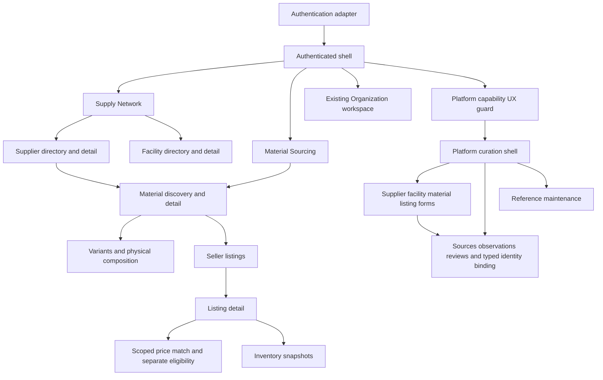

# Phase 1C — sourcing and platform curation UI plan

Status: **PLAN ONLY; implementation requires a subsequent instruction.**

Baseline: PR #2 was squash-merged as `3e0940674bacec355a4f2d4c273bddf11c228508` on main. Its reviewed head was `c9daa5b46fb254fb00b2c9f6e67be9371cf4231c`. The new `phase-1c-ui` branch was created and pushed at that exact main SHA before this document was written. The old supply-network branch remains unchanged.

This plan inspects [OpenAPI](openapi.json), [generated types](../apps/web/src/api/schema.ts), the current [app](../apps/web/src/App.tsx), [client](../apps/web/src/api/client.ts), [primitives](../apps/web/src/ui/index.tsx), and backend controllers/services. Routes below are proposed **browser routes**; backend operations are listed separately and must already exist. No application code, contract, dependency, infrastructure or migration changes accompany this document.

## 1. Goals

Help an authenticated sourcing user identify suppliers/materials, inspect seller offers, understand a scoped price, and distinguish stock knowledge from unknown data. Give PLATFORM_ADMIN a coherent evidence-backed curation workflow. Preserve Organization != SupplierProfile != Facility and catalog Material != seller Listing. Optimize the sequence: identify the right record, compare viable listings, understand price scope, inspect stock/source confidence, then inspect evidence where authorized.

## 2. Explicit non-goals

No Phase 2 RFQ, Quote, quote comparison, samples, BOM, Tech Pack, Production Order, QC workflow or Shipment. No checkout/payment, supplier self-service, claim workflow, AI matching, global material ontology/merging, FX/unit conversion, reservations/allocation/ATP, new domain model, database table, migration or infrastructure. No Next.js, Redux or GraphQL adoption. No raw source payload/HTML/full API-response viewer. This task implements none of the proposed screens or routes and creates no Phase 1C PR.

## 3. Target users and authority

| Surface | User task | Authority |
| --- | --- | --- |
| Discovery workspace | Browse suppliers, facilities, materials, listings and authorized read data | Existing authenticated Actor; no invented BUYER role |
| Platform curation workspace | Maintain canonical facts, evidence, identities and references | Active PLATFORM_ADMIN, checked by backend on every command |
| Existing organization workspace | Maintain organization information | Existing membership rules; separate from canonical curation |

ORG_OWNER/ORG_ADMIN and a supplier-linked organization do not grant canonical edit rights. Organization selection is optional context for discovery and never changes canonical ownership or authorization. People retain issuer + subject identity; no frontend user/domain identity model replaces Actor.

## 4. Information architecture

Three groups: **Supply Network** (Suppliers, Facilities; capabilities as filters/reference context), **Material Sourcing** (Materials, with variants/listings/prices/inventory in context), and **Curation** (canonical records, evidence/identity, references). Retain Overview and Organization. Avoid a top-level page for each endpoint, price row, variant or composition component. Start with navigation plus contextual sections, not dashboards of unsupported aggregate metrics.

## 5. Proposed route map

| Browser route | Purpose |
| --- | --- |
| `/`, `/organization` | Existing overview/organization workflows, retained during shell transition |
| `/sign-in` | Authentication adapter entry; production IdP/callback details require review |
| `/suppliers`, `/suppliers/:id` | Directory and supplier detail with facilities/catalog/seller sections |
| `/facilities`, `/facilities/:id` | Physical-site directory/detail; dependent on contract gap A1 |
| `/materials`, `/materials/:id` | Material discovery and catalog detail |
| `/material-listings/:id` | Seller offer, scoped price/history and inventory knowledge |
| `/admin/suppliers`, `/admin/suppliers/:id` | Search/contextual supplier edits, aliases and legal verification actions |
| `/admin/facilities`, `/admin/facilities/:id` | Facility/capability curation; dependent on A1 |
| `/admin/materials`, `/admin/materials/:id` | Catalog, variant, subtype and composition curation |
| `/admin/listings`, `/admin/listings/:id` | Offers within a selected material or seller; no global listing API exists |
| `/admin/sources` | Providers and explicit record-registration/observation/review workflows |
| `/admin/reference-data` | Country, region, cluster, capability and fiber tabs |

Use query parameters for applied filters, selected tab, variant/listing context and supported cursors. Dialog/drawer state can stay local except where reload/deep-linking matters. A subtype, verification event, observation or price-close operation does not need its own navigation destination.

## 6. Navigation model

Desktop sidebar groups stay small; directory/detail breadcrumbs name catalog supplier and seller explicitly. Material detail links to a seller offer without losing the applied discovery URL. Listing detail links back to its material and seller. Store the return URL as validated same-origin route state. Show curation navigation only after a successful platform capability check; pending capability is neither an authorization grant nor a permanent denial. UUIDs and external record IDs stay in secondary/admin details with copy actions, not primary titles.

## 7. Supplier and facility UX

Supplier discovery uses actual `GET /api/v1/suppliers` filters: country alpha-2, role, verificationStatus, facilityCountry, region, cluster, capability and q. Facility discovery uses `GET /api/v1/facilities`: country alpha-2, region, cluster, type, capability and supplier. Do not add a facility q filter or archived-status filter that the API does not support. Directory services return ACTIVE records; facility discovery also requires an ACTIVE parent supplier.

Supplier detail: identity and country, roles/status, aliases, verification summary/history, facilities, **catalog materials**, and **offers as seller**. Read operations are supplier detail plus `/aliases`, `/verification-events`, `/facilities`, `/catalog-materials`, `/material-listings`. Related facilities/materials use their actual page contracts. Facility detail: parent supplier, type, geography, address where authorized, and `/facilities/{id}/capabilities`. Facility capability verification is UNVERIFIED/DOCUMENTED/AUDITED per assignment, not an invented facility-wide supplier verification ladder. Facility and Supplier remain different entities. Existing archived detail URLs can still resolve, but current directory APIs cannot provide a complete archived-record management list (gap B4).

## 8. Material discovery and results

Use `GET /api/v1/materials`. Keep physical, commercial and scoped-price filters in visibly separate groups; support an applied-filter summary and an explicit Apply action. q may debounce, but the entire applied filter/cursor changes atomically. Default discovery can explicitly send material `status=ACTIVE`; historical detail/price reads must remain available for archived records.

| Group | Actual API parameters | UX rule |
| --- | --- | --- |
| Physical | materialType, catalogSupplierId, originCountryId, fiberTypeId, min/maxFiberPercentage, min/maxGsm, min/maxWidthMm, min/maxThicknessMm, q, color, variantId, status | Fiber percentage requires a fiber; known origin is independent of supplier country |
| Current listing terms | sellerSupplierId, maxMoq, maxMcq, quantityUnit, min/maxLeadTimeDays, listingStatus | All predicates concern one Listing; null terms fail only an explicit corresponding filter |
| Price | maxPrice, priceDataSourceId, currency, priceUnit, asOf, requestedQuantity, allowMaterialFallback | maxPrice requires provider/currency/unit/explicit asOf; fallback initially false; omitted quantity means base prices only |

Backend SearchText normalization is authoritative; never normalize source identities as search text. Color without variantId searches all matching Variant contexts; price must match one such Variant, with material fallback only when explicitly enabled. Do not reimplement this matching across a fetched catalog in JavaScript.

When the price-filter group is disabled, omit every price-only parameter, including its draft asOf/requestedQuantity/fallback; keep independent physical color/variant criteria. The backend rejects a price scope without maxPrice. Turning the group on requires its complete scope before Apply.

Initial result table/card: Material display name, catalog article, type, **catalog supplier**, origin, composition/completeness and a physical-summary affordance. Composition is already returned; optional Fabric/Leather details load on expansion, not for every result. Known MOQ, price and inventory appear only inside a named Listing/scope context. MaterialView does not contain matched listing IDs, offer totals, specs, price or inventory. Therefore initial rows link to offers rather than fabricate commercial values. An expanded bounded offer list may say **N loaded offers**, not N total sellers. Show a price only with its provider/currency/unit/variant/tier/time context; never a cross-scope best price. Gap B3 covers richer matched-offer projections.

## 9. Material detail

Sections: Overview; Physical specification; Composition; Variants; Seller listings; scoped Prices/Inventory through the selected Listing; authorized Sources. Use existing material, `/fabric-spec` or `/leather-spec`, `/variants`, and `/listings` reads. Fetch only the subtype matching materialType. A valid optional spec 404 means no entered spec; a material 404 remains record-not-found. COMPLETE/PARTIAL/UNKNOWN labels come from the API, not a guessed sum; PARTIAL totaling 100 still remains PARTIAL. Variant selection changes the explicit price context and resets its cursors. A color can be a discovery filter without inventing one selected winning variant in MaterialView.

Use **Catalog supplier** for the catalog owner and **Seller** for the offer owner. A listing belongs to the material but can have a different supplier as seller. Catalog article and seller article are separate labels. Related offer reads show all returned offers, not a claim that every offer matches the original material-search filters.

## 10. Listing UX

Listing detail is the main commercial workspace: seller/article, current MOQ and MCQ with quantityUnit, both lead times, status, then Price and Inventory sections. Read via `GET /api/v1/material-listings/{id}`. Show missing MOQ/MCQ/lead time as unknown, including separate unknown-unit state; known zero stays zero. MCQ is a color-lot term and is not automatically compared with total requested quantity or a generic Variant.

Material and seller child lists are bounded offset arrays. `/admin/listings` first selects a material or seller; never fetch all materials to simulate an absent global Listing collection. Direct `/admin/listings/:id` uses the existing detail read. Compare visible offers through labeled columns; do not create a quote/RFQ comparison model, currency conversion or inferred stock availability.

## 11. Price UX

Two modes: **Current price match** omits asOf; **Specified-time price** sends an explicit UTC instant. Material discovery price filtering always uses its explicit asOf and must not imply historical orderability. The Listing resolver uses requestedVariantId/requestedQuantity/dataSourceId; the Material search uses variantId/requestedQuantity/priceDataSourceId. Typed endpoint adapters must map these actual names, not invent one shared request contract.

Display provider identifier/name when available, amount/currency/priceUnit, VARIANT_EXACT/MATERIAL_FALLBACK/MATERIAL_EXACT or NO_MATCH, tier minimum, valid interval and observation time. Preserve independent provider/currency/unit scopes. No quantity means base-only resolution, with the full tier/history list still available separately. A returned NO_MATCH in one paginated scope is not proof that every unloaded provider has no price. Load more through the resolver nextCursor without replacing its captured asOf.

A separate panel shows current Listing terms, listingTermsScope and commercialEligibility: ELIGIBLE, INELIGIBLE, UNKNOWN_TERMS, NOT_EVALUATED_FOR_HISTORICAL_QUERY. MATCHED + UNKNOWN_TERMS is valid. Specified-time results explicitly state that historical Listing terms are not reconstructed. Price matching remains readable after archive/term edits. Material fallback has a visible badge; no cheap material fallback overrides a higher-ranked eligible exact-variant price. Price history is read-only; immutable facts are never editable fields. Exact-decimal transport is a release dependency for unrestricted numeric precision (gap A2).

## 12. Inventory UX

`/material-listings/{id}/inventory` is latest knowledge per variant/location/unit/capture-mode/provider scope; `/inventory-snapshots` is history. Display separate rows with variant, physical facility/location, quantity/unit, observedAt, recordedAt and captureMode/evidence reference. InventoryView supplies sourceObservationId for imported rows, not provider name or dataSourceId; do not invent those response fields. Unknown facility is distinct from a known facility whose label failed to load. A facility may belong to a third-party warehouse; no seller-ownership restriction is added.

A successful empty quantitative result means **No stock observation / unknown stock**, while a quantity of zero means **Known zero stock**. A failed request means unavailable, not unknown or zero. Keep observation times visible. Never sum history or combine providers, locations, units or manual/imported rows into available stock. No Reserve, Allocate, ATP or transactional stock-edit controls.

## 13. Admin UX and commands

Reuse read summaries plus focused forms. PLATFORM_ADMIN is checked on every backend mutation. Admin directory/reference forms dependent on legacy schema collision resolution remain gated by A1. Command paths in the following table have the `/api/v1` prefix.

| Task | Existing command family | Form behavior |
| --- | --- | --- |
| Supplier and aliases | POST `/admin/suppliers`; PUT `/admin/suppliers/{id}`; POST `/admin/suppliers/{id}/aliases` | Evidence required; preserve version; archive through status |
| Supplier verification | POST `/admin/suppliers/{id}/verification-events` | Only supported transitions in section 15 |
| Facility and assignment | POST `/admin/facilities`; PUT `/admin/facilities/{id}`; PUT `/admin/facilities/{id}/capabilities/{capability}` | Parent/site geography and per-capability terms; use operation-specific unit enum |
| Material/variant | POST `/admin/materials`; PUT `/admin/materials/{id}`; POST `/admin/materials/{id}/variants`; PUT `/admin/material-variants/{id}` | Immutable supplier/type/parent shown read-only, even where update DTO requires the same values |
| Specs/composition | PUT `/admin/materials/{id}/fabric-spec`, `/leather-spec`, `/composition` | Correct subtype only; own spec version or parent Material version; atomic composition replacement |
| Listing | POST `/admin/material-listings`; PUT `/admin/material-listings/{id}` | Immutable material/seller, versioned terms; manual create has no retry-idempotency guarantee |
| New price/evidence | POST `/admin/material-prices`, `/admin/material-price-imports`; POST `/admin/material-prices/{id}/sources` | Manual evidence 1..100 from provider; import auto-includes its required observation; optional UUID command key retained across retries |
| Price closure | POST `/admin/material-prices/{id}/close` | Confirm validTo and expected version; close once, refresh history/resolver; no edit/reopen |
| New stock knowledge | POST `/admin/material-inventory-snapshots` | IMPORTED observation or MANUAL scoped key; no body actor; every correction is a new row |
| Sources/observations/reviews | POST `/admin/sources`; PUT `/admin/sources/{id}`; POST `/admin/source-records`, `/admin/source-observations`, `/admin/source-observations/{id}/reviews` | Structured facts only; no mutable observation/review editor |
| Reference data | Existing country PATCH, region/cluster/capability/fiber POST/PUT | No country-create route; country/source identity codes read-only; reference active flags allowed |

Confirm archive, price closure and permanent identity binding with a clear subject and consequence. Ordinary edits get inline validation, not confirmation noise. No DELETE controls. Price closure flow: view immutable facts → enter/confirm validTo → send expected version → refetch. On closure 409, reload and explain current state; never auto-reopen or retry against a new version.

## 14. Provenance and identity UX

Separate **External identities** (record identifies canonical entity) from **Evidence** (observation supports a fact). Use the existing typed `/admin/{suppliers,facilities,materials,material-variants,material-listings}/{id}/external-records` commands and corresponding `/sources` reads/appends; price has its own evidence endpoint. No polymorphic source blob or rebind/unbind action.

Curation starts from an authorized provider and an explicitly known record, or an explicit **Register/reuse source record** command with provider, recordKind and exact external key. POST `/admin/source-records` is a mutation and must not be disguised as passive search. Its returned ID enables bounded GET `/admin/source-records/{id}/observations`, observation registration and review history. Review updates append a new review. Required evidence selection must precede dependent canonical forms; source codes and normalization policy are not search-normalized. Freeze source identity/normalization controls conservatively after creation when current API cannot prove a policy change is safe.

Current contract cannot enumerate existing bindings by canonical target, browse all records, or fetch an observation directly by ID. Show only actually returned citation links and their association time, not invented observation metadata. Exact binding and evidence inspection gaps are recorded below. Admin can submit a known reference after confirmation; a 409 does not authorize creating duplicate canonical entities. Buyer detail does not request admin-only provenance endpoints; hide internal actor/record metadata from the ordinary discovery surface even where a separate read returns it.

## 15. Verification UX: actual legal actions

Inspected `SupplierService.verify`: the only accepted target statuses are **DISCOVERED, VERIFIED, AUDITED**. The current target is rejected with 409; expected supplier version, a nonblank reason and an existing observation are required. The service does not require monotonic progression: any different target in that three-status set is currently allowed, including correction/downgrade. Present a **Change verification status** form with those targets minus the current value, rather than a next-step ladder wizard.

CLAIMED, TRANSACTED and PROVEN may appear as read status values, but have no current transition buttons. Do not implement claim, transaction evidence inference or self-service. Verification event history is read-only and distinct from supplier lifecycle ACTIVE/ARCHIVED. Facility capability UNVERIFIED/DOCUMENTED/AUDITED is a different enum/workflow. Reasons and observations remain explicit; a failed/stale request leaves the form recoverable.

## 16. Data fetching and query keys

Use existing openapi-fetch + generated `paths`/`components`; TanStack Query owns server state. Derive filter/command types from the operation contract, with UI-only form/transport adapters. No copied global entity store, handwritten replacement Facility schema or unsafe casts to conceal A1.

Proposed keys: `['supply', sessionKey, resource, 'list', appliedFilters, limit]`; `['supply', sessionKey, resource, id]`; child keys add parent ID, child kind and complete scope (variant/provider/currency/unit/asOf/quantity/fallback where applicable). `useInfiniteQuery` carries the opaque cursor or offset in pageParam, not a different root key per page. Source/evidence/admin keys are also session-scoped. sessionKey is an opaque in-memory identity-session marker, never an access token. Clear/cancel queries and selected organization state on actor issuer/subject change, logout or expired-session reset.

URL search parameters own applied discovery state; form drafts remain local. Canonical supply queries do not become organization-owned when the selected organization changes. Reference data can use a longer stale time; dynamic terms/prices/inventory get short, intentional freshness and explicit observed-time labels. Propagate AbortSignal on changed filters; do not let a late response replace a different query's results.

## 17. Mutations and invalidation

| Successful command | Invalidate/refetch |
| --- | --- |
| Supplier/facility fact, alias, status or verification | Detail, relevant directory pages and supplier facility children; active-only lists may remove archived rows |
| Material/variant/spec/composition change | Material/variant/subtype/composition detail, all affected material-search pages; composition refreshes parent Material version |
| Listing terms/status | Listing detail, material/seller offer children, material search and effective-price **current eligibility**; historical price facts are not overwritten |
| Price create/close | Listing price history, all affected resolver scopes and material searches with price filters |
| Evidence/binding append | Authorized evidence/identity panels and any review/verification summaries actually affected; never synthesize a binding read response |
| Inventory insert | Listing latest/history scopes; never optimistically add quantities to existing stock |
| Reference/source/review change | Owning reference/source list, bounded children and affected label/evidence queries |

Use conservative prefix invalidation for material discovery after commercial changes because its complete matching scope is server-owned. Detail responses may seed their exact typed query; server-refetch remains authoritative. Avoid optimistic canonical writes at first. Keep submitted draft values on 409, refetch current data/version and show a recoverable comparison. Do not auto-resubmit with the new version. Permission loss invalidates the capability probe and removes stale admin actions.

Automatic retries are for safe GETs only (bounded transient/network retry, never 401/403/404/409). Retain the same manual Price UUID command key and immutable body across an intentional uncertain-outcome retry; valid new evidence can append once. Imported price uses the server's observation/itemKey scheme, not a generated display-name identity. Inventory retains its listing-scoped manual key or imported observation identity. Manual Listing create has no idempotency contract: on ambiguous failure, keep the draft and direct the admin to inspect contextual listings before any explicit repeat. Disable duplicate submissions while pending; disabling alone does not make a command idempotent.

## 18. Authentication and authorization UX

`GET /api/identity` returns issuer/subject only. There is no current-role/capability endpoint. For the initial UX, a session-scoped **read-only** probe of existing `GET /api/v1/admin/sources?limit=1&offset=0` can establish current platform access: 200 enables curation, 403 hides/denies it, 401 returns to authentication. A network/500 result is an unknown capability with Retry, not an inferred grant or permanent denial. Do not infer PLATFORM_ADMIN from organization role, supplier link, token text or the local development subject. This is a UX guard only; backend commands remain authoritative and handle revocation races.

Lazy-load admin bundles behind that guard; a direct admin URL still shows pending/403/401 states correctly. Local subject entry stays DEV-only. Production currently has an in-memory setAccessToken hook but no completed sign-in/refresh integration. Confirm IdP/client/audience/callback/refresh/logout requirements before a production release (A3); do not invent a backend login or role-grant endpoint. No token in URL, localStorage, query key, logs or support diagnostics. Cancel and clear session-owned caches on identity changes.

## 19. Form architecture

Use React Hook Form for draft, touched/dirty and submission state; Zod for UI validation around generated request types. Small field adapters for nullable decimals, reference selection, units, evidence and errors are justified; avoid a schema-driven generic CRUD framework. Keep blank optional numeric fields as null/omitted as required by that operation, never Number('') or zero. Distinguish clear-value intent from unknown data. Preserve immutable parent/supplier/type fields in required update DTOs while rendering them read-only.

Numeric drafts remain strings until validated; do not silently round excess scale. Currency, unit and allowed scalar attributes follow their operation contract. Full-range numeric(19,4) read/write cannot be guaranteed by ordinary JavaScript number serialization (A2); do not hide that with casts or a second domain model. Composition validation can use exact scaled integers for the bounded 0..100/four-decimal range, then submit one completeness/parts command with parent version. UNKNOWN means no rows, PARTIAL requires positive components with sum <=100, COMPLETE exactly 100. Backend deferred integrity remains authoritative.

Specs expose physical fields only, correct subtype and version. Do not offer unrestricted JSON editors for approved attributes or source payloads. Every relevant canonical form has an evidence context. Manual Price requires at least one same-provider observation, while imported Price automatically includes its mandatory observation; do not force redundant input. Stock forms separate IMPORTED and MANUAL; switching mode clears incompatible identity fields and never accepts actor input. Stable identity bindings keep source key normalization rules unchanged.

## 20. Cursor and child pagination UX

Use default 25 and maximum 100 where supported. Large directory/material/price/inventory collections consume nextCursor with Load more or cursor-backed Back/Next using stored visited cursors. No arbitrary page number, total-page count or client-computed global total. Reset cursor/page history when any scope/filter changes; pass opaque cursors unchanged. A cursor rejected after filter change returns to first page with the visible filters preserved.

Bounded child arrays use their actual limit/offset contract: variants, material/seller listings, reference lists, source observations/reviews and citations where exposed. Continue offset by the requested limit while a full page is returned, without claiming an unknown total; stop on a short/empty response and respect backend bounds. Supplier aliases and verification history are currently capped at 100 with no continuation; label the visible history as limited rather than invent Load more. Effective-price group pagination preserves the first server-captured asOf through its cursor. Do not rerun each subsequent page at a different time.

## 21. Loading, error, empty, partial and unknown states

| State | Behavior |
| --- | --- |
| Initial loading | Labeled skeleton/progress, stable heading; no temporary zero prices/counts |
| Valid empty search | No matching records, show applied filters and Clear filters |
| Valid unknown fact | Explicit unknown/not entered; no red error and no fake numeric default |
| Partial child/label failure | Keep loaded canonical facts; retry only failed section and distinguish failed label resolution from unknown business data |
| 401 | Expired/absent-session UX and return path; clear session-sensitive data appropriately |
| 403 | Access denied; no grant/claim CTA or organization-role workaround |
| Detail 404 | Record not found; subtype optional-spec 404 handled as unentered spec in its known parent context |
| 409 | Keep draft, reload current version/state, explain stale/conflicting/closed/identity constraints; never silently overwrite |
| 400 | Field or scope validation; incomplete price-scope filters are caught before request |
| 500/network | Retryable section error with request ID; no raw server/auth dump or automatic unsafe POST retry |

Adapt existing Problem Details transport using HTTP status, safe parsed detail and X-Request-ID/body requestId. Current OpenAPI lacks a ProblemDetail schema/error responses, so a small defensive transport-envelope validator is appropriate; it is not a replacement business schema. Do not assume every error is JSON. A minimal support copy action carries safe status/reference, not token, body or full authenticated request.

## 22. Component and design-system recommendation

Continue existing CSS tokens and Button/Input/StatusBadge/Surface/PageLayout/Stack/Skeleton/EmptyState/ErrorState primitives. They already establish restrained green/neutral surfaces and clear focus styling. Add a small set of task components in later implementation: labeled nullable fields, filter sections, accessible native tables, scope/unknown badges, bounded collections and confirmation dialogs. Extend current primitives only as needed; no large framework or icon dependency for styling. Prefer native select/details/dialog where behavior is sufficient. A small accessible headless layer needs a concrete interaction/cost justification and review before dependency adoption.

## 23. Accessibility

Semantic landmark/nav/headings, skip link, labels and descriptive button names; do not use placeholder-only fields. Table caption and th scope, sortable state only for supported sorts, accessible status text beyond color. Visible keyboard focus, no focus loss on filter application or Load more, aria-live announcements for results/errors without reading the whole table. Confirmations manage initial focus, Escape/cancel, focus return and pending submission. On validation, focus the first invalid field or error summary; preserve typed values. Test contrast, zoom/reflow, keyboard-only flow and modal focus manually and in focused browser assertions. No inaccessible custom combobox solely to imitate consumer UI patterns.

## 24. Responsive strategy

Desktop/laptop first: sidebar, filter rail or grouped toolbar, useful dense tables and contextual detail sections. On tablet/mobile, collapse navigation/filters and use horizontally scrollable labeled tables or compact cards with the same facts. Preserve price scope, unknown-state text and accessible actions; do not drop units/provider/validity to fit a screen. Avoid consumer mobile gestures or duplicate domain logic in two layouts. Desktop has the initial density budget; smaller screens remain usable for review and bounded edits.

## 25. Test strategy

Vitest + React Testing Library exercise behavior with generated-contract-shaped fixtures: serialization/omission, numeric null versus zero, filter reset/cursor navigation, Material versus Listing labels, color/variant price context, base-only absent quantity, explicit fallback, grouped prices, specified-time versus current eligibility, and stock unknown/zero/error. Test all eligibility values, stable asOf across scope pages, partial child data, 401/403 and 409 preserved drafts. No snapshot-only acceptance.

Test admin navigation/actions for positive platform probe, non-admin/ORG_OWNER/linked-organization denial, capability unknown and revocation. Verify actor switching clears caches and that an admin's evidence data cannot survive into a buyer session. Test evidence required on manual price, automatic import evidence, idempotent intentional retry, no Listing auto-retry, and one-time close handling. Do not fabricate legal verification transitions from the enum. Baseline organization tests remain, but their assertion that Materials navigation is absent must be deliberately revised only when that navigation is implemented. Every slice typechecks, builds and runs its relevant unit/browser tests before advancing.

## 26. Playwright flows

Maintain a small real-API set on PostgreSQL-backed local/test services; use synthetic fixture provisioning only in test/local operation, never a public admin bootstrap endpoint or production admin seed. Preserve the current organization smoke flow as a regression.

Required flows: authenticated Material search → filter and cursor navigation → Material → selected Listing → scoped effective price and inventory; supplier → facility/detail/capabilities once A1 is resolved; exact/color Variant and explicit fallback labels; specified-time price with NOT_EVALUATED_FOR_HISTORICAL_QUERY; valid empty stock versus known zero; ORG_OWNER/linked buyer sees no canonical edit controls and direct admin request is denied; platform admin registers/selects evidence → edits a Material/Listing → refreshes dependent views; stale version conflict preserves the draft; price creation retry does not duplicate facts, then close once and show closed history. Verify UI controls and real backend authorization; do not mock every end-to-end response. Targeted transport/network-error interception is appropriate in component tests, with limited browser interception only for difficult recovery states.

## 27. Performance approach

Route-level lazy boundaries: discovery shell, supplier/facility detail, material/listing detail and admin workspace. Reuse one QueryClient and generated client. Cancel superseded reads, bound child collections and cache pages, and fetch optional specs/evidence only on demand. Default 25/max 100; no giant all-data fetch, client-side full-catalog filter or all-Listing fanout to reconstruct Material search. Reference pages may be cached around five minutes, details around 30 seconds and current commercial/stock reads briefly (initial suggestion 10 seconds); observed times remain visible and these are freshness policies, not availability guarantees. Current-price Refresh starts a new asOf/cursor sequence; historical queries can also gain later imported facts.

Bound the retained/rendered page window; evaluate a cursor-backed table before a virtualized grid. Virtualization, extra indexing and external search engines require measured need. Record route bundle size, request fanout and interaction latency on representative loaded pages during implementation; no production benchmark is claimed by this plan.

## 28. Minimal observability

Use the existing request ID pipeline. Show a copyable reference in failure details and preserve it in the safe transport error adapter. Local diagnostic context may include operation name, status and correlation ID, never access token, Authorization/dev headers, raw bodies, source payloads or sensitive identity metadata. Keep secrets out of URLs, analytics and query keys. Existing error boundaries handle render failures with a safe recovery action. No third-party telemetry stack, browser event pipeline or new backend observability infrastructure is needed for Phase 1C.

## 29. Implementation slices and dependency order

The proposed order prioritizes the already distinct Material contracts and puts source/evidence selection **before** evidence-required admin forms. It differs from putting all provenance work last. A1/A2/A3 are explicit dependencies, not permission to fix backend code inside this planning task.

| Slice | Scope | Dependency/review gate |
| --- | --- | --- |
| 1C-1 | Authenticated shell, React Router lazy boundaries, query/error adapters, current primitives and capability-probe UX | Production auth decisions A3; local synthetic sign-in can exercise development flows |
| 1C-2 | Material discovery, URL filters, cursor pagination and supplier, country and fiber references and a basic Material detail destination | 1C-1; no Facility/capability schema workaround |
| 1C-3 | Full Material detail, variants, seller Listing detail, effective/history price and inventory read views | 1C-2; A2 resolution or an explicitly reviewed precision envelope for release; provider-label limits visible |
| 1C-4 | Supplier/facility directory/detail, aliases, facilities, capabilities and contextual catalog/seller links | 1C-1; A1 must be separately resolved for Facility/capability contracts |
| 1C-5 | Admin sources, known-record registration/observation/review and required evidence selection; country/region/cluster/fiber reference basics | 1C-1; no fabricated global source-record lookup; capability reference editing also waits for A1 |
| 1C-6 | Admin Material/variant/spec/composition/Listing curation and targeted invalidation | 1C-2 + 1C-5; explicit uncertain Listing-create behavior |
| 1C-7 | Admin supplier/facility/capability verification/curation; Price create/evidence/close, inventory insert and typed identity binding | 1C-4 + 1C-5 + 1C-6; A2 for unrestricted decimal forms; existing-binding inspection limited by B2 |
| 1C-8 | Cross-workspace recovery, keyboard/responsive/performance checks and real-API browser hardening | All preceding delivered scopes green; production release also requires A3 |

1C-2/3 can make useful progress while an independently reviewed A1 contract correction is pending. Do not mark the complete directory/admin slices accepted while their blocking fields rely on casts or invented types. Split an oversized slice further without weakening its checks; do not add unrelated backend/domain work.

## 30. Acceptance criteria per slice

Every slice must compile, typecheck, pass behavioral unit tests, production build and relevant browser tests before the next dependent slice. Contract regeneration must remain consistent; any approved future API correction is separately reviewed. Preserve existing authorization/module/migration regressions and CI coverage. The baseline main CI is evidence of existing Phase 1A/B behavior, not tests of unimplemented Phase 1C screens.

| Slice | Required behavior demonstrated |
| --- | --- |
| 1C-1 | Existing organization flow preserved; deep links and lazy routes work; safe 401/403/500/request-ID handling; role probe unknown/denied/success and actor-cache reset tested |
| 1C-2 | Complete physical/commercial/price scope serialization; no implicit null-to-zero; filter reset/cursor return; loaded-count honesty and no unsupported best-price claim |
| 1C-3 | Catalog supplier != seller; explicit variant/fallback/tier/time semantics; current eligibility separate; archived history available; unknown/zero/unavailable stock distinguished |
| 1C-4 | Directory filters use actual names/country codes; Supplier != Facility; legal API contract types; bounded related data and no invented archived/facility-q query |
| 1C-5 | PLATFORM_ADMIN-only surface; register/reuse is an explicit mutation; same-provider observation selection; append-only reviews and supported reference commands; no raw payload or fake identity list |
| 1C-6 | Immutable identities stay read-only; evidence/version fields are correct; COMPLETE composition is atomic; 409 preserves draft; archive and uncertain manual create are explicit |
| 1C-7 | Supported verification targets only; manual/import price evidence and retry rules; close once with version; stock corrections append; permanent binding confirmation and conflict recovery |
| 1C-8 | Major browse/admin flows exercise the real backend; keyboard/dialog/table access, narrow-screen use, bounded request fanout, safe diagnostics and all existing regressions verified |

Do not assign invented future test totals or claim green for UI that has not been built. Plan-only validation checks document scope and references; it does not rerun or replace the existing application suites.

## 31. Known limitations

The current frontend is a Phase 0 shell with two unit tests and one browser smoke; Phase 1C behavior tests are planned, not existing. Backend main was accepted with 150 backend tests, but generated-contract consistency alone does not prove every legacy schema is semantically correct. Material hit rows lack matching Listing references and commercial aggregates; child/reference resources have bounded reads; some histories cap at 100. No global Listing/source-record index is exposed. Manual Listing create is not retry-idempotent. Full-scale performance and production IdP validation remain open. Archived Supplier/Facility recovery and detailed identity/evidence inspection have API limits. These constraints must be visible in UX and slice acceptance rather than hidden with frontend guesses.

### Backend gaps / Phase 1C blockers

Classification: **A = true blocker for the specified release/slice**, **B = useful enhancement with an honest bounded fallback**, **C = defer/out of scope**. Only document them here. No new API, contract change or migration is implemented or authorized by this plan commit.

| ID/class | Observed evidence and affected UX | Safe plan / review needed |
| --- | --- | --- |
| A1 — typed legacy contracts | OpenAPI GET `/api/v1/facilities/{id}` references `View` whose fields are SupplierProfile fields (displayName/roles), while FacilityService.View requires supplierId/facilityType/name. Facility POST/PUT and Capability POST/PUT reference supplier-shaped `Input`; GET `/capabilities` also references supplier-shaped `View`. Facility identity import references `IdentityInput` with supplier rather than facility; shared Citation also cannot faithfully express both fact enums. | Blocks truthful generated-type Facility/capability forms/detail and affected identity/citation UI. Request a separately authorized, narrow backend schema-name/reference correction plus semantic contract tests and regeneration; keep paths/domain/schema unchanged. No handwritten replacement DTOs or unsafe casts in Phase 1C. Supplier and distinct Phase 1B contracts can proceed where correct. |
| A2 — exact decimal transport | Price/quantity fields support numeric(19,4), but OpenAPI/TypeScript expose JSON numbers. Ordinary JS parsing of 999999999999999.9999 loses its four-decimal value before formatting/round-trip. | Blocks a promise of full supported precision in Price/stock/commercial forms and exact display. Review an exact-decimal transport strategy, or an explicitly bounded release policy with rejected out-of-envelope input. Do not silently round, stringify against an incompatible generated contract, add FX arithmetic or redesign the domain. No transport fix in this task. |
| A3 — production authentication readiness | Client only has an in-memory token setter and DEV local subject; `/api/identity` reports the authenticated Actor, not an interactive sign-in flow. No production frontend IdP integration is present. | Production release dependency, not a local-development blocker or missing supply-domain model. Review existing IdP/client/PKCE-or-provider adapter/callback/refresh/logout configuration and validation. No invented login/bootstrap HTTP API or production synthetic admin. |
| B1 — capability introspection | `/api/identity` has issuer/subject, no platform capability field; no platform-role read endpoint is exposed. | Existing authorized GET `/admin/sources?limit=1` can be the UX probe; server remains authoritative. A dedicated current-capability read would reduce coupling, subject to separate review. |
| B2 — identity/evidence inspection | Binding POSTs exist but no canonical-target binding GET. No source-record collection/detail lookup or direct observation-by-ID GET; citation reads expose observation IDs/association facts, not complete source-record metadata. | Full identity/evidence browsing cannot be claimed complete. Use explicitly known/registered records, their bounded observation/review reads and returned citations. Existing-binding inspection remains visibly unavailable; a complete inspection experience requires separately approved read projections. Do not synthesize from local mutation history or call a write as passive lookup. |
| B3 — discovery commercial summary | MaterialView has no matchedListingIds, counts, resolved physical-spec summary or scoped commercial projection. | Initial Material rows show catalog facts and offer links. Child panels show loaded offers and independently scoped Listing results, not all matching offers or exact totals. A match-reference projection is a future enhancement; no client full-catalog/Listing scan. |
| B4 — archive discovery | Supplier/facility search is ACTIVE-only; no status filter/admin archive collection exists. Detail by known ID remains readable. | Keep current detail URL after archive and explicit known-ID access. Do not expose an unsupported archive list; richer archive discovery is a separate enhancement. |
| B5 — buyer-safe labels | Provider names are returned by admin-only source listing; Price outcomes give dataSourceId. InventoryView has sourceObservationId/captureMode but no provider identity/name. | Render the facts actually supplied, keep IDs secondary and source identity unresolved where unavailable. Do not fabricate provider names/confidence. Named buyer-provider filters and richer stock provenance need approved read-only labels/projections. |
| B6 — error/nullability contract detail | Problems handler returns Problem Details, but OpenAPI has no ProblemDetail schema; nullable runtime fields are not consistently represented explicitly as nullable in generated types. | Defensive status/envelope parsing and nullish rendering are possible. Review additive error/nullability documentation as a contract improvement; do not assume absent/null data means numeric zero. |
| C1 — unsupported future workflows | Claim/self-service, production role bootstrap UI, RFQ/Quote/AI/conversion/reservation/transaction-derived verification have no Phase 1C authority. | Defer; expose no future transition just because an enum contains it. No domain extension or infrastructure request follows from these UI ideas. |

## 32. Decisions requiring review before implementation/release

1. Approve the exact Phase 1C slice order and the A1 legacy contract correction as a separate task before affected typed UI. Recommended: keep Material discovery work independent of that correction.
2. Choose A2 exact-decimal transport/release bounds before promising unrestricted commercial data fidelity. Recommended: preserve backend decimal truth; never accept silent JS rounding.
3. Confirm production IdP/client/auth integration and production validation ownership (A3); keep local synthetic fixtures separate.
4. Accept the initial read-only admin capability probe or commission a dedicated capability read (B1). Recommended: probe the existing endpoint for the first UI, without treating it as security.
5. Decide whether complete existing-binding/evidence inspection (B2) is required for the initial curation release or can remain a clearly limited panel pending approved reads.
6. Confirm initial language/date/number presentation (Korean labels are suitable for the current operator; preserve source-native names). Use UTC ISO instants on the wire and visibly labeled display timezone; no currency/unit conversion.
7. Approve the Material result's catalog-first presentation and loaded-offer counts, or prioritize the matched-offer/name projections B3/B5 before demanding commercial summary columns.
8. Confirm desktop density, accessible primitive approach and the three consequential confirmations (archive, close, bind). No new component dependency by default.

All are planning/review items, not consent inferred from silence. This task ends with this single documentation commit on phase-1c-ui; Phase 1C implementation and Phase 2 remain unstarted.
