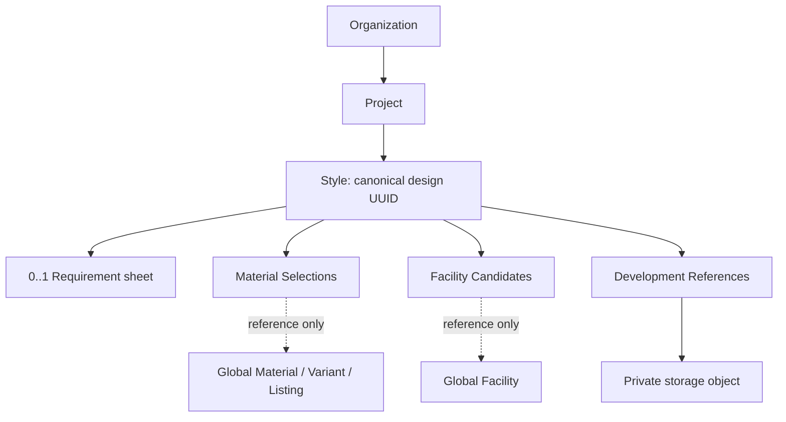

# Phase 2 — Product Workspace contract lock

## 1. Baseline and authority

Decision baseline: `Croco-JY/codex`, accepted main `6eacb4e8d96fabc6b2c03d7d2e6a295db8196283` (PR #3 squash merge). Live main and merged PR state were checked before creating `phase-2-product-workspace` directly at that SHA. Local/remote target branch did not previously exist; the starting worktree was clean. The initial branch HEAD and origin/main both equalled that SHA.

This is documentation and architecture-contract work only. Every Phase 2 DTO, endpoint, table and module below is **planned, not implemented**. Approval of an individual implementation specification is still required before 2A or any later slice starts.

The [Master Specification](source-os-specification.md) defines long-term architecture. Its historical **IMPLEMENT PHASE 0 ONLY** instruction applied to the original task; it explicitly allows later tasks to authorize later work. It is preserved unchanged. The accepted repository roadmap and this explicit task establish current planning authority. Where the historical broad Phase 2 vision includes measurements/Tech Packs/BOM, the narrower boundaries in this lock defer their revision/workflow entities to Phase 3+.

Authoritative roadmap: Phase 0 Foundation; Phase 1 Supply Database / Discovery / Curation; Phase 2 Product Workspace; Phase 3 Product Development / Pattern Operations; Phase 4 SOURCE Pattern AI; Phase 5 Sourcing / RFQ / Quotations; Phase 6 Contracts / Approvals; Phase 7 Protected Payments; Phase 8 Production / QC / Shipment; Phase 9 Intelligence / Reorder. Phase 2 is **not RFQ**. DISCOVER → DEVELOP → SOURCE → TRANSACT → PRODUCE → LEARN remains the sequence.

## 2. Current repository state

| Inspected baseline evidence | Current behavior and consequence |
| --- | --- |
| OrganizationEntity/Service/Controller/View, MembershipAccess | `/api/organizations` is the existing foundation API (not renamed here). Organization creation atomically creates ORG_OWNER membership and audit. Membership is JDBC-persisted issuer+subject; Organization is versioned JPA. Lists require active membership and active Organization. |
| MembershipLookup / OrganizationAuthorization | Organization implements the lookup port; authorization depends on identity, not back on organization. requireRead accepts an active membership; requireWrite permits ORG_OWNER/ORG_ADMIN. VIEWER is read-only. An inactive/missing Organization yields no active membership and thus 403. |
| IdentityService / Actor / PlatformAuthorization | Actor is issuer+subject; no user table. Active PLATFORM_ADMIN is a separate global grant, not an Organization role or tenant bypass. |
| AuditRecorder / Problems / V1–V4 | Audit joins a caller transaction (MANDATORY). Existing record(actor,org,action,requestId) emits ORGANIZATION scope; rich changed/platform methods emit PLATFORM scope. V3 already permits tenant entity/state fields. Existing rich scalar allowlist does not yet include all workspace fields; 2A must add an explicit tenant-scoped target/state method, not misuse changed(). Problems preserves requestId and maps validation 400, access 403, missing 404, integrity/version 409 and explicit 412. |
| StoragePort / AuthorizedStorage / LocalStorageAdapter | Binary put/get is organization-authorized; put generates an object UUID, caps bytes at 10 MiB, and the local adapter uses CREATE_NEW under org/object UUID paths with symlink checks. There is no persistent Style/object association, HTTP upload/download API, delete/list contract, MIME detection or upload idempotency. UUID knowledge alone is not authorization. |
| Material/Variant/Listing entities and public services | Material has immutable catalogSupplierId/type; Variant has immutable materialId; Listing has immutable materialId/sellerSupplierId and **no variantId**. Public immutable read views exist, including archived direct reads. Material statuses DRAFT/ACTIVE/ARCHIVED; Variant/Listing ACTIVE/ARCHIVED. |
| Supplier/Facility services and directory/search projections | Supplier is canonical business, Facility is its site. Directory reads are bounded and ACTIVE-only; known archived detail remains readable. Facility's parent Supplier is immutable. Public read views exist; no active-lifecycle lock contract for candidate registration currently exists. |
| Price/Inventory and V9–V12 | Exact decimal transport, separate match/eligibility/current/history semantics, immutable facts and typed persistent identities are accepted. No private Project owns these catalog facts. |
| SessionProvider, api/session, queryKeys, routes, client/errors | Opaque Actor scopes, abort/clear/remount on Actor change, fail-closed admin gate, safe error references and trusted API origin are implemented. Selected Organization is currently in-memory advisory state; it does **not yet** implement private Organization-switch cancellation/draft boundaries. |
| package-info.java / ArchitectureTest | Top-level Spring Modulith packages declare allowed dependencies. ArchitectureTest invokes ApplicationModules.verify(); private repositories/entities stay internal. Project and Style packages do not exist. |
| OpenAPI/exporter/generated schema | Java/springdoc → scripts/export-openapi.sh → docs/openapi.json → openapi-typescript schema.ts → openapi-fetch. Current paths/types remain authoritative until a separately approved slice generates additions. No planned API is hand-added in this pass. |

V1–V12 were inspected for ownership FKs, unique/composite keys, lifecycle checks, optimistic versions, audit scopes and immutable histories. They remain byte-identical. The current IA now includes sourcing/network reads and protected curation, not merely Overview/Organization. Current-state corrections are in architecture/domain/data/IA docs; roadmap's obsolete Phase 0 stop wording is reconciled without rewriting the master spec or prior completion records.

## 3. Phase 2 goals

Create the first private DEVELOP foundation: Organization → Project → Style. **Style UUID is canonical design identity**. A Style may have one Requirement sheet and bounded private Material Selections, Facility Candidates and generic Development References. Future domains may attach to Style, but none are pre-created. Prefer the existing Java/Spring/PostgreSQL, React/strict TypeScript/Router, RHF/Zod and TanStack Query stack. No new runtime dependency is assumed.

## 4. Non-goals

Phase 3+: MeasurementRevision, Pattern/PatternRevision, grading, TechPackRevision, BOMRevision and Approved Sample workflows. Phase 4: AI Pattern and geometry engines. Phase 5: RFQ/recipients, Quotations/revisions, comparison, shortlist and acceptance. Phase 6+: contracts, approvals, signatures; Phase 7 payments; Phase 8 production orders/execution, QC and shipment; Phase 9 intelligence/recommendations. None is a hidden Phase 2 subfeature.

No new roles, support impersonation, private PLATFORM_ADMIN bypass, catalog mutation through private links, commercial snapshots, FX/unit conversion, inventory aggregation/reservation/ATP, outbox, event sourcing/CQRS framework, Redux, Redis, Kafka, search/graph cluster, microservice or infrastructure. Future durable delivery requires evidence and separate authorization, not a master-spec keyword.

## 5. Global vs private data boundary

| Global Phase 1 truth, never Project-owned | Private Organization workspace |
| --- | --- |
| Material, MaterialVariant, MaterialListing, Supplier, Facility, Price, Inventory, Source, SourceRecord, Observation, Review | Project, Style, StyleRequirement, StyleMaterialSelection, StyleFacilityCandidate, StyleDevelopmentReference |

Private descendants inherit Organization ownership through immutable parent FKs; they need not duplicate organizationId in every table. A catalog UUID reference does not change catalog ownership, acquire supplier permissions, reserve stock or approve BOM/RFQ/commercial terms. Private changes need authenticated Actor audit, not fabricated global SourceRecords/Observations or mandatory catalog evidence IDs.

## 6. Organization authorization model

Use OrganizationAuthorization on **every** private service entry. Active VIEWER reads; active ORG_ADMIN and ORG_OWNER read/write. The existing policy also requires active Organization. No BUYER_MANAGER/BUYER_MEMBER/SUPPLIER_MANAGER/SUPPLIER_MEMBER is assumed. PLATFORM_ADMIN without active requested-Organization membership cannot read or mutate private workspace data, attachments or metadata. No support bypass or new role administration UI.

UI membership roles only hide/disable controls; server enforcement is independent. Pending/error membership/context state mounts no private child query/form. A stale selected Organization object cannot authorize anything. Capability revocation remains relevant to curation; private access instead follows live Organization membership on each request.

## 7. Tenant lookup/error semantics

For well-formed private requests: **A resolve Actor → B requireRead/requireWrite(organizationId) → C tenant-scoped lookup**. Never look up a private identity before the Organization policy. Syntax-level transport errors may be 400 without a resource lookup; they disclose no resource existence.

Project predicate: id=projectId AND organization_id=organizationId. Style lookup must establish that Project, then Style.id=styleId AND project_id=projectId. Every descendant additionally matches style_id and its own ID. Membership failure/insufficient role is 403, including a PLATFORM_ADMIN without membership. Once requested-Organization permission succeeds, absent/foreign Project, Style under the wrong Project, or descendant under the wrong Style is 404. Do not inspect the foreign resource to improve the error message.

After full private hierarchy validation, mutable commands check parent lifecycle and their own version. Parent archive 409 takes precedence over an otherwise valid create-only attempt; stale version 409, duplicate relation 409. Explicit inconsistent global Material/Variant/Listing IDs are 400; missing global referenced ID 404; a known inactive reference is 409. Failed Requirement create precondition 412 remains distinct. No new machine-readable conflict-code framework; use existing Problem Details and safe requestId. 401 follows existing authentication adapters. Unexpected failure 5xx and status 0 network ambiguity retain drafts; AbortError is cancellation.

## 8. Module topology

All entries are **future top-level packages**, with package-private persistence and explicit allowedDependencies. Public contracts return immutable records/IDs, never JPA entities/repositories. No business entity moves into shared.

| Consumer | Allowed providers / reason |
| --- | --- |
| project | authorization, identity, audit, shared; organization public ownership/read contracts if needed. Existing membership policy + DB FK suffice for ordinary ownership validation; never OrganizationRepository/Entity. |
| style | project public parent contract, authorization, identity, audit, shared |
| stylerequirement | style public scoped/lifecycle contract, authorization, identity, audit, shared |
| stylematerialselection | style, material and materiallisting public reference contracts, authorization, identity, audit, shared |
| stylefacilitycandidate | style, facility public reference contract, authorization, identity, audit, shared |
| styledevelopmentreference | style, file public authorized storage contract, authorization, identity, audit, shared |

Allowed spine: descendants → style → project → existing foundation contracts. **project → style is forbidden**; neither foundation nor catalog/file provider gains a reverse dependency on a workspace consumer. Style owns the Project child Styles endpoint; Project read does not embed mutable Styles. This graph is acyclic and must pass Spring Modulith verification in each slice.

2A must introduce public Project parent access and Style context access contracts: scoped read plus a transaction-MANDATORY write guard returning immutable IDs/status. For writes lock Project first, then Style, then child. Project archive/reactivate uses the same Project row lock. All descendant writes, including unlink/detach, participate; a prior unlocked read is not sufficient. This serializes archive-vs-child races without a project→style callback or automatic child updates. Reads use scoped joins and need no write lock. Define named method signatures in the 2A specification, preserving these semantics.

## 9. Project contract

| Field | Locked proposed schema |
| --- | --- |
| id | Required server UUID, canonical Project identity |
| organizationId | Required UUID from path; immutable FK to organization |
| name | Required trimmed nonblank string, max 160 |
| description | Optional text, max 4000 |
| status | Required ACTIVE or ARCHIVED; create always ACTIVE |
| version | Required nonnegative integer; create 0; successful update N→N+1 |
| createdAt / updatedAt | Required server UTC instants, immutable createdAt |

ProjectCreateInput: `{name, description?}`. No caller id/organizationId/status/version/Actor. ProjectUpdateInput: `{name, description?, status, version}`; version explicitly required, not a primitive missing-to-zero default. View contains all fields, with description nullable. Names need not be unique. No reparent or hard delete.

## 10. Style contract

| Field | Locked proposed schema |
| --- | --- |
| id | Required server UUID; canonical design identity |
| projectId | Required path-derived UUID; immutable FK to project |
| styleCode | Optional trimmed string, max 100; empty→absent; case preserved; **no uniqueness constraint**, including within a Project |
| name / description | Required trimmed nonblank name max 160; optional description max 4000 |
| status / version | ACTIVE/ARCHIVED; create ACTIVE/version 0; independent Style version |
| createdAt / updatedAt | Required server UTC instants |

StyleCreateInput: `{styleCode?, name, description?}`. StyleUpdateInput: `{styleCode?, name, description?, status, version}`. No mutable parent field. StyleView includes all fields and nullable optional values. An empty loaded styleCode does not become canonical identity. No reparent/hard delete, inferred code identity or placeholder future entity.

## 11. Lifecycle/archive contract

ACTIVE→ARCHIVED and ARCHIVED→ACTIVE are the only transitions for both aggregates. Exact current owning version is mandatory. No same-state write to an ARCHIVED aggregate is permitted (409). Reactivation of an archived aggregate is allowed only as a lifecycle-only update with its current metadata unchanged; mixed metadata/reactivation input is 400. Once active, metadata may be edited in a separate request. ACTIVE→ARCHIVED may also only change status; ordinary metadata edits use ACTIVE→ACTIVE. Successful ACTIVE updates, including an identical replacement, increment version via explicit versioned persistence rather than relying on JPA dirty detection.

Archived Project: authorized reads of it and all descendants remain allowed. Only its own lifecycle-only reactivation is writable. Creating/updating/reactivating any Style or changing any descendant—including removal/detach—is 409. Archived Style: reads allowed; only its own reactivation is allowed, and only under ACTIVE Project. Requirements/selections/candidates/references cannot change while either parent is archived. Project reactivation never automatically reactivates Styles. No status cascade rewrites children.

Archive-vs-write transactions lock in the order in §8: one operation serializes first; after archive wins, later child writes 409. Test independent connections, not merely sequential UI state. Membership changes are evaluated through current existing policy; this phase does not redesign membership administration or promise instantaneous distributed revocation of a transaction already executing.

## 12. Audit contract

All private mutations emit **ORGANIZATION** scope with the owning organizationId, derived through the authorized path. Actor is IdentityService.current(), never body input. Audit and each database mutation commit/rollback together. 2A prerequisite: add a tenant-scoped target/state AuditRecorder application method using the existing V3 columns and MANDATORY transaction. Do not call platform()/changed() for private data. No audit migration is needed.

Actions are controlled: project/style created/updated/archived/reactivated; requirement created/updated; material_selection/facility_candidate added/removed; development_reference upload_started/ready/failed/detached. Each identifies its typed entity UUID (Requirement uses Style UUID). Allowlisted state: version/status, projectId/styleId and canonical reference IDs, upload state/size where applicable. No raw DTO/entity dump, private description/notes, bytes, credentials or request Actor/org override. Exact domain decimals, if ever audited, are plain strings; no float conversion. Extend the narrow allowlist intentionally per slice. A conflicting/rolled-back mutation emits no success audit.

## 13. API path contract

These are **new planned APIs**, not assertions about current OpenAPI. Existing `/api/organizations` remains unchanged. Exact expansions: `O=/api/v1/organizations/{organizationId}`, `P=O/projects/{projectId}`, `S=P/styles/{styleId}`. Every abbreviated path below expands literally to that hierarchy. No global `/api/v1/projects/{id}` or descendant shortcut is planned.

R=OrganizationAuthorization.requireRead; W=requireWrite, always before scoped resource lookup. Common errors: 400 input,401 authentication,403 Organization policy,404 scoped hierarchy/reference,409 lifecycle/domain conflict; 5xx/network safe recovery. All mutation retries explicitly false. POST random-ID creates are not automatically idempotent.

| Operation / owner slice | Method + exact hierarchical path pattern | Auth | Version / precondition | Success | Important additional errors |
| --- | --- | --- | --- | --- | --- |
| Project list /2A | GET O/projects | R | none; status?, limit, offset |200 ProjectPage |400 invalid page/filter |
| Project create /2A | POST O/projects | W | ProjectCreateInput; server 0 |201 ProjectView |400 invalid input; no auto retry |
| Project read /2A | GET P | R | none |200 ProjectView |404 scoped absent |
| Project update/lifecycle /2A | PUT P | W | ProjectUpdateInput current version |200 ProjectView |409 stale/archived; 400 mixed lifecycle+metadata |
| Styles of Project /2A, Style-owned | GET P/styles | R | none; status?, limit, offset |200 StylePage |404 parent |
| Style create /2A | POST P/styles | W | StyleCreateInput; server 0 |201 StyleView |409 Project archived |
| Style read /2A | GET S | R | none |200 StyleView |404 full hierarchy mismatch |
| Style update/lifecycle /2A | PUT S | W | StyleUpdateInput current Style version |200 StyleView |409 parent archive/stale/archived state |
| Requirement read /2C | GET S/requirement | R | none |200 StyleRequirementView |404 no sheet |
| Requirement create-only /2C | PUT S/requirement | W | If-None-Match: * + RequirementInput version 0 |201 StyleRequirementView |412 exists/concurrent loser; 400 bad header/version |
| Requirement update-only /2C | PUT S/requirement | W | header entirely omitted; exact Requirement version |200 StyleRequirementView |404 sheet absent; 409 stale |
| Selections list /2D | GET S/material-selections | R | limit, offset |200 SelectionPage |404 hierarchy |
| Selection add /2D | POST S/material-selections | W | SelectionInput; no version |201 SelectionView |400 inconsistent refs; 404 missing ref; 409 duplicate/inactive |
| Selection remove /2D | DELETE S/material-selections/{selectionId} | W | no version; immutable edge identity |204 empty |404 absent/wrong parent; 409 archived ancestor |
| Candidates list /2E | GET S/facility-candidates | R | limit, offset |200 CandidatePage |404 hierarchy |
| Candidate add /2E | POST S/facility-candidates | W | CandidateInput; no version |201 CandidateView |404 missing Facility; 409 duplicate/inactive |
| Candidate remove /2E | DELETE S/facility-candidates/{candidateId} | W | no version |204 empty |404 absent/wrong parent; 409 archived ancestor |
| References list /2F | GET S/development-references | R | state?, limit, offset |200 ReferencePage |404 hierarchy |
| Reference upload /2F | POST S/development-references | W | multipart displayName + file; no object UUID/key/Actor |201 ReferenceView only when READY |400 invalid file/name; 413 transport limit; 409 lifecycle; 5xx storage/DB |
| Reference metadata /2F | GET S/development-references/{referenceId} | R | none |200 ReferenceView |404 hierarchy/absent |
| Reference download /2F | GET S/development-references/{referenceId}/content | R | READY required |200 attachment bytes |409 not READY; 404 missing stored content |
| Reference detach /2F | POST S/development-references/{referenceId}/detach | W | `{version}` current reference version |200 ReferenceView |409 stale/already detached/archived ancestor |

Collection envelopes are `{items, limit, offset, hasMore}` with no total. Initial limit 25 / offset 0; limit 1..100, offset 0..100000. ORDER BY created_at DESC,id DESC (Requirement has no collection). Fetch limit+1 to determine hasMore; no browser all-pages preload. Projects/Styles: omitted status means both ACTIVE and ARCHIVED, explicit valid status filters one; UI may apply ACTIVE deliberately. References: omitted state returns all states for upload recovery; explicit filter accepts only §17 states. Offset pages are not a historical snapshot; after insert/unlink/detach reset to the first sequence. No q/sort/cursor parameter is invented in this minimal private contract.

All input schemas reject foreign ownership/Actor fields rather than accepting caller authority. Optional text blanks normalize to SQL NULL after outer trimming; names remain required. Full-replacement PUT: omitted or explicit null optional properties clear those values; empty decimal/date/enum strings are 400, never sent by the UI. Create omits absent optionals. Views must document nullable fields explicitly and retain required identity/version/status fields in generated contracts; runtime hydration still fails closed on incomplete state. No new HTTP 412 outside the explicitly create-only Requirement operation (accepted Phase 1 preconditions remain unchanged).

Planned browser routes in 2B: `/organizations/:organizationId/projects`, `/organizations/:organizationId/projects/:projectId`, `/organizations/:organizationId/projects/:projectId/styles/:styleId`. Child workspaces are Style sections, not global directories. DEVELOP initially links only Projects. Resolve the URL Organization to authorized context; never silently load a selected Organization's different Project. Switching Organization goes to that Organization's Projects route, not the old Project under a new prefix.

## 14. StyleRequirement contract

Cardinality **Style 1 : 0..1 Requirement**. PK/FK style_id; no list of arbitrary Requirement rows. One mutable structured sheet, not RFQ/Tech Pack/BOM. Read absence 404 is distinct from an existing sheet with all optional facts unknown.

| Field | Locked scope / validation |
| --- | --- |
| styleId | Required response UUID, immutable path-derived owner |
| productType | Optional text max 160; a private product/category description, not a new taxonomy |
| targetQuantity | Optional exact NUMERIC(19,4), nonnegative, max 15 integer / 4 fractional digits |
| quantityUnit | Optional enum **PCS / SET**, existing unit codes restricted to product planning; required if targetQuantity or targetCost is present |
| targetCost | Optional exact NUMERIC(19,4), nonnegative target **unit** cost per quantityUnit; not a quote/accepted price or landed cost |
| currency | Optional uppercase recognized commercial ISO4217 code; paired with targetCost (both or neither); no conversion, XXX/XTS excluded as in current commercial validation |
| targetDeliveryDate | Optional valid ISO date YYYY-MM-DD, a planning date without timezone/commitment; past dates remain legal for retained plans |
| notes | Optional safe text max 4000, never copied to audit |
| version / createdAt / updatedAt | Required independent version, server UTC timestamps |

RequirementInput contains the optional fact fields plus explicitly required version. No styleId/Actor body field. All-empty optional facts are legal; there is no inferred completeness/approval. Zero remains a deliberate target, not absence. No body JSON map, float total or automatic quantity×cost calculation.

Atomic create-only is strict If-None-Match:* with version 0; existing/concurrent loser 412, winner 0, losing audit absent. Unsupported/blank/multiple header or nonzero create version 400. Omitted header is update-only: absent 404, exact current version increments, stale 409. Reuse the accepted precondition parser, not blind upsert; only Requirement version changes, not Style metadata version. Parent lifecycle locks apply first. No Requirement delete endpoint; clear optional fields through a versioned replacement.

## 15. StyleMaterialSelection contract

SelectionInput: `{materialId:UUID, variantId?:UUID, listingId?:UUID}`. Missing optional UUIDs normalize to NULL; empty/invalid UUID 400. View: `{id, styleId, materialId, variantId:null|UUID, listingId:null|UUID, createdAt}`. Server UUID; immutable relationship, no mutable fields/version.

Allowed levels: Material; Material+Variant; Material+Listing; Material+Variant+Listing. Variant and Listing independently refine the **same Material**. Require variant.materialId=materialId and listing.materialId=materialId; inconsistent supplied IDs 400. Never validate nonexistent listing.variantId or assume the catalog Supplier is the Seller.

DB uniqueness: **UNIQUE NULLS NOT DISTINCT(style_id, material_id, variant_id, listing_id)**. Thus two bare Material edges are duplicates; different explicit scopes are distinct. A conditional insert/affected-row strategy produces one 201 / one 409 under concurrency, with one added audit; no precheck-only protection or unusably aborted transaction. Use existing V9 composite unique keys for `(variant_id,material_id)` and `(listing_id,material_id)` FKs, plus required material_id FK; no V9 edit.

New selection requires Material ACTIVE and every supplied Variant/Listing ACTIVE. DRAFT/ARCHIVED references 409; direct known archived addition is forbidden, not a UI-only preference. Existing selections survive later catalog archival and remain identifiable with honest live status. Do not cascade delete/unlink or replace an ID if a label read fails. No extra Supplier lifecycle restriction is inferred.

Selection removal is **physical unlink of this private draft edge**, after full hierarchy/write/lifecycle checks; canonical catalog and audit remain intact. The relationship has no accepted contractual fact to preserve as a separate revision. No edit/reparent: explicitly remove/add for a distinct scope. Repeated removal 404; concurrent removals one 204 / one 404, one removal audit. Re-add after removal is a new edge/UUID; no Price/Inventory/MOQ/lead-time snapshot is stored.

2D prerequisite: existing MaterialService.read/variant/requireVariant and ListingService.read supply immutable context, but not a complete active-reference locking contract. Add narrow provider-owned public read/lock contracts in material/materiallisting, joining the caller transaction, not consumer SQL/repository access. Lock required catalog rows FOR SHARE in consistent Material→Variant→Listing order while inserting; this conflicts with ordinary status UPDATE and defines active-at-registration atomically. Provider locks enforce existence/parent/status without changing catalog truth. Existing edges are unaffected by later archive. No buyer Source directory or price-filter work is needed.

## 16. StyleFacilityCandidate contract

CandidateInput: `{facilityId:UUID}`. View: `{id, styleId, facilityId, createdAt}`. Persist **no supplierId**; derive parent Supplier through Facility's public read view. The candidate means consideration, not RFQ recipient, chosen/contracted factory or production assignment.

DB UNIQUE(style_id,facility_id), server UUID, immutable edge, no version. Concurrent duplicate add: one 201 / one 409, one audit. New candidate requires ACTIVE Facility; archived 409. Existing candidate survives Facility archive. Supplier status is displayed if known, not silently converted into a new Facility eligibility policy.

Removal is physical private unlink with audit, same hierarchy/lifecycle/404/concurrency rules as selections; no global Facility mutation. 2E prerequisite: FacilityService.read exists; add a narrow facility-owned active-reference FOR SHARE contract for race-safe insertion, not cross-module repository/SQL access. Human selection reuses bounded current directories and direct known reads, not raw UUID as normal UX or per-row capability fanout.

## 17. StyleDevelopmentReference contract

A generic private attachment/reference, **not** Tech Pack, Pattern, BOM, Approved Sample or a manufacturing specification package. New persistent metadata is required; current storage provides no association.

| Field | Proposed persisted/read schema |
| --- | --- |
| id / styleId | Server UUID PK and immutable Style FK |
| storageObjectId | Required server-generated private object UUID, unique/immutable; no caller-supplied attach-by-UUID command |
| displayName | Required nonblank safe filename/label max 255; reject controls, path separators and traversal names; not an on-disk path |
| mediaType | Required **application/octet-stream** in this first slice; truthful generic delivery, not a trusted user MIME claim or inferred file type |
| sizeBytes | Required server-computed byte length, integer 1..10485760; never a caller assertion |
| state | PENDING / READY / FAILED / DETACHED; upload bookkeeping, not product approval |
| version / createdAt / updatedAt | Required nonnegative reference-owned version and server UTC times |

The server buffers/validates at most 10 MiB, as bounded by existing AuthorizedStorage; 2F must explicitly configure/test the HTTP multipart request envelope to allow that file plus bounded metadata, not assume Spring defaults already do so. No inline preview or MIME detection; downloads use attachment disposition, safely encoded displayName and nosniff. No permanent/public URL, bytes in PostgreSQL or unauthenticated/global object getter. Metadata is private even if it contains UUIDs.

Read/download always traverses Organization→Project→Style→Reference before AuthorizedStorage.get(org,object). A storage UUID never authorizes access. Download requires READY; non-READY 409, actual missing content 404 with safe reference and an integrity diagnostic (no silent empty file). Archived parents still allow authorized READY downloads.

Removal is **soft detach**, not hard metadata/binary deletion. Explicit POST detach uses current reference version; PENDING/READY/FAILED→DETACHED, already DETACHED 409. READY file contents and all identity/metadata fields are immutable; no rename, replace, reuse-object, restore or content edit. Reads retain status/metadata; detached content cannot download. Parent archive blocks detach like all user descendant writes. This preserves the durable object ownership needed for failure handling without designing a document-revision domain.

## 18. File failure semantics

Use one metadata table and synchronous bounded commands, not a distributed transaction/outbox framework. **Metadata reservation first** avoids unowned binary UUIDs; direct binary-first upload is not used.

1. Authenticate, requireWrite, validate full hierarchy and active parents, validate filename and bounded bytes. Server allocates reference/object UUIDs and computes size; client provides neither ownership nor key.
2. Transaction 1 locks parents and inserts PENDING/version 0 metadata with upload_started audit; commit. If reservation/commit fails, **do not call storage**: no orphan bytes.
3. Outside the SQL transaction call the planned file-module `AuthorizedStorage.putNew(org, serverObjectId, bytes)` contract. It rechecks Organization write access, uses create-only StoragePort.put and the same byte cap. This overload does **not exist yet**; it is a specific 2F prerequisite. StoragePort already accepts a UUID; the file adapter remains internal. No generic object-write HTTP route is introduced.
4. Transaction 2 re-evaluates Actor/Organization permission and full hierarchy/active parents, locks the PENDING row and atomically changes to READY/version 1 with ready audit. Only then return 201. A concurrent detach/parent archive prevents finalization 409, never exposes bytes or restores the row.
5. If binary write fails (including a partial write), try a separate authorized, lifecycle-guarded PENDING→FAILED/version+1 transaction and failed audit. If permission/lifecycle/DB failure prevents that, leave the durable PENDING row. Never bypass authorization/archive to mark failure. If the READY transaction rolls back after bytes were stored, PENDING remains with the exact object UUID and no READY audit. A connection loss during commit can leave either PENDING or committed READY; do not pretend commit ambiguity proves rollback. Report no confirmed success and inspect authoritative metadata before any operator action.

Crash windows and DB uncertainty therefore leave **tracked PENDING/FAILED metadata**, not an unassociated object. After a lost response the metadata may already be READY; bounded list/detail inspection remains authoritative. UI explicitly uses retry:false, preserves the draft and warns that bounded absence does not prove failure. It never automatically resends bytes, creates a new object/key or overwrites a PENDING object. An operator may keep a confirmed READY item or, when parents are active and write permission exists, explicitly detach an incomplete/failed item and intentionally begin a new upload. An archived parent must first be deliberately reactivated; no repair bypass.

**Retention/cleanup decision:** Phase 2 retains PENDING/FAILED/DETACHED metadata and any corresponding bytes; it does not physically delete objects. This avoids the current port's absent delete capability and a second DB/blob atomicity problem. Tenant writers own explicit incomplete-upload disposition via the contextual list/detach workflow. Storage operations own capacity monitoring and reconciliation of object UUIDs against these durable rows; they must not delete arbitrary unreferenced Phase 0 objects or inspect private bytes through PLATFORM_ADMIN UI. Physical garbage collection/retention expiry is a separately authorized future task, not a hidden job. The 2F runbook/tests must cover crashes at both commits, partial writes and retained-byte accounting. This is an explicit tracked-retention strategy; it does not claim immediate automatic orphan reclamation or safe generic upload retry.

## 19. Exact decimal policy

NUMERIC + BigDecimal + JSON decimal **string** is permanent for quantities, target cost and future exact domain values. Proposed new quantities/costs use NUMERIC(19,4), 15 integer and 4 fractional digits; negative/exponent/excess precision input 400, no silent rounding. Zero is deliberate and remains different from NULL/omission. Currency/unit stays explicit; no inferred total or conversion.

Reuse exact string syntax/BigInt helpers from accepted curation; no Java float/double, JS Number/parseFloat/parseInt for domain decimals or floating arithmetic. Integer pagination, bounded file size and safe nonnegative version checks are not domain decimal conversions. Version must be present and Number.isSafeInteger before frontend mutation; missing/unsafe version blocks the form rather than fabricating 0. Server version uses nonnegative bigint/long; a future range exhaustion is an explicit limitation, never rounded.

## 20. Query/cache isolation

Private keys include **opaque Actor session scope + organizationId + full relevant parent IDs**: `['workspace',session,org,'projects',filters,page]`; `['workspace',session,org,'project',projectId]`; `[...,projectId,'styles',filters,page]`; `[...,projectId,'style',styleId,'requirement'|'material-selections'|'facility-candidates'|'development-references',scope]`. No private global key by Project/Style UUID alone. Admin-only cache remains separate; private data is not placed in supply/admin keys merely to reuse a component.

2B must add an Organization context generation/boundary; current selected state alone is insufficient. Before A→B selection: cancel/remove A workspace queries/mutations, abort local command controllers and remount private UI/drafts/conflicts. Async handlers check both initiating Actor scope and Organization context generation, preventing A→B→A stale completion even within one Actor session. Never show A data as placeholder while B loads. Leave global catalog caches intact on Organization-only switch. A UI action cannot rewrite a captured A request into B. Revalidate selected Organization membership; 403 removes private context and blocks retry loops, not a fabricated not-found redirect.

Actor switch/logout reuses existing cancel/clear/new-session/remount, discarding all private objects/drafts/download buffers and revoking temporary object URLs. No private localStorage/sessionStorage persistence, route-state credentials, Actor identity or attachment bytes. Safe return routes are allowlisted internal routes. All future workspace mutations explicitly retry:false; 400/403/404/409/412 are not background retry triggers. On 409 retain draft, fetch authoritative state and require explicit reconciliation; never submit an old draft with a newly fetched version automatically. Invalidate only the initiating Organization/parent's affected keys, guarded against late session/context changes. A child mutation does not increment Style/Project metadata version.

## 21. Migration ownership V13–V17

These filenames/table definitions are the locked **plan**, not migration files. Each implementation slice owns only its next migration. Never pre-create all Phase 2 tables in V13 or edit accepted V1–V12. After a slice is accepted, its migration also becomes immutable; corrections require a new additive migration and explicit sequence reconciliation, not rewriting another slice's file.

| Slice / proposed migration | Planned table, ownership/PK | Lifecycle/version | Uniqueness/checks/immutable fields | Planned access indexes |
| --- | --- | --- | --- | --- |
|2A `V13__project_and_style.sql` | project(id PK,organization_id FK organization); style(id PK,project_id FK project) | ACTIVE/ARCHIVED, separate version bigint>=0, UTC created/updated | Required trimmed names<=160; descriptions<=4000; styleCode<=100 optional/nonunique; guard id/parent/createdAt; no reparent/delete/truncate; RESTRICT FKs, no cascade deletion | project(organization_id,created_at DESC,id DESC), project(organization_id,status,created_at DESC,id DESC); analogous style(project_id,...) |
|2C `V14__style_requirement.sql` | style_requirement(style_id PK/FK style) | independent version >= 0, UTC created/updated; no lifecycle boolean/delete API | Nonnegative NUMERIC(19,4); cost/currency pair; quantityUnit in PCS/SET and required with quantity/cost; text/date limits; immutable style_id/createdAt | PK covers singular Style lookup |
|2D `V15__style_material_selection.sql` | style_material_selection(id PK,style_id FK,material_id required FK,variant_id/listing_id nullable composite FKs to existing V9 keys) | immutable edge, createdAt; no version/status | UNIQUE NULLS NOT DISTINCT(style_id,material_id,variant_id,listing_id); immutable IDs/refs/createdAt; physical private unlink allowed, no catalog cascade | style_id,created_at DESC,id DESC; material_id/variant_id/listing_id reverse FK indexes for integrity/reference diagnostics |
|2E `V16__style_facility_candidate.sql` | style_facility_candidate(id PK,style_id FK,facility_id FK) | immutable edge, createdAt; no version/status | UNIQUE(style_id,facility_id); immutable IDs/refs/createdAt; no supplier_id; physical private unlink allowed | style_id,created_at DESC,id DESC; facility_id reverse FK index |
|2F `V17__style_development_reference.sql` | style_development_reference(id PK,style_id FK,storage_object_id UUID not a fictitious blob-table FK) | §17 states, independent version >= 0, UTC created/updated | UNIQUE(storage_object_id); size 1..10485760; fixed mediaType; safe displayName; immutable identities/metadata, controlled state transitions; no hard delete/truncate | style_id,created_at DESC,id DESC; style_id,state,created_at DESC,id DESC |

2B and 2G: no migration expected. New parent identity/state guards must be tested directly against PostgreSQL; cross-module application guards enforce lifecycle/permission, not consumer entity access. Existing global FKs preserve catalog references; later archive cannot delete private history. No new user, storage-object registry, generic polymorphic relationship/history or future Pattern/BOM/RFQ table.

## 22. Slice dependency/order

| Order | Authorized scope when separately approved | Stop boundary |
| --- | --- | --- |
|2A | Project/Style backend/schema, tenant guards, public parent contracts, org-scoped audit support, independent versions/lifecycle, OpenAPI/generated additions and tests | No requirements, selections, candidates, attachments, RFQ or React workspace pages |
|2B after 2A | Projects/Style UI, DEVELOP Projects navigation, Organization-specific cache/generation boundary, forms and tenant error UX | No new child schema or later workflow controls |
|2C after 2A/B | Singular Requirement backend/UI + V14, strict create/update preconditions and exact target fields | No RFQ/Tech Pack/BOM |
|2D after 2C | Material Selections backend/UI + V15, provider read/lock prerequisites and duplicate race | No accepted commercial snapshot or price filter |
|2E after 2D | Facility Candidates backend/UI + V16, provider read/lock prerequisite | No recipient/award/production assignment |
|2F after 2E | Development References backend/UI + V17, narrow file-contract extension, reservation/upload/retention protocol | No Pattern/Tech Pack processing, public blob routes or GC framework |
|2G after 2F | Cumulative security/integration/accessibility/responsive/contract/migration hardening | No new feature, migration or Phase 3+ scope by default |

Each slice must receive its own reviewed implementation specification. If a prerequisite proves incompatible with current public contracts, stop/report rather than access foreign persistence or change ownership/authorization semantics silently. No slice starts automatically on acceptance of this document.

## 23. Per-slice acceptance gates

All future slices: authorization-first tests with two Organizations, viewer/writer/owner and PLATFORM_ADMIN-without-membership; nested wrong-parent IDs 404 after requested-org permission; safe Problem Details/requestId; membership denial 403; no cross-tenant existence leaks. Full backend/PostgreSQL/module tests, relevant frontend/component/browser journeys (both origins when UI exists), type/build, deterministic generated contracts, migration validation and secret scan; actual counts only. Preserve released migration bytes and existing Phase 1 regressions.

| Slice | Mandatory focused coverage |
| --- | --- |
|2A | Scoped Project/Style create/read/update, immutable parents, independent versions/stale 409, lifecycle-only transitions, archived descendant 409, reactivation without child cascade, concurrent archive/child write, audit transaction rollback/scalar boundaries, style-owned collections and no module cycle; no child tables or hard delete |
|2B | VIEWER read-only, admin without membership denied, pending/error fail closed, direct nested URL, A→B and A→B→A late read/mutation/draft isolation, logout/Actor switch, global catalog cache preserved,409 draft comparison, archived read-only and responsive keyboard flows |
|2C |0..1 cardinality; absent 404 vs empty sheet; create 201/version 0 vs existing/concurrent 412; missing/nonzero version and malformed/multiple/blank headers 400; headerless missing 404/stale 409; no losing audit; decimal zeros/precision/pairs/date validation; Style version unchanged |
|2D | All four reference combinations; Listing not Variant-owned; mismatch 400, missing 404, inactive 409; NULL uniqueness and independent duplicate transactions one 201 / one 409; archive race and retained references; authorized unlink/no canonical mutation; no copied commercial facts |
|2E | Facility-only storage, derived Supplier, active-only add/archive race, UNIQUE duplicate concurrency, surviving archive, unlink audit once, no per-row capability/detail fanout |
|2F | No write without full tenant hierarchy; no raw UUID download; 10 MiB bound and safe attachment headers; DB reservation failure creates no bytes; stored bytes + READY rollback leaves tracked PENDING; ambiguous commit is inspected as PENDING/READY; partial write/failure; crash before/after each commit; concurrent detach/archive/revocation blocks finalization; ambiguous response never auto reuploads; retained states/bytes; no physical deletion claim |
|2G | Full cumulative clean-state validation, actor/org revocation and stale-result tests, cross-module verification, V1–V17 integrity as actually accepted, same/separate-origin journeys and ignored desktop/mobile visual review; no inappropriate async/dependency/feature expansion |

Documentation-only 2-PLAN gate: content/link/matrix review, git diff --check, allowed-files-only diff, existing build/test compatibility, Gitleaks and exact documentation-HEAD SOURCE OS CI success. No code generation is needed for this pass: OpenAPI/schema and migration directory must remain byte-identical. Observed commands/results and final SHA/CI are reported after push rather than fabricating a future commit identifier in this document.

## 24. Deferred decisions

No critical tenant/cardinality/lifecycle/reference/removal/decimal/file-failure decision is deferred. Named Java method signatures, controller annotation details, labels and form layout are finalized within each separately reviewed slice while preserving the locked behavior. No endpoint implementation exists until then.

Deliberately later: production IdP release setup; signed/external storage delivery and malware/type-specific processing; physical attachment garbage collection/retention expiry and upload resumption/idempotency; role expansion; large-workspace pagination/index optimization after evidence; live collaboration. Phase 1 deferrals remain: buyer Source labels/provider directory, Material maxPrice filter, complete archived catalog directories, binding reverse/global lookup/unlink/reassignment/delete, imported commercial creation and claim/transaction-derived trust. Phase 3–9 entities/workflows remain under §4.

## 25. Known risks

| Risk / concrete baseline gap | Locked response / owning prerequisite |
| --- | --- |
| Existing rich audit helper is PLATFORM-scoped |2A adds a narrow ORGANIZATION target/state method on existing audit schema; no platform bypass or raw private text |
| No Project/Style public parent guard yet |2A implements scoped immutable read/write-guard contracts and lock order; never foreign repository access |
| Existing catalog read views do not freeze active state |2D/2E add provider-owned FOR SHARE reference guards; no Phase 1 migration rewrite |
| Organization selection currently has no tenant generation boundary |2B must add it before any private UI is exposed; Actor scope alone is insufficient for org switches |
| Storage currently generates UUID only during put and lacks metadata/delete |2F pre-reserves metadata/server UUID and adds only putNew authorization overload; no uncontrolled blob attach/delete or fake transactional guarantees |
| PENDING/FAILED/DETACHED bytes deliberately retained |2F exposes honest status, bounded contextual recovery and capacity/retention runbook; physical GC separately authorized, no claim of automatic reclaim |
| Parent row serialization and offset drift |Accept small-workspace correctness; bound collections, reset after changes, measure rather than preemptively add infrastructure |
| Generated optionality / bigint JavaScript envelope |Explicit schema tests and defensive safe hydration; no missing-to-zero/version coercion |

These are concrete future slice prerequisites, not unimplemented fixes smuggled into 2-PLAN. If evidence during a slice invalidates this bounded design, stop for a contract decision rather than silently redesigning it.

## 26. Implementation stop boundaries

This pass ends with allowed documentation only, a pushed `phase-2-product-workspace` documentation commit, clean local/origin equality and successful exact-head SOURCE OS CI. No PR. No Project/Style Java module, React page, API, generated-contract change or V13 exists as a result of this task. V1–V12, production/test code, dependencies, infrastructure and workflows remain unchanged. Do not begin 2A until its specification is reviewed and explicitly authorized.
