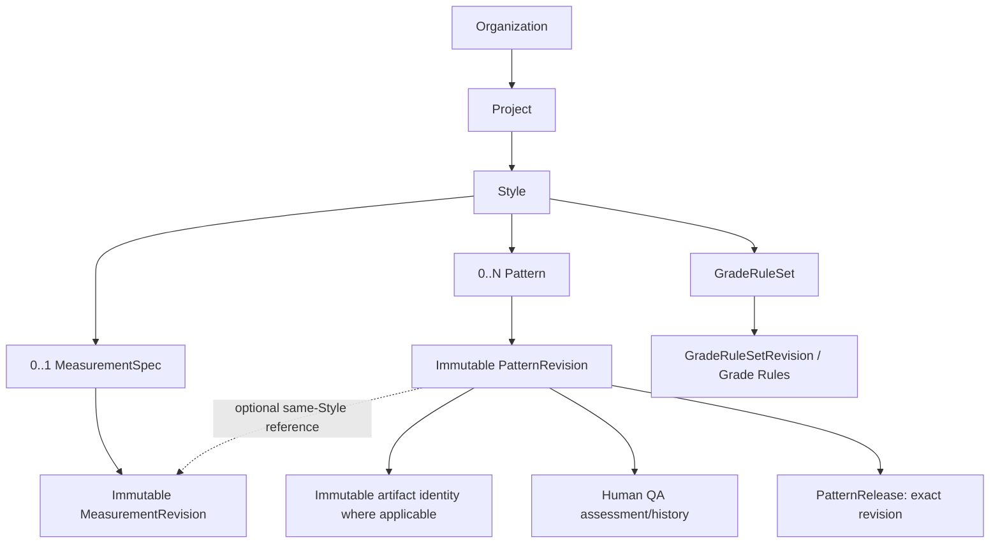

# Phase 3 — Product Development / Pattern Operations contract lock

## 1. Authority, integration and starting baseline

This is a documentation-only PLAN for `Croco-JY/codex`. It locks the deterministic, human-controlled Product Development / Pattern Operations domain. No implementation slice starts automatically from PLAN acceptance. The older master specification's **SOURCE Pattern Operations** and the roadmap's **Product Development / Pattern Operations** name the same domain; neither implies AI. The [master specification](source-os-specification.md) remains historical authority, reconciled by the explicit accepted slice boundaries here and in [roadmap](roadmap.md).

Phase 2 was independently accepted and integrated before Phase 3 branch creation:

| Evidence | Actual value |
| --- | --- |
| Old main / accepted Phase 1 baseline | `6eacb4e8d96fabc6b2c03d7d2e6a295db8196283` |
| Accepted Phase 2 final HEAD | `e79dde2becfaf15d951a924749e793b1d09313f8`, `test: harden phase 2 release gate` |
| Accepted Phase 2 exact-head push CI | [40116758318](https://github.com/Croco-JY/codex/actions/runs/40116758318), completed/success |
| Integration path | [PR #4](https://github.com/Croco-JY/codex/pull/4), merge commit, no squash/rebase |
| PR CI | [40118339839](https://github.com/Croco-JY/codex/actions/runs/40118339839), pull_request / exact Phase 2 head / success |
| Canonical Phase 3 baseline / resulting main merge | `41c629cce3bcdf5abf776cf33784631a4e150667` |
| Merge parents, in order | Old main, then accepted Phase 2 final HEAD above |
| Resulting main exact-head push CI | [40118844964](https://github.com/Croco-JY/codex/actions/runs/40118844964), attempt 2 completed/success |
| Phase 3 branch | `phase-3-pattern-operations`, created only after main CI success |
| Branch creation equality | local starting HEAD = origin/main = live GitHub main = `41c629cce3bcdf5abf776cf33784631a4e150667` |

The merge tree is byte-identical to the accepted Phase 2 tree; `e79dde2` is an ancestor of the merge. Separately accepted 2A/correction, 2B, 2C, 2D, 2E, 2F, strict timestamp Correction A and 2G SHAs are preserved in main ancestry. There were no open PRs or Phase 3 branch before this task. The integration PR is merged; no Phase 3 implementation PR is created. The user independently accepted Phase 2; this does not claim an additional GitHub reviewer approval.

Integration evidence limits are retained: the first merge API call returned 503; authoritative PR/main reads confirmed no merge before a deliberate retry succeeded. Main CI attempt 1 failed its backend step; its logs and artifact downloads returned 403 and annotations disclosed only exit code 1. The identical tree passed local full verify; unchanged attempt 2 passed every exposed foundation step. The initial CI failure's detailed cause remains unconfirmed. No code, test, workflow, timeout or accepted expectation was modified to obtain that result.

Accepted Phase 2 authority remains [plan](phase-2-plan.md), [2A](phase-2a-project-style-foundation.md), [2B](phase-2b-product-workspace-ui.md), [2C](phase-2c-style-requirement.md), [2D](phase-2d-style-material-selections.md), [2E](phase-2e-style-facility-candidates.md), [2F](phase-2f-style-development-references.md), strict timestamp Correction A, and [2G](phase-2g-cumulative-hardening.md). These historical contracts/completion documents are not rewritten.

## 2. Purpose, ownership and architectural spine

The principal invariant is: **a downstream business process must be able to identify exactly which immutable development revision existed at the time of a decision.** A latest alias, cache state or mutable file cannot substitute for a revision identity.

Style.id remains the canonical manufactured-design identity. All Phase 3 business data belongs directly or indirectly to Style under Organization → Project → Style. There is no independent Pattern project tree, globally scoped private Pattern, cross-Organization IP reuse from UUID knowledge, or private Pattern data in global Supply models/caches.



Measurements, artifacts, grading, QA and release metadata are private Organization IP. This diagram is planned ownership, not an implemented schema or an authorization grant.

## 3. Scope and explicit exclusions

Phase 3 may implement MeasurementSpec/MeasurementRevision; Pattern/PatternRevision; artifact/import metadata and open DXF-AAMA, DXF-ASTM, PDF formats; GradeRuleSet/GradeRuleSetRevision/GradeRule/SizeRange; bounded human QA and quality transitions; and secure exact-revision PatternRelease. Each needs its own approved slice specification.

AI Pattern generation, LLM geometry, AI measurement parsing/block retrieval/modification/grading/QC belong to **Phase 4**. RFQ, quotation/revisions, comparison, shortlist and award belong to **Phase 5**. Contracts/ManufacturingSpecificationPackage/signature, protected payment, production orders/execution, QC and shipment belong to later phases. Candidate/release state never implies any of those commercial decisions.

Tech Pack, BOM and Sample ownership remains unresolved. No TechPackRevision, BOMRevision, ApprovedSample, Sample workflow or speculative migration is authorized. A separate roadmap decision must define phase ownership, revision semantics, Style/Pattern/Measurement dependencies and downstream contract use before implementation.

Paid Pattern Service/pricing is outside 3A–3F. After the deterministic spine exists, separately decide whether to authorize a possible 3H or defer it. Service tiers, costs, prices and margins must be configurable/data-backed if later approved; master-spec examples are not hard-coded business rules. Phase 3 owns no escrow, settlement, capture/refund or payment truth.

## 4. Authorization, hierarchy and lifecycle inheritance

Read: active requested-Organization ORG_OWNER / ORG_ADMIN / VIEWER. Write: ORG_OWNER / ORG_ADMIN. VIEWER is read-only; PLATFORM_ADMIN without active requested-Organization membership receives 403, with no support bypass.

For well-formed requests: Actor → requested Organization authorization → Project → Style → aggregate → revision/child. Never globally look up a private revision to discover its owner before authorization. No requested-org membership is 403. After requested-org authorization succeeds, missing/foreign Project, Style, MeasurementSpec/Revision, Pattern/Revision, GradeRuleSet or PatternRelease is scoped 404. Do not inspect foreign facts to improve an error. Syntax/body-shape failures remain 400.

Reuse StyleService.readContext(...) and lockContextForWrite(...) public boundaries. Archived Project/Style remains authorized-readable, subject to the artifact/release's own explicitly defined access state. All descendant writes—including aggregate/revision creation, artifact upload, quality/grading transition and release/revoke—require active parents or return 409. Reactivation does not mutate descendants. Authorization is re-evaluated at each later phase boundary; no instantaneous retroactive cancellation of an already-authorized transaction is promised.

## 5. Stable aggregate plus complete immutable revision

MeasurementSpec, Pattern and GradeRuleSet separate stable business identity from immutable revision identity. Normal creation must atomically commit the stable aggregate, **revisionNumber=1**, its complete snapshot/child rows and audit in one transaction. Failure anywhere rolls back all. No ordinary empty-shell aggregate creation followed by an optional first revision; existence implies at least one revision. MeasurementSpec cardinality is 0..1 per Style; Pattern is 0..N per Style. Grading cardinalities are owned by 3D, not guessed here.

Creation input conceptually includes aggregate metadata plus initialRevision content. Success is 201 and identifies both the stable aggregate and revision 1; the exact DTO/routes belong to the slice. Metadata-only Pattern revision 1 is complete historical truth when 3B implements no artifact path.

Revisions carry server-generated IDs and monotonically assigned numbers 1,2,3,..., unique per stable aggregate. The client never chooses revisionNumber. Each snapshot is independently reconstructable; no patch-chain replay for authoritative history. Substantive content, row identities, source metadata and associations cannot be updated in place after commit. Changed design means a new revision. No ordinary hard-delete API for committed revisions; cancellation needs a separate explicit model.

Latest/current is derived within the aggregate by revision_number DESC LIMIT 1. The initial implementation stores no duplicated mutable currentRevisionId pointer. Histories are bounded and ordered; exact pagination and summary DTOs are slice-owned. Avoid list→detail N+1 when list summaries can carry the required fields.

## 6. Stale-head concurrency, locks and ambiguity

Every revision after revision 1 requires expectedLatestRevisionNumber. For latest N, lock the stable aggregate **before** determining latest and verify expected=N. Success commits N+1. Two requests based on N must yield one N+1 and one 409 stale-head, with exactly one success audit. They must not silently become N+1 and N+2 from two stale copies. A loser explicitly reloads/reconciles before a new command. Initial history is linear: no DAG, branch, fork, merge or CRDT.

All writes lock Project → Style → stable aggregate → revision/workflow row. No reverse order; no unserialized SELECT MAX(number)+1. Provider boundaries and any cross-aggregate lock requirements must be explicitly defined by their slice without cycles. Parent archive wins first → write 409; revision commit wins first → retained readable history, archive may follow. No cascade rewrite.

Every mutation defaults retry:false, especially aggregate/revision creation, upload, QA transition, release and revoke. Lost response/5xx/network ambiguity never transparently creates another revision or resends bytes. Refetch authoritative history/state and require explicit reconciliation. Do not invent hidden N+2, replacement objects or idempotency protocols.

## 7. Measurement Foundation contracts

Requirement remains Phase 2 target/intent/development brief. MeasurementSpec is structured point-of-measure specification and must not be merged into Requirement.

A MeasurementRevision is a full snapshot, conceptually id, measurementSpecId, revisionNumber, baseSize, unitSystem, status, createdBy, createdAt and POM rows. Core measurement truth is relational, not an opaque JSON blob. Each POM has a stable within-revision machine identity such as code, plus label, exact value, optional tolerancePlus/toleranceMinus and bounded notes. Human label is not identity; exact keys, precision/ranges and row constraints belong to 3A.

Permanent authoritative numeric policy: PostgreSQL NUMERIC → Java BigDecimal → JSON decimal string. No float/double/authoritative JS Number, parseFloat or numeric-token/exponent coercion. Proposed explicit units are MM/CM/IN; no silent authoritative conversion. Any display conversion is presentation-only unless separately contracted. Grading increments and tolerances inherit exact decimal truth, with their own reviewed ranges.

Initial measurement quality language must be honest. DRAFT/REVIEWED are potential states, not an implemented enum. No PRODUCTION_VERIFIED without an evidence contract. Timestamps are explicit RFC3339/OpenAPI date-time with timezone, following Correction A strict runtime validation; no permissive date-only Date.parse fallback.

## 8. Pattern foundation and same-Style measurement references

Pattern creation atomically creates revision 1. A Style may have multiple Pattern families/purposes. PatternRevision conceptually includes id, patternId, revisionNumber, optional measurementRevisionId, sourceKind, qualityState, createdBy and createdAt; exact content/workflow representation belongs to 3B/3E. Content immutability is not permission to overwrite design data during a quality transition.

An optional MeasurementRevision must belong to the **same Style**: Pattern.styleId = MeasurementRevision → MeasurementSpec.styleId. Resolve requested Organization → Project → Style → Pattern before a MeasurementRevision lookup scoped to that Style. Missing or foreign-Style supplied revision is 404, including same-Organization foreign Style; it is not Phase 2's global catalog mismatch-400 case. Malformed UUID/body remains 400. No cross-Organization association or existence leakage.

3A/3B must choose a practical DB-enforceable ownership design before coding: owner-aware composite FKs, immutable duplicated owner key protected by FK/trigger, or another explicit relational constraint. An unchecked UUID plus Java-only validation is insufficient when relational enforcement is practical. Direct DB tests must reject cross-owner links. This PLAN does not choose ad hoc DDL or pre-create Pattern tables in 3A.

Dependency is PatternRevision → MeasurementRevision, not Measurement → Pattern. Source kinds such as MANUAL, MANUAL_IMPORT, SYSTEM_GENERATED and AI_PROPOSED are design vocabulary; only truthfully implemented paths may execute. AI_PROPOSED is not a working Phase 3 creation mode.

## 9. Hard 3B / 3C artifact boundary

A committed artifactless 3B revision stays artifactless forever. **3C must not attach a file to an existing revision.** Introducing or replacing a file creates a new PatternRevision with artifact identity fixed at creation. No overwrite, reused storage object or mutable revision-file replacement.

3C may define PatternArtifact or an equivalent immutable association, conceptually artifactId, patternRevisionId, storageObjectId, declared format, displayName, sizeBytes, operational state and createdAt. Exact schema is 3C-owned. Revision id/parent/number/artifact association and artifact object ID/declared format/immutable metadata never change. An explicitly modeled PENDING→READY/FAILED operational lifecycle does not mutate substantive revision content. No Phase 2F state is automatically copied into a new domain without a contract.

Preferred protocol, to be fully specified in 3C before coding:

1. TX1 reauthorizes and locks Project → Style → Pattern, checks expected latest, atomically reserves a new revision and its PENDING artifact identity/metadata with audit, then commits.
2. Binary write happens outside SQL transaction through AuthorizedStorage, using server-generated object identity and create-only storage.
3. TX2 reauthorizes, resolves/locks the hierarchy and scoped revision/artifact, requires the appropriate operational state, finalizes READY with audit, then commits.
4. Storage failure may record FAILED in a separately authorized active-parent transaction. Never bypass membership, archive or ownership to label failure. Reservation history and none/partial/full bytes remain tracked when later transitions fail.

3C must lock exact crash/commit ambiguity, response loss, partial-write retention, archive/revocation and concurrent finalization races, history visibility and reconciliation semantics. No XA fiction, automatic binary retry or rollback claim across storage/SQL. No silent physical deletion/GC of PENDING/FAILED history/bytes. No client-chosen object UUID or public object getter. Pattern consumes AuthorizedStorage, never StoragePort/LocalStorageAdapter.

Current inherited file ceiling is **10 MiB**. PLAN does not raise it. A larger real DXF/PDF need requires separate 3C evidence/review of HTTP/storage caps, memory/DoS behavior and upload architecture.

## 10. Formats, parser security, geometry and preview

Initial open formats: DXF-AAMA, DXF-ASTM, PDF. No proprietary reverse engineering or undocumented decoder. Filename extension and multipart MIME do not prove valid format/geometry. An upload alone is not SYSTEM_VALIDATED.

Before choosing normalized PatternPiece/PatternPoint/PatternAnnotation storage, 3C must inspect actual import/parser evidence. Do not pre-create speculative geometry schemas. Hostile parser input requires bounded bytes, CPU, memory, entity/coordinate counts, nesting/recursion and runtime. No shell/macro execution, arbitrary path access or untrusted subprocess commands. Raw parser errors/paths never reach API clients; safe bounded diagnostics only.

Preview is presentation, not authoritative geometry; client transforms never change revision truth. No LLM supplies authoritative geometry in Phase 3. Future flow is deterministic computation/validation plus defined human review; AI proposals arrive in Phase 4. Preview buffers/Blob URLs are temporary and revoked on route/org/Actor change and teardown. No durable binary cache.

## 11. Deterministic grading

GradeRuleSet creation atomically creates revision 1 and complete rules. GradeRuleSetRevision is an immutable full snapshot, never an in-place historical edit. GradeRule and SizeRange relationships/constraints belong to 3D. SizeRange owns explicit deterministic order; labels XS/S/M/L/XL/2XL are not lexical ordering logic. Grade increments use NUMERIC/BigDecimal/JSON string; no authoritative floating arithmetic and no AI grading.

## 12. Human QA and truthful quality state

QA assesses an exact immutable PatternRevision and records assessment/history without rewriting revision content. Bounded review state, authenticated reviewer, reviewedAt and notes/evidence require a defined 3E contract; binary evidence uses private storage only when specified, not PostgreSQL blobs.

The master vision's AI_DRAFT, SYSTEM_VALIDATED, HUMAN_REVIEWED, SAMPLE_VALIDATED and PRODUCTION_VERIFIED are future vocabulary, not automatic Phase 3 reachability. Each slice explicitly defines reachable states/evidence. File upload cannot imply deterministic validation; a button cannot imply production verification; AI-only output is never production verified.

Quality transitions audit revision ID, prior/new state, Actor, Organization and request/timestamp. No caller Actor. Exact state/history separation must preserve substantive revision immutability.

## 13. Secure exact-revision release

PatternRelease deliberately identifies one exact PatternRevision, immutable recipient/context and releasedAt. It is not a latest alias, mutable share link, public blob URL, RFQ recipient, quotation invitation, nomination/award, contract party, factory approval, production approval/assignment or capacity reservation.

Release means bounded authorized access only. It infers no copyright/IP ownership transfer, resale license or production authorization. Those require later legal/commercial contracts. releaseId/patternRevisionId/storageObjectId knowledge never grants access. 3F must define recipient/context authorization and explicit revoke state/history; immutable release identity/content is never rewritten. Parent archive blocks release/revoke writes. No permanent unauthenticated Pattern URL or Phase 2 FacilityCandidate reinterpretation.

## 14. Module and transaction ownership

Proposed modules, exact names fixed per slice:

| Consumer | Planned public providers |
| --- | --- |
| measurement | style |
| pattern | style + measurement; artifact path uses file |
| grading | pattern/style only as explicitly required |
| patternqa | pattern |
| patternrelease | pattern plus required authorization/file public contracts |

No style→pattern, measurement→pattern or file→workspace reverse dependency. No child→Project persistence shortcut. Public providers expose immutable contracts, not foreign Repository/Entity/JDBC table ownership. Examples prohibited: PatternService→StyleRepository, GradingService→PatternEntity, PatternRelease→StoragePort. Java/PostgreSQL owns authorization, numbering, lifecycle, quality/release and pricing truth; future Python workers return proposals, never independently commit those facts. Core revision identity remains model-provider-neutral.

Remain a modular monolith: no Pattern microservice/database/deployment unit, GraphQL gateway, Kafka, event sourcing, CQRS, Redis or default event framework. An outbox needs a separately reviewed durable asynchronous requirement. No WebSocket/CRDT/presence/automatic merge or background reconciliation by default.

## 15. Lazy contextual frontend IA and request budgets

Ordinary StyleDetail remains Project GET → Style GET → exactly four unordered Phase 2 siblings: Requirement, Material Selections, Facility Candidates, Development References. Phase 3 does not expand this initial set or rewrite its request-count meaning. No eight-to-ten-child fanout.

Lightweight navigation to Measurements/Patterns/Grading/Releases is allowed only in a future approved UI slice; displaying it triggers **zero Phase 3 API requests**. Phase 3 domains use contextual lazy sub-routes, not global private Pattern routes:

| Planned route | Eligible data after Project → Style succeeds |
| --- | --- |
| `.../styles/:styleId/measurements` | Measurement domain only; Pattern/Grading/Release requests 0 |
| `.../styles/:styleId/patterns` | Bounded Pattern list; no automatic Measurement history/Grading/Release fanout |
| `.../patterns/:patternId` | Scoped Pattern detail |
| `.../patterns/:patternId/revisions/:revisionId` | Scoped exact revision |
| `.../styles/:styleId/grading` or explicitly chosen Pattern context | 3D-owned grading budget |
| `.../styles/:styleId/pattern-releases` or explicitly chosen Pattern context | 3F-owned release budget |

Every prefix contains Organization/Project/Style. Wrong parent → domain requests 0. Shared layout does not justify mounting unrelated workspaces/prefetch. Each slice measures its own bounded initial requests and pagination; no speculative all-history/artifact/QA/release preload. No detail N+1 when summaries suffice. Existing Phase 2 siblings retain their independence and current-generation 403 workspace-denial behavior.

## 16. Runtime validation, cache, command and binary isolation

Private query keys contain workspace, Actor scope, Organization, Project, Style, domain identity and exact revision when needed. Never key private IP only by a globally unique revision UUID or put it in Supply cache. Reuse accepted Actor scope + monotonic Organization generation protections for A→B, ABA, late reads/mutations/uploads/errors. Actor/session switch clears owned Phase 2/3 caches, drafts, mutations, binary buffers and object URLs.

Binary commands use authenticated trusted transport and current-generation/AbortSignal guards. A late response after org/Actor/route invalidation must create zero Blob URLs/anchor clicks/downloads. No raw insecure fetch, token in URL, public object route or permanent object URL. No private business/draft/binary persistence in localStorage, sessionStorage, IndexedDB, service-worker offline cache or URL query payload without separately reviewed secure persistence authority.

Strict runtime hydration rejects malformed identity, parent, revision number, timestamp, quality/artifact state and decimal; no defaults to make UI editable. Safe Problem Details preserve requestId and never disclose SQL, stack traces, paths, parser internals, credentials/tokens, bytes or foreign identity. Exact-decimal policy and strict timezone-aware date-time remain permanent.

## 17. Audit and private IP minimization

Every mutation audits ORGANIZATION scope with Organization/Actor derived from authenticated hierarchy. No PLATFORM-scope misuse, caller Actor, false loser/success audit or independent audit commit. Bounded identity/state/revision numbers and artifact state/size may be appropriate only after scalar allowlist review per slice. Do not audit measurement matrices, geometry, DXF/PDF bytes, large private notes or arbitrary entity/request serialization. No new audit key is added by PLAN.

## 18. Ordered slices and migration ownership

All V1–V17 are released and immutable. PLAN creates **no V18** and no speculative table/index/function. Planning sequence:

| Slice | Separately approved scope | Planned next migration |
| --- | --- | --- |
| 3A — Measurement Foundation | 0..1 spec, atomic revision 1, POM snapshot, exact decimals/units, history, expected latest, lazy Measurement route | V18 |
| 3B — Pattern Vault / Revision Foundation | After accepted 3A: 0..N Patterns, atomic revision 1, optional same-Style MeasurementRevision, DB integrity, metadata-only history, expected latest | V19 |
| 3C — Pattern Artifacts / Import | After 3B: new artifact-bearing revisions, tracked non-XA upload, DXF-AAMA/ASTM/PDF, private download, bounded import/preview | V20 |
| 3D — Grading | Pattern foundation, SizeRange, atomic GradeRuleSet revision 1, complete immutable rules, deterministic ordering/exact increments | V21 |
| 3E — Human QA | Exact revision assessment/evidence, bounded truthful transitions, reviewer/audit; no release | V22 if schema required |
| 3F — Secure Pattern Release | Exact revision/recipient/context, immutable release identity, revoke/access contract; no RFQ | V23 if schema required |
| 3G — Cumulative Hardening | Test/docs-only and production-diff-zero by default; Defect-Stop | No default migration |

These are planning order, not pre-created/reserved schema. Each slice owns only its actual next migration and must reconcile conditional QA/release schema needs explicitly; no dummy migration or future table creation. Once accepted, V18/V19/etc. become immutable; corrections use new additive migrations. No Tech Pack/BOM/Sample migration number is reserved.

## 19. Required slice validation

Each implementation slice preserves Phase 0/1/2, strict timestamps and 2G. Security cases cover two Organizations, OWNER/ADMIN/VIEWER, PLATFORM_ADMIN without membership, wrong Project/Style/aggregate/revision, revocation, archive and safe errors. Revision cases cover atomic revision 1/no empty aggregate, complete snapshots, latest derivation, expected latest, real concurrent N→N+1/409, immutable history, ordering/isolation and winner-only audit.

Pattern/Measurement reference tests include valid same Style; missing or foreign Style scoped 404; foreign Organization denied at the appropriate requested-org/hierarchy boundary; and direct DB ownership violations. Artifact tests cover no retrofit to old revision, immutable association, create-only storage, reservation-before-storage, no SQL lock during I/O, reauthorization, partial write/commit/response ambiguity, retained history, non-READY denial, raw-object absence and cross-tenant download denial.

Frontend tests measure unchanged StyleDetail four-child initial set and each domain route's own budget; no hidden Phase 3 reads. Test A→B/ABA/Actor, late read/mutation/upload/download, explicit conflicts and no automatic retries. Histories are paginated. Responsive widths 1440/820 or 768/390, associated labels, keyboard/focus, textual state/evidence/conflict explanation, VIEWER read-only and non-color-only semantics are required. A technical canvas/table may have explicitly documented contained internal scrolling; the whole document must not overflow by accident. Visual Pattern content needs supporting textual metadata.

3G cumulatively proves tenant/revision/reference integrity, concurrency, artifact failure/retention, QA honesty, release authorization, generation isolation, immutable released migrations/generated artifacts, regression, responsive/accessibility behavior. It adds no product capability by default.

## 20. Production compatibility and deferred architecture

Contracts must remain compatible with HTTPS, OIDC/Cognito, ALB/CloudFront, RDS PostgreSQL, private S3, Secrets Manager, KMS, backup/PITR, metrics/alerts/logging, WAF/rate controls and rolling deployment. This does not authorize provisioning or an adapter in PLAN. Local adapters remain development details; business identity never depends on localhost, filesystem paths or browser/cache state.

Design additive schema/API rollout where practical: consider old frontend→new backend and new frontend→current backend rather than requiring simultaneous deployment. PostgreSQL revisions and durable binary metadata support restore/object reconciliation. Diagnostics use bounded request/org/Style/aggregate/revision/artifact identifiers where permitted, not raw private IP. Use public Spring/Zod/TypeScript/HTTP/PostgreSQL abstractions so security upgrades do not rewrite domain identity. Generated contracts remain Java/springdoc → official exporter → OpenAPI → schema.ts → openapi-fetch; no manual generated edit.

## 21. PLAN validation and immutable baseline

Current schema remains 17 migrations / 47 public tables including Flyway / 46 application tables. No schema count changes, V18, endpoint, parser, geometry engine, upload, Pattern UI, grading, QA, release or AI worker is implemented.

Accepted generated SHA-256 values, unchanged by PLAN:

```text
8dbb2dc2bfdc72f28462b365f2cf78d005ae753e86c45227a40608d00fb16dd4  docs/openapi.json
6723ea026a6cee834187e8670e374df41019fb45b5303cffdbaf6f7f3497af23  apps/web/src/api/schema.ts
```

Local regression was executed on the canonical main merge tree before documentation edits: backend verify 578 tests, failures/errors/skips 0; Vitest 1,198 tests / 29 files; typecheck/build passed. The PLAN changes only documentation, so that executable tree remains identical. Final documentation validation additionally checks local links/headings, whitespace, V1–V17 byte identity/no V18, generated hashes, and zero production/dependency/config/infra/workflow diff. Standalone staged documentation Gitleaks version/result and exact PLAN commit/CI identity are reported in the final execution report; no unexecuted check is represented as passed.

Commit policy: one `docs: lock phase 3 pattern operations plan` commit on phase-3-pattern-operations, exact parent `41c629cce3bcdf5abf776cf33784631a4e150667`. Push only that branch, verify local/origin/GitHub equality and clean tree, require exact-head push SOURCE OS CI success, and inspect exposed foundation steps. Empty step metadata or denied logs is reported honestly; job-level success is distinct from invented step inspection. No Phase 3 implementation PR.

## 22. Defect-Stop and stop boundary

If planning/validation exposes an accepted production defect: reproduce deterministically, identify exact accepted contract and observed/required result, propose minimum correction and API/migration/security impact, then STOP before production edits or unrelated correction commit. Do not weaken tests, silently patch production or bundle a correction into this PLAN.

After PLAN commit/push/exact-head CI success, STOP for independent PLAN review. Do not create V18, Measurement or Pattern code/tables/UI, DXF/PDF importer, grading, QA, PatternRelease, AI worker or RFQ. Only after PLAN acceptance can a separately approved **Phase 3A — Measurement Foundation / MeasurementSpec + MeasurementRevision / Atomic Revision 1 / Exact POM Values / Stale-Head Concurrency / V18 / Lazy Measurement Route** specification authorize implementation. Later slices never start automatically.
