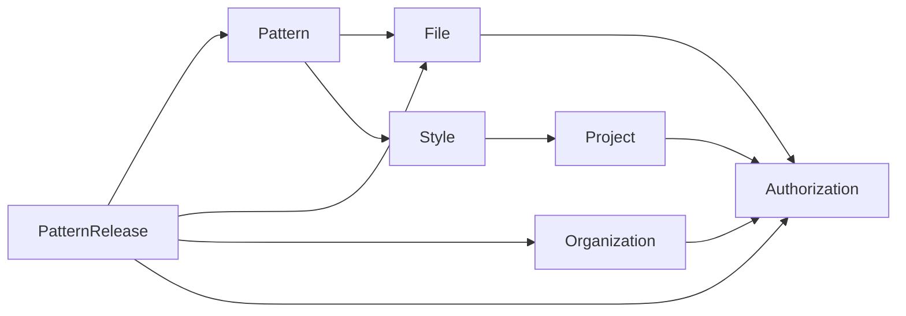

# Phase 3F — Secure exact-revision Pattern releases

Implementation contract: `SOURCE-OS-PHASE-3F-1-IMPLEMENTATION-v1`, governed by
`3F-0E-signoff-v1` and its verified approval amendments. Starting source:
`5412b1f3ce64baf11ef6148647d499d5bd73b78b`.
The authenticated [standing mandate](https://github.com/Croco-JY/codex/issues/7#issuecomment-6557061968)
supplied conditional implementation authority after a complete specification.
Technical recommendations are not fabricated human signatures. Independent
implementation acceptance and any later phase remain separate.

## Product boundary

A release grants authenticated, bounded access to one exact immutable
PatternRevision and its corresponding READY PatternArtifact. It grants no IP
transfer, manufacturing licence, production/sample/geometry approval, RFQ,
commercial acceptance or payment authority. HUMAN_REVIEWED is not required and
never supplies release authority. The source explicitly chooses outbound purpose
text; private QA notes are not copied.

Source and recipient are distinct Organizations. They exchange UUIDs and the
recipient-issued consent identifier out of band. No Organization directory,
invitation, anonymous share link, source-consent preview or bearer download exists.
Consent issuance deliberately does not look up the requested source UUID and has
no source-Organization FK. A real, independently authorized source is required at
redemption. Consent administration, including reads, is OWNER/ADMIN only.

Consent redemption lasts exactly 15 minutes. Each consent authorizes at most one
release. Release access defaults to 24 hours; an explicit integer duration from
1 through 86,400 seconds may shorten it. All timestamps come from PostgreSQL.
Consent expiry after successful consumption does **not** shorten the resulting
release. Withdrawal before or after consumption permanently denies future access;
source revocation is permanent for that release. Delivered files cannot be recalled.
Renewed access needs a new consent and release identity.

## V23 and immutable truth

V1–V22 remain byte-identical. V23 adds exactly four application tables:

| Owner/table | Stored truth |
| --- | --- |
| PatternRelease / `pattern_release_consent` | Recipient, opaque intended source, actual issuer/subject, server issuance and redemption deadline |
| PatternRelease / `pattern_release_consent_event` | ISSUED → CONSUMED or WITHDRAWN; consumed consent may later be WITHDRAWN; owner, exact release, sequence, actual Actor and Actor Organization |
| PatternRelease / `pattern_release` | Unique consumed consent, exact source/recipient/hierarchy/revision/number/READY artifact/private integrity tuple, outbound purpose, server access period, actual source Actor and five captured versions |
| PatternRelease / `pattern_release_event` | ACTIVATED → REVOKED, sequence, source ownership and actual Actor |

All four tables are immutable. State is derived from events; there is no mutable
consumed pointer, latest pointer, expiry worker, context-event table or backfill.
Statement guards reject UPDATE/DELETE/TRUNCATE even with no matching rows and
through cascade truncation. Owner-aware composite FKs and insert guards bind the
exact hierarchy/artifact/consent. Deferred constraints require initial issuance
and complete matching activation/consumption at commit. Event numbering,
single-consumption uniqueness, size/hash/TTL bounds and Actor scope are enforced.
Direct SQL structural protection does not authenticate a privileged DB operator
as an HTTP Actor; command authorization and mandatory audit belong to the service.

Fresh Flyway V23 has 23 migrations, 63 public base tables including Flyway history,
and 62 application tables. The populated V22 upgrade test compares every previous
application table and existing trigger definition/enabled state. Its synthetic
fixture includes artifactless and READY/PENDING/FAILED revisions, Measurement,
Grading, QA and audits. This is distinct from the earlier 3E fixture. **3E-R02
remains LOW / NON-BLOCKING / OPEN**; the historical 3E document/test is not rewritten.

Option B adds local OLD/NEW exact `NEW.version = OLD.version + 1` UPDATE guards to
Organization, Project and Style. It neither changes versions automatically nor
locks foreign rows. Organization already had `@Version`; no duplicate column or
`updated_at` assumption is added. Ordinary JPA rename/no-op/stale handling and
JDBC Project/Style metadata/archive/reactivate paths remain supported. Actual
UPDATE without advancement, rewind, jump, nullification and overflow are rejected.
Organization/Project/Style retain their nonnegative BIGINT range; exhausted
BIGINT is terminal. Pattern's accepted lifecycle guard/safe version bound stays.

## Lifecycle fence and write protocol

Creation captures source Organization, recipient Organization, Project, Style
and Pattern versions under ordered locks. Effective access requires every parent
ACTIVE and exactly equal to its captured version. Metadata-only changes can end
access and require reissue. Archive/reactivation never restores a previous grant.
A newer immutable PatternRevision does not replace an existing release. No parent
archive command calls PatternRelease and no release row is cascaded or rewritten.
Organization lifecycle probes are DB-only; no new Organization archive API exists.

New cross-Organization writes lock Organization rows in PostgreSQL UUID order
with `FOR NO KEY UPDATE`, then Project → Style → Pattern → Consent → Release →
Audit as applicable. Existing child-first transactions are preserved. The prior
Organization `FOR UPDATE` / child / audit-FK cycle remains rejected. Compatibility
with ordinary FK KEY SHARE is useful but is not a universal deadlock-free proof.
Concurrency tests use barriers and observed `pg_blocking_pids`, not sleep-only races.

Release creation atomically establishes five logical effects: consumed consent
state, truthful CONSUMED event, immutable release, ACTIVATED event and source
success audit. Consumed state is represented by the CONSUMED event, so these use
four inserted rows, not five invented physical rows. Failure after each stage or
at deferred commit rolls everything back. Concurrent redemption has one winner
and one 409, with one release/event/audit set and no transparent retry. New terminal
commands recheck write membership after all row-lock waits; a membership loss
committed during a wait cannot authorize a revoke/withdraw event or a no-op receipt.

Consent issuance/withdrawal audit belongs to the recipient. Release creation/
revocation audit belongs to the source. CONSUMED records the actual source Actor
and source Actor Organization while retaining recipient consent ownership; it
never impersonates the recipient issuer and creates no mirrored recipient audit.
Only approved scalar IDs/numbers/states extend AuditRecorder. No purpose/notes,
bytes, paths, private hashes, tokens or arbitrary bodies enter audit. Downloads
create no additional permanent audit/event. Stale event heads return 409; a
repeated terminal command with the current head is a no-op without another audit.

## Acyclic File boundary

Authorization owns immutable facts interfaces, fixed policy and privately minted
Scope/Binding values. Domain-owned providers query only their own persistence;
Pattern delegates Style/Project facts through their public providers. Compile-time
Authorization does not import PatternRelease/Pattern/File persistence. At runtime
Authorizer → fixed facts providers → ScopeVerifier/Identity is nonrecursive.
Gateway → Authorizer → facts completes before Gateway → private bounded reader;
the final Authorizer call follows storage. Actual Modulith and Spring startup
checks cover the combined graph, not just a diagram.

The only public File release entry is
`ReleasedBinary download(UUID recipient, UUID release)`.
The private File reader accepts only an authorization-owned Binding minted after
actual recipient authorization. It binds one release, source namespace, object,
expected length/hash and Actor. HTTP cannot construct a scope/descriptor or choose
object coordinates. Missing/extra/fake providers, extra manager/DataSource and
unreviewed reader wiring fail startup. No File→PatternRelease dependency,
foreign Repository/Entity/JDBC shortcut, callback, unchecked getter, source Actor
impersonation or temporary membership is introduced. Existing AuthorizedStorage
source membership checks and StoragePort are unchanged.

The Local adapter's narrow release read walks anchored SecureDirectoryStream
handles from the filesystem root, with NOFOLLOW on every directory/object open.
Unsupported providers fail closed. UUID paths are server-derived. Preflight size
or symlink observations are not treated as race-proof; the channel remains
anchored and no-follow. Replacement tests cover object symlinks and renamed/
substituted Organization directories. Storage is service-owned; this is not a
claim to sandbox a hostile host that can replace files with arbitrary devices/FIFOs.

Read at most expected length plus one detection byte. The largest read buffer is
10 MiB + 1; valid content is copied into an expected-size result, so simultaneous
payload arrays are bounded by 20 MiB + 1, excluding fixed JVM/NIO/hash overhead.
No hostile full-file-size allocation is used. Missing, empty/short, oversized,
sparse, corrupt and symlinked objects deny without partial success. Exact length
and SHA-256 are checked; READY metadata/history is retained after later corruption.

## F01 production authorization boundary

Content processing is initial completed authorization → bounded physical read
outside SQL → integrity verification → new completed final authorization → binary
response. Both authorizations use the explicitly selected JpaTransactionManager,
its guarded Hikari DataSource and a new read-only REPEATABLE READ transaction.
All membership, release, consent, Organization, Project, Style, Pattern/revision/
artifact facts and current wall-clock decision share that physical transaction.
An actual transaction-settings SELECT acquires the snapshot; merely opening a
Spring transaction is not the snapshot boundary.

A private thread/resource/connection lease fences participation. Additional
managed connections, nested/alternate/suspended transactions, commit/rollback/
autocommit/isolation/read-only changes, unwrap escapes and transaction-control SQL
deny and poison the owner. A scope used on another thread poisons its original
owner, so catching that denial cannot revive it. Fixed reviewed synchronous
providers and architecture checks prohibit unmanaged/async dependencies; this is
not a hostile-JVM/DriverManager sandbox. Startup and runtime checks complement
direct source inspection and physical-transaction observations.

PID and snapshot strings are diagnostic only. A production regression control
demonstrates equal PID/snapshot metadata across two different read-only physical
transactions. Test-only catalog observations establish distinct initial/final
virtual transactions and coherent provider participation; production never polls
pg_locks as an authorization primitive. Actual rollback, sticky denial and late
commit failure return zero binary bytes. The controller never returns a lazy stream.

Final expiry uses fresh `clock_timestamp()` after facts. Revoke, withdrawal,
membership denial or parent invalidation committed before the final snapshot is
observed. Changes after that coherent snapshot need not recall an already
authorized in-flight response. The fixed 15-minute consent deadline is also tested
after an observed lock wait; transaction-start time cannot extend redemption.

R1 proof mapping (production tests, not reused feasibility totals):

| Original obligation | Production coverage |
| --- | --- |
| E001 | PatternReleaseSnapshotTest provider/physical-snapshot matrix |
| E002 | PatternReleaseFileTest held I/O: no ambient SQL, idle backends and independent NOWAIT parent locks |
| E003–E010 | Held physical read followed by committed withdrawal/revoke/five parent versions/membership denial |
| E011 | Revoke after Spring begin but before first final snapshot |
| E012 | After-snapshot changes do not split later provider facts; next access denies |
| E013/E014 | Real short release expiry during I/O or after final snapshot before current-clock decision |
| E015/E016 | Selected REQUIRES_NEW and alternate-manager faults in actual content path |
| E017/E018 | Actual storage/integrity failure and Actor change |
| E019 | PatternReleaseExpiryTest: real 15-minute consent expiry across observed lock wait |
| NEG001–004/006–007 | PatternReleaseTransactionTest physical/SQL/propagation/swallowed/sticky faults |
| NEG005/011 | PatternReleaseStartupTest full application graph rejection |
| NEG008–010 | Read-committed/no-owner/annotation-bypass/escaped-scope regressions and fixed-provider architecture |
| NEG012 | Actual beforeCommit failure and rollback-only content denial |

Original F01 remains CLOSED_FOR_DISPOSABLE_FEASIBILITY in its historical trail;
production regression results and independent implementation acceptance are
separate. An initial implementation-stage escaped-scope sticky-denial regression
was reproduced, preserved, corrected and retested before delivery.

## Twelve scoped operations

`O = /api/v1/organizations/{organizationId}`.
`R = O/projects/{projectId}/styles/{styleId}/patterns/{patternId}/revisions/{revisionId}/releases`.

| Operation | Permission |
| --- | --- |
| POST O/release-consents | Recipient OWNER/ADMIN |
| GET O/release-consents | Recipient OWNER/ADMIN |
| GET O/release-consents/{consentId} | Recipient OWNER/ADMIN |
| POST O/release-consents/{consentId}/withdrawals | Recipient OWNER/ADMIN |
| POST R | Source OWNER/ADMIN |
| GET R | Source OWNER/ADMIN/VIEWER |
| GET R/{releaseId} | Source OWNER/ADMIN/VIEWER |
| POST R/{releaseId}/revocations | Source OWNER/ADMIN |
| GET R/{releaseId}/events | Source OWNER/ADMIN/VIEWER |
| GET O/received-pattern-releases | Recipient OWNER/ADMIN/VIEWER |
| GET O/received-pattern-releases/{releaseId} | Recipient OWNER/ADMIN/VIEWER |
| GET O/received-pattern-releases/{releaseId}/content | Recipient OWNER/ADMIN/VIEWER, effective access required |

These accepted 0E paths/bodies take precedence over illustrative alternatives in
the implementation request. Release creation takes consentId, expected consent
event head, canonical purpose (1–1000 Unicode code points) and optional bounded
duration. The revision is in the route and the recipient comes from consent;
neither arbitrary recipient/artifact/object/hash nor client Actor/time/version is
accepted. Strict JSON rejects duplicate/unknown/trailing fields and coerced numbers.

Lists default to 25 and allow 1–100, with scope-bound descending keysets. Inbox
facts are bulk queries, with no per-row hydration. Active recipient projection
contains only release/source/recipient IDs, exact revision/number/artifact, safe
format/name/size, outbound purpose, times and effective state. Inactive projection
contains only release/source/recipient IDs, times and generic effective state.
It reveals no source hierarchy, memberships, QA notes, Actor provenance, private
hash or storage identity. PLATFORM_ADMIN without requested membership has no bypass.

401/403/404/409 and correlated safe ProblemDetail conventions are preserved.
Foreign lookup follows requested-Organization authorization. Consent observations
are normalized; no source existence lookup is added. New private JSON and binary
responses use private/no-store. Binary is an exact-length octet-stream attachment
with safe UTF-8 filename and nosniff, after successful final transaction completion.

## Frontend and verification

Lazy exact-revision source and recipient inbox/consent routes extend the existing
WorkspaceGate family. Recipient Organizations need no fabricated Project tree.
Ordinary StyleDetail keeps its four accepted sibling requests; links prefetch no
release, consent or binary. Inbox entry makes one scoped collection GET, exact
detail one GET, and artifact/event inspection and downloads require explicit action.

New cache keys contain Actor scope, Organization, generation, exact scope/IDs and
page parameters. Private selected summaries, drafts and histories are memory-only,
including navigation selection; no private DTO is placed in browser history state.
Runtime validation runs on cached collections, event pages, exact detail and artifact
metadata through the same schema/scope checks used for network responses. Invalid
cache values cannot replace pinned history or authorize artifact submission.
Event-history windows retain a private, immutable copy of their first validated
network response. Each anchor belongs to the QueryClient's fully scoped Query
(Actor/session, Organization, workspace generation, exact hierarchy/release,
window bound and limit); it survives page navigation and observer remounts and
is released with query eviction. Cache selection cannot create trust. An
unrecognized cached window remains hidden until an authoritative network
response validates it; expansion/remount revalidates without automatic retries.
Both network and cached candidates compare exact serialized event fields,
ordered membership and pagination against the retained anchor. Contradictions
surface a safe error and never replace that anchor or render rejected values.
Only this bounded history query disables deep structural sharing, so an identical
authoritative response still reruns selection after an unknown cache entry was
rejected. Cache storage, lifetime, scope and other queries remain unchanged.

Immutable fields and exact timestamp precision are compared; terminal access is
not silently restored. Open event head,
older page and selection survive current-state refresh until deliberate reset.

All mutations and downloads retry:false. Unknown outcomes retain drafts, refresh
authorized state and require explicit reconciliation; matching receipts are not
proof of a lost request. Downloads are explicit, cancellable and generation-checked
before Blob creation and click, with URL revocation. Late Actor/Organization/ABA/
403/content responses cannot populate or deny a new workspace. No protected bytes
or drafts enter localStorage, sessionStorage, IndexedDB or service-worker caches.

Run the supported full Maven verify, frozen frontend install/typecheck/Vitest/build,
both-origin Playwright, official deterministic OpenAPI export, Terraform checks and
Gitleaks. Real fixed-TTL backend and browser tests each take approximately 15 minutes;
CI timeout accommodates those tests instead of shortening policy or bypassing guards.
Test-only Spring spy contexts close after their classes so their connection pools
do not exhaust the cumulative isolated PostgreSQL instance. Production pool and
authorization configuration are not relaxed.

Final execution totals, failures/corrections, migration/catalog/hash evidence,
exact implementation SHA, push CI and independent review status belong to the
implementation handoff report. This document does not claim unexecuted tests or
independent acceptance. Phase 3G, deployment and PR mutation are excluded.
